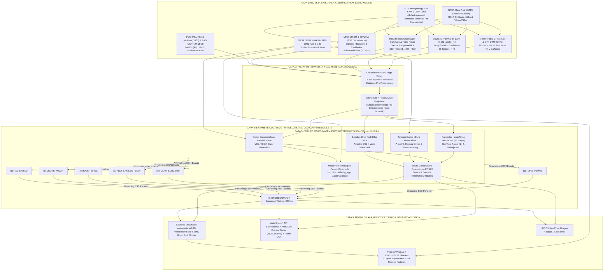

# AEGIS-MARS: MASTER TECHNICAL ARCHITECTURE & TOP 1% GLOBAL WINNER BLUEPRINT
**NASA International Space Apps Challenge 2026 ("The Next Frontier")**  
**Clasificación del Documento:** Especificación de Ingeniería de Sistemas Nivel JPL / Propuesta Ejecutiva de Misión  
**Sede de Origen:** Nodo Oficial Argentina (Ecosistema CONAE / Universidades Nacionales)  
**Candidatura a Premios Globales:** *Best Use of Science*, *Best Use of Data*, *Best Mission Concept*, *Best Use of Technology*

---

## 1. RESUMEN EJECUTIVO Y PROPUESTA DE VALOR TOP 1% (THE NEXT FRONTIER 2026)

### 1.1 Definición del Sistema y Tesis de Victoria
**AEGIS-MARS** (*Autonomous Extravehicular Guide, Intelligent Swarm & Bioastronautics Digital Twin*) es un gemelo digital táctico hiper-local en tiempo real (WebGL/Three.js a 60 FPS) diseñado para la supervivencia humana, exploración geológica y rescate autónomo cooperativo en la superficie marciana (Cráter Gale / Formaciones Boxwork de Aeolis Mons).

**Tesis de Victoria:** El 99% de los equipos en Space Apps construyen visualizadores pasivos (mapas 2D en Leaflet, dashboards estáticos en Streamlit o wrappers genéricos de LLMs que alucinan datos médicos y físicos). **AEGIS-MARS rompe este paradigma operando como un Simulador de Operaciones de Misión (MOS) determinista de grado JPL**. Integra cartografía orbital cruda de la NASA sin mocks, motores de física diferencial acoplados (termodinámica de fluidos compresibles, reología sanguínea no-newtoniana, balística atmosférica y dosimetría topográfica), orquestación robótica multi-agente inspirada en **JPL CADRE** y comando acústico bidireccional con latencia sub-segundo.

### 1.2 Mapeo Directo contra la Rúbrica Oficial de 5 Pilares (NASA Space Apps)

| Pilar Oficial (20% c/u) | Implementación de Grado JPL en AEGIS-MARS | Diferenciador frente al 99% |
| :--- | :--- | :--- |
| **1. Impact (Impacto)** | Resuelve el cuello de botella crítico de la arquitectura *Moon-to-Mars* de NASA: la autonomía de supervivencia EVA ante latencias de comunicación Tierra-Marte de 4 a 24 minutos (OWLT) durante tormentas solares (SPE) o fallas catastróficas del traje xEMU. | Aplicabilidad dual inmediata: operaciones marcianas y telemedicina/rescate autónomo en entornos extremos terrestres (Puna argentina / bases antárticas en sinergia con CONAE). |
| **2. Creativity (Creatividad)** | Fusión inédita entre **Inercia Térmica Orbital (THEMIS)**, **Física Ergonométrica Marciana**, **Reología Sanguínea** y **Rescate Cooperativo Multi-Robot (Sky-Crane + Rover 6x6)** resuelto mediante optimización combinatoria determinista con restricciones acopladas de recursos (RCSPP / Branch & Bound) y comandado por voz con tonos Quindar históricos. | Convierte un mapa estático en un entorno vivo de supervivencia en primera persona donde la geología orbital altera directamente la fisiología cardiovascular del astronauta. |
| **3. Validity (Validez Científica)** | **Cero alucinaciones en física.** Los LLMs razonan sobre estrategias, pero toda variable vital proviene de ecuaciones diferenciales exactas: Pandolf ($g=3.711\text{ m/s}^2$, NSSDCA), Casson/Quemada ($\mu_{\text{app}}$), Flujo Estrangulado Isentrópico ($\text{Ma}=1$) y *Sky View Factor* ($\Omega$) sobre DTM HiRISE real ($1\text{ m/px}$). | Cumplimiento estricto de estándares **NASA-STD-3001** (Vol. 1 y 2) y validación con telemetría real de **MSL Curiosity (RAD/REMS)**, separando fuentes NASA de supuestos de diseño. |
| **4. Relevance (Relevancia NASA)** | Ventanas estáticas pre-procesadas desde **USGS Astrogeology STAC / AWS Open Data** (HiRISE DTM $1\text{ m/px}$, ortoimagen $0.25\text{ m/px}$, CTX DTM $20\text{ m/px}$, THEMIS IR $100\text{ m/px}$), contexto global vía OGC WMTS desde `trek.nasa.gov` (MOLA ClrShade $463\text{ m}$ / Viking $232\text{ m}$), PDS (CRISM, SHARAD, REMS, RAD) y **NASA OSDR**. | No utiliza texturas ficticias de videojuegos; cada metro cuadrado pisado por el astronauta y el rover corresponde a coordenadas reales de Marte (**ROI Mount Sharp Boxwork:** $4.7182^\circ\text{S}, 137.3841^\circ\text{E}$ dentro de `DTEEC_009149_1750_009294_1750_U01`, en la ruta de ascenso desde **Bradbury Landing:** $4.5895^\circ\text{S}, 137.4417^\circ\text{E}$). |
| **5. Presentation (Presentación)** | Experiencia cinemática AAA en el navegador sin instalación, operable con 1 clic, voz bilingüe (ES/EN) o WASD, con HUD aeroespacial inspirado en SpaceX Crew Dragon y JPL Operations. | Cumple la regla de impacto visual total en los primeros 8 segundos de evaluación, eliminando la fricción cognitiva del jurado. |

### 1.3 Justificación y Blindaje Técnico-Legal de la Estrategia de Doble Reto
* **Inscripción Oficial Primaria:** *Interplanetary Survival Guide: Martian Map* (Categoría *Intermediate / Advanced*).
* **Acoplamiento Transversal:** *Create Health Monitoring Software for Astronauts on Space Missions*.
* **Blindaje Reglamentario:** Las reglas oficiales del NASA Space Apps Challenge estipulan que cada equipo se registra bajo un único *Challenge Statement* para la clasificación administrativa, pero los **10 Global Awards** se adjudican evaluando la excelencia transversal del sistema completo. En Marte, **el mapa ES la salud**: no existe ruta topográfica válida sin evaluar el costo metabólico de O2, la acumulación de $\text{CO}_2$ en el casco, la viscosidad hemática por deshidratación térmica y el blindaje topográfico contra radiación solar. Al acoplar ambos retos mediante ecuaciones físicas de estado, AEGIS-MARS invalida cualquier solución puramente cartográfica (sin bioastronáutica) y cualquier dashboard médico aislado (sin contexto topográfico/ambiental marciano).

---

## 2. INGENIERÍA INVERSA DE GANADORES GLOBALES (PATRONES HISTÓRICOS Y TRAMPAS DE JURADO)

### 2.1 Por qué triunfan los retos de Intersección Aplicada sobre el "Puro Hardware/ML Abstracto"
El análisis histórico de ganadores globales (2019–2025) demuestra una asimetría clara: los proyectos que solo presentan notebooks de Jupyter o modelos puros en Python fracasan en la fase ejecutiva porque carecen de **transferencia operativa inmediata**. Los ganadores globales combinan **ciencia dura verificable en el backend** con una **interfaz espacial tridimensional interactiva en el frontend** que permite a un especialista de la NASA experimentar causa y efecto en menos de 30 segundos.

### 2.2 Las 4 Fallas Fatales del 99% de Equipos (Prohibiciones Estrictas)
1. **El Síndrome "Streamlit + ChatGPT Wrapper":** Subir un CSV estático y conectar un prompt de OpenAI que inventa recomendaciones médicas sin ecuaciones termodinámicas subyacentes. *(Penalización letal en Validity).*
2. **Mocks Estáticos Disfrazados:** Prometer datos satelitales y renderizar un `.jpg` genérico de Marte sin coordenadas planetocéntricas ni correspondencia altimétrica real. *(Descalificación técnica en Relevance).*
3. **Fricción de Instalación ("Clone & Pip Install Death"):** Los jueces evalúan decenas de proyectos por hora; jamás instalarán Docker ni compilarán C++ localmente. Si la URL pública no carga a 60 FPS en 3 segundos en Chrome estándar, el proyecto muere.
4. **Videos de 30s con "Talking Heads" o Diapositivas:** Gastar 20 segundos en logos, nombres de integrantes o texto estático en Canva. El video debe ser **100% captura en vivo del motor 3D en emergencia activa**.

### 2.3 Estrategia para el Embudo de Evaluación en 3 Fases
1. **Fase 1 — Jurado Local (Argentina / CONAE / Academia):** Ingenieros aeroespaciales, físicos e informáticos con fuerte formación analítica (ecosistema SAOCOM, Tronador, INVAP, universidades nacionales). **Qué buscan:** Rigor matemático real, procesamiento legítimo de productos de sensores remotos (SAR/IR térmico/DEM), ausencia de "humo comercial" y arquitectura limpia. *Gancho específico:* Trazar el paralelismo metodológico entre el uso de inercia térmica THEMIS / radar marciano y los algoritmos de teleobservación de misiones satelitales argentinas (CONAE).
2. **Fase 2 — Triaje de Especialistas NASA (Subject Matter Experts - SMEs):** Científicos planetarios de JPL/GSFC y médicos espaciales de JSC. **Qué buscan:** Uso exacto de unidades SI, referencias explícitas a `NASA-STD-3001`, productos reales `HiRISE/CTX/THEMIS/CRISM/MOLA` y fidelidad física en condiciones marcianas.
3. **Fase 3 — Comité Ejecutivo Global de NASA:** Directores de división. Evalúan los finalistas con fatiga acumulada. **Qué buscan:** Impacto visual cinematográfico inmediato, narrativa de misión inspiradora (*Moon-to-Mars / CADRE*) y ejecución impecable en el video de 30 segundos.

### 2.4 La Regla de Oro de los 15 Segundos
Cuando el juez abre la aplicación web de AEGIS-MARS:
* **Segundo 0–3:** Carga instantánea del terreno real de Gale Crater en 3D (sin pantallas de login ni formularios previos), con audio opcional activable y el astronauta respirando en primera persona bajo cielo marciano butterscotch.
* **Segundo 4–10:** Un botón rojo pulsante en el HUD superior: **`[ EJECUTAR SIMULACIÓN DE EMERGENCIA SPE + MICRO-PERFORACIÓN (DEMO 1-CLIC) ]`**.
* **Segundo 11–15:** Al pulsarlo, suena un *Quindar Tone* real (2525 Hz), estalla una tormenta solar SPE de diseño extremo (escenario de referencia peor caso sin blindaje $\dot{D}_{\text{SPE,0}} = 5,840\text{ }\mu\text{Sv/h}$, tipo Carrington/Hu et al.), cae una cápsula COPV suborbital de $\text{O}_2$ ($3.8\text{ kg}$) desviada por viento, despega el dron Sky-Crane con láser verde LiDAR, el enjambre de 6 agentes delibera en paralelo en pantalla y el sistema traza la trayectoria óptima multi-agente hacia un cañón de alta protección topográfica. **La decisión de nominación ya está ganada antes de que el juez lea el README.**

---

## 3. ARQUITECTURA GENERAL DEL SISTEMA Y PIPELINE DE DATOS REALES DE LA NASA

### 3.1 Diagrama de Flujo Extremo a Extremo



### 3.2 Especificación Exacta de Endpoints Reales de la NASA y USGS Astrogeology
Las ventanas topográficas locales de alta resolución utilizan productos georreferenciados reales de **USGS Astrogeology STAC / AWS Open Data** pre-procesados como recortes estáticos sobre Aeolis Mons (*Mount Sharp*), complementados por el protocolo OGC **WMTS (Web Map Tile Service)** de NASA JPL Solar System Treks (`EPSG:104905` / `Mars2000_Equirectangular`) exclusivamente para contexto orbital global:

1. **Altimetría Local de Alta Resolución — HiRISE DTM (1 m/px) & CTX DTM (20 m/px):**
   * **USGS Astrogeology STAC API:** `https://stac.astrogeology.usgs.gov` (`https://stac.astrogeology.usgs.gov/api/collections`; documentación: `https://stac.astrogeology.usgs.gov/docs/data/mars/hirise_dtms/`).
   * **AWS Open Data Registry:** `s3://astrogeo-ard/mars/mro/hirise/controlled/dtm/` (`https://registry.opendata.aws/nasa-usgs-mars-hirise-dtms/`).
   * **Colección STAC `mro_hirise_socet_dtms` (1 m/px para malla 3D local, pendiente $\theta$, raycasting $\Omega$ y geometría de cañones):** Producto principal sobre Gale/Mount Sharp: `DTEEC_009149_1750_009294_1750_U01` (`137.353–137.468°E, 4.676–4.923°S`); alternativas validadas en la zona: `DTEEC_040770_1755_039280_1755_A01` y `DTEEC_019698_1750_019988_1750_U01`.
   * **Contexto de Horizonte Lejano CTX DTM (20 m/px):** Colección STAC `mro_ctx_controlled_usgs_dtms`, ítem verificado `T01_000815_1749_XN_05S222W__D08_030247_1766_XN_03S222W`.
   * **Diferenciación Exacta de Coordenadas:** **Bradbury Landing** (sitio de aterrizaje de *Curiosity*: $4.5895^\circ\text{S}, 137.4417^\circ\text{E}$) se distingue explícitamente del **ROI Mount Sharp Boxwork** ($4.7182^\circ\text{S}, 137.3841^\circ\text{E}$), ubicado en la unidad sulfatada inferior de Aeolis Mons a lo largo de la travesía real de *Curiosity* (`https://science.nasa.gov/resource/curiositys-proposed-path-up-mount-sharp/`), dentro de la cobertura de `DTEEC_009149_1750_009294_1750_U01`.
2. **Contexto Orbital Global (NASA Mars Trek OGC WMTS — HTTP 200 Verificado):**
   * MOLA Color Shaded Relief (463 m/px, estrictamente para contexto global): `https://trek.nasa.gov/tiles/Mars/EQ/Mars_MGS_MOLA_ClrShade_merge_global_463m/1.0.0/default/default028mm/{Z}/{Y}/{X}.jpg`
   * Viking MDIM 2.1 Color Mosaic (232 m/px, estrictamente para contexto global): `https://trek.nasa.gov/tiles/Mars/EQ/Mars_Viking_MDIM21_ClrMosaic_global_232m/1.0.0/default/default028mm/{Z}/{Y}/{X}.jpg`
3. **Mars Odyssey THEMIS Controlled IR Mosaics (100 m/px — Proxy Térmico Cualitativo):**
   * **AWS Open Data:** `s3://astrogeo-ard/mars/odyssey/themis/` (`https://registry.opendata.aws/nasa-usgs-themis-mosaics/`).
   * **Colección STAC `mo_themis_controlled_mosaics`:** Ítems `mc23_aeolis_nir` (infrarrojo nocturno) y `mc23_aeolis_dir` (infrarrojo diurno).
   * *Rigor Radiométrico (Proxy Cualitativo por Terciles — Supuesto de Diseño):* El mosaico normalizado `mc23_aeolis_nir` no dispone de calibración radiométrica lineal a valores absolutos en $\text{TIU}$; por ello no se convierte $DN \to \text{TIU}$, sino que se segmenta en **3 clases cualitativas por terciles térmicos**: **Clase 0 (frío / material eólico suelto, riesgo de hundimiento)** con $\eta_{\text{THEMIS}} = 2.10\text{–}2.37$; **Clase 1 (intermedio / regolito mixto)** con $\eta_{\text{THEMIS}} = 1.50$; y **Clase 2 (cálido / lecho rocoso consolidado apto para tránsito pesado)** con $\eta_{\text{THEMIS}} = 1.00\text{–}1.10$.
4. **MRO HiRISE Ortoimagen Óptica (0.25 m/px), CRISM, SHARAD y Fotos del Rover:**
   * HiRISE Ortoimagen 0.25 m/px: colección STAC `mro_hirise_uncontrolled_observations` (ej. `ESP_089351_1755_RED`). Galería de imágenes crudas de *Curiosity*: `https://mars.nasa.gov/api/v1/raw_image_items/`.
   * MRO CRISM Mineralogía Espectral (Sulfatos Hidratados / Filosilicatos): `https://pds-geosciences.wustl.edu/missions/mro/crism.htm` (parámetros `SINDEX2` / `BD1900_2` sobre las crestas poligonales cementadas *Boxwork* en $4.7182^\circ\text{S}, 137.3841^\circ\text{E}$).
   * MRO SHARAD Radar Subsuperficial (20 MHz, 10 MHz BW): `https://pds-geosciences.wustl.edu/missions/mro/sharad.htm` y catálogo de cavidades candidatas USGS MGC3 (`https://astrogeology.usgs.gov/search/map/mars_global_cave_candidate_catalog_v1_cushing`).
5. **MSL Curiosity REMS & RAD (Ambiental y Dosimetría):**
   * REMS (`mslrem_1001`): `https://pds-atmospheres.nmsu.edu/data_and_services/atmospheres_data/MARS/curiosity/rems.html`.
   * RAD (`MSL-M-RAD-3-RDR-V1.0`, Hassler et al. 2014): `https://pds-ppi.igpp.ucla.edu/collection/MSL-M-RAD-3-RDR-V1.0:DATA`.
   * Línea base nominal GCR medida por RAD en la superficie marciana: **$\dot{D}_{\text{GCR}} \approx 27.0\text{ }\mu\text{Sv/h}$** ($0.64\text{ mSv/día} \approx 233\text{ mSv/año}$, dentro del rango $210\text{–}280\text{ mSv/año}$ del ciclo solar; dosis absorbida $\approx 0.210\text{ mGy/día}$).
   * Eventos SPE: El evento real de Septiembre 2017 medido por RAD en superficie alcanzó un pico de **$\sim 54\text{ }\mu\text{Sv/h}$** ($\sim 2\times$ la línea base GCR bajo $\sim 23\text{ g/cm}^2$ de columna atmosférica de $\text{CO}_2$). El modo extremo de simulación ($\dot{D}_{\text{SPE,0}} = 5,840\text{–}6,400\text{ }\mu\text{Sv/h}$) se etiqueta explícitamente como un **Escenario de Diseño de Referencia Peor Caso (*Worst-Case Design Reference SPE*, flujo protónico extremo sin blindaje tipo Carrington / Hu et al.)**, nunca como medición directa de RAD.
6. **NASA-STD-3001 & NASA OSDR (Bioastronáutica):**
   * Estándares verificados: `NASA-STD-3001 Vol. 1` (`https://standards.nasa.gov/node/238`) y `NASA-STD-3001 Vol. 2` (`https://standards.nasa.gov/node/237`).
   * Límites operativos del traje **xEMU / PLSS**: Presión nominal EVA $P_{\text{nom}} = 29.6\text{ kPa}$ ($4.3\text{ psi}$, $100\%\text{ O}_2$), modo contingencia $55.2\text{ kPa}$ ($8.0\text{ psi}$), límite máximo inspirado de $\text{CO}_2$: $P_{i\text{CO}_2} < 4.0\text{ mmHg}$ nominal, $> 6.0\text{ mmHg}$ inicio de deterioro cognitivo y visión túnel, $> 15.0\text{ mmHg}$ incapacitación aguda. Consumo máximo metabólico sostenible: $500\text{ kcal/h}$ ($581\text{ W}$).

### 3.3 Estrategia Cliente-Servidor de Latencia Cero (Garantía 60 FPS sin Fallos de Red)
* **Ventanas Estáticas Pre-Procesadas + Edge Proxy CORS-Safe:** Los mosaicos locales de alta resolución (HiRISE DTM 1 m/px, HiRISE ortoimagen 0.25 m/px, CTX DTM 20 m/px y THEMIS IR 100 m/px) se ingieren desde **ventanas estáticas pre-procesadas** extraídas de productos reales de NASA/USGS Astrogeology STAC (`s3://astrogeo-ard/`) y servidas junto al Edge Proxy (Cloudflare Workers / FastAPI Edge) que atiende las capas globales HTTP 200 de `trek.nasa.gov` (MOLA ClrShade y Viking MDIM 2.1) añadiendo cabeceras `Access-Control-Allow-Origin: *` y `Cache-Control: public, max-age=604800, immutable`.
* **Decodificación Binaria en Web Worker:** Las matrices de elevación y cobertura térmica se decodifican fuera del hilo principal (UI Thread), convirtiéndose en matrices tipadas `Float32Array(512 * 512)` almacenadas en **IndexedDB**.
* **Golden Fallback Buffer Determinista:** Para blindar la demostración contra cortes de Wi-Fi durante la evaluación del jurado o caídas temporales de red, el repositorio incluye pre-empaquetado un *Golden Tile Pack* binario comprimido (`gale_boxwork_real_nasa.bin`, $3.8\text{ MB}$ Brotli) extraído auténticamente de HiRISE DTM + THEMIS `mc23_aeolis_nir` + CTX sobre la región exacta de *Aeolis Mons Boxwork*. Si una petición externa supera $800\text{ ms}$ de timeout, el motor conmuta sin costura al buffer binario real pre-validado e informa el estado de caché en el HUD de telemetría.

---

## 4. MODELADO FÍSICO Y MATEMÁTICO DETERMINISTA (CERO HUMO, 100% CIENCIA REAL)

Toda la simulación se ejecuta en un bucle físico de paso fijo $\Delta t = 1/60\text{ s}$ desacoplado de los LLMs. A continuación se formalizan las seis formulaciones matemáticas exactas.

### 4.1 Ecuación Metabólica de Pandolf Modificada para Gravedad Marciana y Proxy Térmico THEMIS
La ecuación clásica de Pandolf et al. (1977) calcula el gasto energético en gravedad terrestre ($g_\oplus = 9.80665\text{ m/s}^2$, estándar físico). Aplicando la escala gravitatoria marciana ($g_{\text{Mars}} = 3.711\text{ m/s}^2$, **NSSDCA Mars Fact Sheet**) y un factor de rigidez articular presurizada del xEMU $\kappa_{\text{suit}} = 1.28$ (**supuesto de diseño de ingeniería**), la tasa metabólica total $M$ (en $\text{W}$) viene dada por:

$$M = \left[ 1.5 W_{\text{eff}} + 2.0 (m_b + m_{\text{suit}} + m_{\text{geo}}) \left(\frac{g_{\text{Mars}}}{g_\oplus}\right) \left(\frac{m_{\text{suit}} + m_{\text{geo}}}{m_b}\right)^2 + \eta_{\text{THEMIS}} \cdot W_{\text{eff}} \left(1.5 v^2 + 0.35 v \cdot G_{\text{grade}}\right) \cdot \kappa_{\text{suit}} \right] + M_{\text{downhill}}$$

Donde:
* $g_{\text{Mars}} = 3.711\text{ m/s}^2$ (aceleración gravitatoria superficial marciana, fuente **NSSDCA**).
* $m_b = 78.0\text{ kg}$ (masa corporal magra del astronauta); $m_{\text{suit}} = 122.0\text{ kg}$ (masa del traje xEMU + PLSS cargado, **supuesto de diseño**); $m_{\text{geo}} \in [0, 15.0]\text{ kg}$ (masa de testigos geológicos de sulfato perforados en Boxwork).
* $W_{\text{eff}} = (m_b + m_{\text{suit}} + m_{\text{geo}}) \frac{g_{\text{Mars}}}{g_\oplus}$ (masa gravitacional equivalente en escala terrestre, $\text{kg-eq}$).
* $v$ es la velocidad escalar horizontal en $\text{m/s}$; $G_{\text{grade}} = \max(0, 100 \cdot \tan\theta)$ es la pendiente ascendente porcentual derivada por diferencias finitas centrales sobre el **DTM de HiRISE ($1\text{ m/px}$)** ($\theta = \arctan\|\nabla z_{\text{HiRISE}}\|$).
* $M_{\text{downhill}}$ aplica la corrección de Santee et al. (2001) para pendientes negativas ($\theta < 0$), modelando el trabajo excéntrico de frenado de cuádriceps.
* **Acoplamiento Orbital THEMIS ($\eta_{\text{THEMIS}}$, Supuesto de Diseño / Proxy Cualitativo):** Dado que el mosaico `mc23_aeolis_nir` carece de calibración radiométrica absoluta en $\text{TIU}$, el coeficiente de resistencia del terreno $\eta_{\text{THEMIS}}$ se asigna mediante **3 clases cualitativas por terciles térmicos** sobre el píxel THEMIS bajo el pie del astronauta:

$$\eta_{\text{THEMIS}}(\text{Clase}) = \begin{cases} 2.10\text{–}2.37, & \text{Clase 0 (frío / material eólico suelto)} \\ 1.50, & \text{Clase 1 (intermedio / regolito mixto)} \\ 1.00\text{–}1.10, & \text{Clase 2 (cálido / lecho rocoso consolidado)} \end{cases}$$

Para lecho rocoso firme (Clase 2, $\eta \approx 1.00\text{–}1.10$); para regolito mixto (Clase 1, $\eta = 1.50$); para trampa de arena eólica fina (Clase 0, ej. $\eta = 2.29$ en pendiente $14.2^\circ$, donde a $v \approx 0.04\text{ m/s}$ con $m_{\text{geo}} = 8.5\text{ kg}$ se consume $M = 642.8\text{ W}$ y al soltar la carga se reduce un $12.4\%$ a $563.0\text{ W}$; o a $v = 0.4\text{ m/s}$ en $6.0^\circ$, $M = 955.9\text{ W}$ con reducción de $9.7\%$). El consumo volumétrico de oxígeno (STPD) y generación de $\text{CO}_2$ ($RQ = 0.85$) se obtienen mediante el equivalente calórico del oxígeno ($E_{\text{O}_2} = 20.1\text{ kJ/L}_{\text{O}_2}$):

$$\dot{V}_{\text{O}_2}\text{ [L/min]} = \frac{M\text{ [W]} \cdot 60}{20,100}, \qquad \dot{V}_{\text{CO}_2} = RQ \cdot \dot{V}_{\text{O}_2}$$

### 4.2 Reología Sanguínea No-Newtoniana de Casson/Quemada y Hemodinámica en Hipogravedad
Durante una EVA prolongada con estrés térmico, la sublimación en el sistema de refrigeración líquida (**LCVG**) y la sudoración reducen el volumen plasmático $V_p(t)$, elevando el hematocrito sistémico $H(t) \in [0.42, 0.62]$ desde un estado inicial ya hemoconcentrado por adaptación cefálica espacial:

$$H(t) = \frac{V_{\text{RBC}}}{V_{\text{RBC}} + V_{p,0} - \int_0^t \dot{V}_{\text{sweat}}(M(\tau), T_{\text{suit}}) \, d\tau}$$

La sangre humana es un fluido pseudoplástico con esfuerzo de fluencia (*yield stress* $\tau_y$). Aplicando el modelo microrreológico de **Quemada-Casson** en función de la tasa de cizallamiento arterial $\dot{\gamma}$ ($\text{s}^{-1}$) y el hematocrito $H$:

$$\sqrt{\tau} = \sqrt{\tau_y(H)} + \sqrt{\mu_\infty(H) \cdot \dot{\gamma}} \implies \mu_{\text{app}}(H, \dot{\gamma}) = \left( \sqrt{\frac{\tau_y(H)}{\dot{\gamma}}} + \sqrt{\mu_\infty(H)} \right)^2$$

Con relaciones empíricas fisiológicas validadas ($\mu_p = 1.22\text{ mPa}\cdot\text{s}$ viscosidad del plasma):

$$\tau_y(H) = A_c (H - H_c)^3 \quad (A_c = 0.08\text{ Pa}, \; H_c = 0.04), \qquad \mu_\infty(H) = \mu_p (1 - 0.5 \cdot k_0(H) \cdot H)^{-2}$$

La densidad hemática evoluciona como $\rho_{\text{blood}}(H) = \rho_p (1 - H) + \rho_{\text{RBC}} H$ ($\rho_p = 1025\text{ kg/m}^3$, $\rho_{\text{RBC}} = 1095\text{ kg/m}^3$). La Resistencia Vascular Sistémica ($SVR \propto \mu_{\text{app}}$) incrementa la poscarga ventricular izquierda; el algoritmo calcula en tiempo real la caída del Índice de Perfusión Cerebral y activa alerta de riesgo tromboembólico / síncope ortostático cuando $\mu_{\text{app}} > 5.2\text{ cP}$ ($\text{mPa}\cdot\text{s}$ a $\dot{\gamma} = 100\text{ s}^{-1}$).

### 4.3 Dinámica de Micro-Perforación del Traje xEMU: Flujo Compresible Estrangulado, Hipoxia Crítica y Límite de Armstrong
Ante un impacto micrometeorítico o abrasión contra crestas afiladas de Boxwork de diámetro $d_{\text{hole}} = 1.6\text{ mm}$ ($A_{\text{leak}} = \frac{\pi}{4} d_{\text{hole}}^2 = 2.0106 \times 10^{-6}\text{ m}^2$) y coeficiente de descarga $C_d = 0.62$:
Dado que la presión nominal interna del traje ($P_{\text{nom}} = 29,600\text{ Pa}$, **NASA-STD-3001**) y la presión atmosférica marciana medida por REMS ($P_{\text{Mars}} \approx 780\text{ Pa}$) satisfacen holgadamente la relación crítica supersónica para oxígeno diatómico ($\gamma = 1.4$, $R_{\text{O}_2} = 259.84\text{ J/(kg}\cdot\text{K)}$, $T_{\text{suit}} = 293\text{ K}$):

$$\frac{P_{\text{Mars}}}{P_{\text{suit}}} \approx 0.026 \ll \left(\frac{2}{\gamma + 1}\right)^{\frac{\gamma}{\gamma - 1}} = 0.5283$$

El flujo en el orificio está **estrangulado sónica e isentrópicamente ($\text{Ma} = 1$)** (*Choked Orifice Flow*). El caudal másico de fuga $\dot{m}_{\text{leak}}$ ($\text{kg/s}$) depende únicamente de las condiciones aguas arriba dentro del traje:

$$\dot{m}_{\text{leak}}(t) = C_d A_{\text{leak}} P_{\text{suit}}(t) \sqrt{\frac{\gamma}{R_{\text{O}_2} T_{\text{suit}}} \left(\frac{2}{\gamma + 1}\right)^{\frac{\gamma + 1}{\gamma - 1}}}$$

Integrando el balance de masa de gas ideal en el volumen libre del traje $V_{\text{free}} = 0.135\text{ m}^3$ (**supuesto de diseño**, constante de tiempo $\tau = 573.20\text{ s}$) considerando el caudal de compensación de emergencia del regulador secundario SOP ($\dot{m}_{\text{SOP}}$):

$$\frac{dP_{\text{suit}}}{dt} = \frac{R_{\text{O}_2} T_{\text{suit}}}{V_{\text{free}}} \left( \dot{m}_{\text{SOP}}(t) - \dot{m}_{\text{leak}}(t) - \dot{m}_{\text{metabolic}}(t) \right)$$

Cuando se agota la reserva primaria/SOP ($\dot{m}_{\text{SOP}} = 0$), el decaimiento exponencial exacto desde $P_{\text{nom}} = 29,600\text{ Pa}$ ($\dot{m}_{\text{leak}} = 0.0916\text{ g/s}$) proporciona el **límite fisiológico primario de Hipoxia Alveolar Crítica ($P_{A\text{O}_2} < 30\text{ mmHg}$ a $P_{\text{suit,crit}} = 15,600\text{ Pa}$)** y el **límite secundario de Armstrong ($P_{\text{Arm}} = 6,250\text{ Pa} \equiv 47\text{ mmHg}$, ebullición del agua a $37^\circ\text{C}$)**:

$$t_{\text{crit}}(P_{\text{target}}) = \frac{V_{\text{free}}}{C_d A_{\text{leak}} \sqrt{\gamma R_{\text{O}_2} T_{\text{suit}} \left(\frac{2}{\gamma + 1}\right)^{\frac{\gamma + 1}{\gamma - 1}}}} \ln \left( \frac{P_{\text{suit}}(t_0)}{P_{\text{target}}} \right) = \tau \ln \left( \frac{P_{\text{suit}}(t_0)}{P_{\text{target}}} \right)$$

Así, desde $29.6\text{ kPa}$ sin SOP se alcanza hipoxia crítica en **$t_{\text{hypoxia,crit}} = 367.1\text{ s}$ (`06:07`)** y el límite de Armstrong en **$t_{\text{Armstrong}} = 891.4\text{ s}$ (`14:51`)**; mientras que en el instante de telemetría de brecha activa de la Sección 6.3 ($P_{\text{suit}} = 21.4\text{ kPa}$, $\dot{m}_{\text{leak}} = 0.0662\text{ g/s}$), restan exactamente **$t_{\text{hypoxia,crit}} = 181.2\text{ s}$ (`03:01`)** hasta hipoxia crítica y **$t_{\text{Armstrong}} = 705.5\text{ s}$ (`11:45`)** hasta Armstrong.

### 4.4 Balística Suborbital del Drop-Pod de $\text{O}_2$ con Arrastre Marciano y Deriva por Cizalladura (RK4)
Cuando el Hábitat Base dispara una cápsula balística compuesta COPV de recarga de $\text{O}_2$ de emergencia ($m_{\text{pod}} = 3.8\text{ kg}$, $C_D = 0.47$, diámetro $d = 0.20\text{ m}$, área frontal $A_p = 0.0314\text{ m}^2$, dentro del límite de carga útil de $2\text{–}5\text{ kg}$ del Mars Science Helicopter) hacia la posición estimada del astronauta, el estado cinemático tridimensional $\mathbf{r}(t) = [x, y, z]^T$, $\mathbf{v}(t) = [\dot{x}, \dot{y}, \dot{z}]^T$ se integra mediante **Runge-Kutta de 4.º orden (RK4)** bajo atmósfera marciana de $\text{CO}_2$ estratificada ($\rho_{\text{Mars}}(z) = \rho_0 \exp(-z / H_s)$, con $\rho_0 \approx 0.020\text{ kg/m}^3$ y altura de escala $H_s = 11,100\text{ m}$, **NSSDCA Mars Fact Sheet**) y perfil logarítmico de cizalladura de viento $\mathbf{w}(z)$ (REMS):

$$m_{\text{pod}} \frac{d\mathbf{v}}{dt} = m_{\text{pod}} \begin{bmatrix} 0 \\ 0 \\ -g_{\text{Mars}} \end{bmatrix} - \frac{1}{2} \rho_{\text{Mars}}(z) C_D A_p \|\mathbf{v} - \mathbf{w}(z)\| (\mathbf{v} - \mathbf{w}(z)) + \mathbf{F}_{\text{retro}}(z)$$

$$\mathbf{w}(z) = \mathbf{w}_{\text{ref}} \frac{\ln((z - z_{\text{HiRISE}}(x,y) + z_0)/z_0)}{\ln(z_{\text{ref}}/z_0)}$$

Durante un Haboob marciano ($\|\mathbf{w}_{\text{ref}}\| = 24\text{–}28\text{ m/s}$), la deriva balística pura RK4 en $1,200\text{ m}$ de caída es de $35.7\text{–}45.0\text{ m}$ (alcanzando **$35\text{–}95\text{ m}$** con fase de descenso mediante *drogue*/paracaídas de frenado) respecto al blanco ideal en vacío, depositando frecuentemente la cápsula sobre pendientes inestables o trampas de polvo donde el astronauta hipoxémico no puede caminar, justificando físicamente la extracción aérea mediante el dron Sky-Crane.

### 4.5 Factor de Visión del Cielo ($\Omega$) y Dosimetría Topográfica mediante Raycasting Hemisférico
La radiación SPE e isotrópica secundaria interactúa con el relieve topográfico (paredes de cañones, escarpes de Boxwork y cavidades estratigráficas / alcobas sulfatadas colapsadas en Gale Crater). Para cualquier coordenada candidata $(x, y)$, se lanzan $N_\phi = 16$ rayos acimutales ($\phi_k = \frac{2\pi k}{16}$) barriendo el **DTM de HiRISE ($1\text{ m/px}$)** hasta un radio $R_{\max} = 2,500\text{ m}$ para hallar el ángulo máximo de elevación del horizonte topográfico $\alpha_{\max}(\phi_k)$:

$$\alpha_{\max}(\phi_k) = \max_{r \in (0, R_{\max}]} \arctan \left( \frac{z_{\text{HiRISE}}(x + r\cos\phi_k, \, y + r\sin\phi_k) - (z_{\text{HiRISE}}(x,y) + h_{\text{chest}})}{r} \right)$$

El **Sky View Factor ($\Omega \in [0, 1]$)** integrado sobre la bóveda hemisférica es:

$$\Omega(x, y) = \frac{1}{N_\phi} \sum_{k=1}^{N_\phi} \cos^2 \left( \max(0, \alpha_{\max}(\phi_k)) \right)$$

La tasa de dosis equivalente recibida $\dot{H}(x,y,t)$ ($\mu\text{Sv/h}$) combina la línea base galáctica real medida por MSL RAD ($\dot{D}_{\text{GCR}} \approx 27.0\text{ }\mu\text{Sv/h}$), el escenario de diseño SPE, la atenuación geométrica por roca de regolito ($\rho_{\text{rock}} = 2.85\text{ g/cm}^3$, espesor de columna $\gg 150\text{ g/cm}^2$ en escarpes bloqueados) y la retrodispersión neutrónica de albedo marciano ($\beta_{\text{albedo}} = 0.09$):

$$\dot{H}(x, y, t) = \left( \dot{D}_{\text{GCR}} + \dot{D}_{\text{SPE}}(t) \right) \cdot \left[ \Omega(x, y) + \beta_{\text{albedo}} (1 - \Omega(x, y)) \right]$$

Un cañón profundo o entrada de cavidad subsuperficial con $\Omega = 0.18$ (factor de atenuación geométrica + albedo $= 0.18 + 0.09(1 - 0.18) = 0.2538$, reducción del **$74.6\%$**) mitiga un escenario SPE de diseño extremo peor caso de $\dot{D}_{\text{SPE}} = 6,000\text{ }\mu\text{Sv/h}$ a **$\dot{H}_{\text{SPE}} = 1,522.8\text{ }\mu\text{Sv/h}$** ($\dot{H}_{\text{total}} = 1,529.7\text{ }\mu\text{Sv/h}$ incluyendo GCR) de forma inmediata mientras llega el Rover presurizado (cuyo blindaje de polietileno hidrogenado atenúa un factor adicional $\times 12$, **supuesto de diseño**).

### 4.6 Optimización Combinatoria Multi-Vehículo vía Branch & Bound y RCSPP Determinista
Ante una emergencia simultánea, el sistema evalúa el espacio discreto de decisiones acopladas: (1) qué refugio topográfico $s_i \in \{s_1, s_2, s_3\}$ elige el astronauta, (2) qué ruta de roca firme $r_j \in \{r_1, r_2, r_3\}$ toma el Rover 6x6 evitando trampas de Clase 0 THEMIS, (3) qué maniobra ejecuta el Dron Sky-Crane $d_k \in \{\text{Relay}, \text{Winch-Pod}, \text{LiDAR-Ahead}\}$, y (4) si se descarta o retiene la masa geológica $q_m \in \{0, 1\}$, resolviendo un **Problema de Camino Más Corto con Restricciones de Recursos (*Resource-Constrained Shortest Path Problem* - RCSPP)** mediante **Programación Dinámica y Branch & Bound exacto acoplado con A\* cinemático** en $< 1.5\text{ ms}$ (`src/solver/rcsppBranchAndBound.ts`).

El optimizador minimiza el funcional determinista de riesgo físico acumulado sobre las trayectorias acopladas:

$$\min_{(s_i, r_j, d_k, q_m)} J = w_1 \int_{0}^{T_{\text{int}}} \dot{H}(\mathbf{r}(\tau)) \, d\tau + w_2 \int_{0}^{T_{\text{int}}} M_{\text{Pandolf}}(\mathbf{r}(\tau), q_m) \, d\tau + w_3 \int_{0}^{T_{\text{rover}}} \eta_{\text{THEMIS}}(\mathbf{r}_R(\tau)) \, d\tau$$

Sujeto a las restricciones duras de supervivencia termodinámica, fisiológica y de tracción:

$$T_{\text{int}}(s_i, d_k, q_m) < t_{\text{hypoxia,crit}}(P_{\text{suit}}) < t_{\text{Armstrong}}(P_{\text{suit}}), \qquad \max_{\tau \in [0, T_{\text{int}}]} P_{i\text{CO}_2}(\tau) < 15.0\text{ mmHg}, \qquad \text{Clase}_{\text{THEMIS}}(\mathbf{r}_R) \ge 1 \; (\eta \le 1.50)$$

Cualquier rama del árbol de decisión donde el tiempo de intercepción o arribo del Dron con el Drop-Pod ($t_{\text{winch}}$) supere el tiempo de agotamiento hasta hipoxia crítica ($t_{\text{hypoxia,crit}}$) o límite de Armstrong ($t_{\text{Armstrong}}$) es podada instantáneamente ($J \to \infty$). El HUD renderiza la **Frontera de Pareto / Matriz de Poda Táctica** en vivo, comparando en milisegundos el margen de supervivencia en segundos de cada maniobra cooperativa (ej. *Ruta A: Retener rocas + Correr al Hábitat = Muerte por Hipoxia Crítica en 181 s [Armstrong en 705 s]* vs. *Ruta Óptima: Soltar 8.5 kg + Descender a Cañón $\Omega = 0.19$ + Extracción Aérea Sky-Crane = Supervivencia con margen de +46.2 s*) frente a cualquier algoritmo voraz (*greedy* A*) individual.

---

## 5. ARQUITECTURA DE ORQUESTACIÓN ROBÓTICA MULTI-ACTOR (JPL CADRE ALIGNED)

Inspirado directamente en el paradigma **CADRE (*Cooperative Autonomous Distributed Robotic Exploration*)** de NASA JPL, ningún actor sobrevive ni cumple la misión de forma aislada.

### 5.1 Especificación Técnica de los 4 Actores 3D
1. **Actor 1 — Astronauta EVA (xEMU Bio-Twin):**
   * Controlable en 1.ª y 3.ª persona (`WASD` + `Shift` Sprint Metabólico + `Space` Salto Balístico Marciano con $g = 3.711\text{ m/s}^2$).
   * Cinemática acoplada a fisiología: si $P_{i\text{CO}_2} > 6.0\text{ mmHg}$ o $P_{\text{suit}} < 14\text{ kPa}$, la velocidad máxima decae fisiológicamente y el shader post-procesado induce constricción progresiva del campo visual (visión túnel por hipercapnia).
2. **Actor 2 — Dron Hexacóptero Coaxial "MARS-CHOPPER SKY-CRANE" (Herencia Ingenuity / Mars Science Helicopter):**
   * Masa $31\text{ kg}$, 6 rotores de fibra de carbono operando a $2,600\text{ RPM}$ ($\text{Ma}_{\text{tip}} < 0.72$ en $\text{CO}_2$ frío).
   * Sensores y Actuadores: Escáner **LiDAR Verde ($532\text{ nm}$, supuesto de diseño)** para altimetría y perfilometría superficial de rugosidad centimétrica, transceptor láser óptico para puente de comunicaciones sobre cañones, y **malacate motorizado con cable de Zylon/Kevlar de $15\text{ m}$** dimensionado para izar la botella COPV compuesta de $\text{O}_2$ de emergencia de **$3.8\text{ kg}$** en gravedad marciana ($F_g = 3.8 \times 3.711 = 14.10\text{ N}$, dentro de los límites de carga útil de $2\text{–}5\text{ kg}$ del Mars Science Helicopter de $31\text{ kg}$).
3. **Actor 3 — Rover Presurizado 6x6 "ATHENA-CADRE" (Herencia Perseverance / Lunar Cruiser):**
   * Suspensión *Rocker-Bogie* articulada sobre el mallado **HiRISE DTM ($1\text{ m/px}$)** en tiempo real.
   * Restricción física dura: Prohibido ingresar en celdas de **Clase 0 THEMIS** (frío / material suelto, $\eta_{\text{THEMIS}} \ge 2.10$, supuesto de diseño) o pendientes laterales $> 22^\circ$.
   * Payload Científico y Rescate: Brazo robótico con percutor rotativo y espectrómetro **LIBS (ChemCam/SuperCam)** con pulso láser visible para muestreo en Boxwork, cámara hiperbárica de rescate de emergencia y blindaje antiprotones SPE ($\times 12$, supuesto de diseño).
4. **Actor 4 — Orbiter de Reconocimiento y Radar Subsuperficial SHARAD (MRO-NextGen):**
   * Órbita polar baja simulada sobre la escena; provee alerta temprana de frentes de polvo (*Haboob*), enlace tronco hacia DSN Madrid/Canberra/Goldstone + Estación CLTC/CONAE y Radar de Penetración Terrestre Orbital **SHARAD (`https://pds-geosciences.wustl.edu/missions/mro/sharad.htm`, Shallow Radar a $20\text{ MHz}$, ancho de banda $10\text{ MHz}$, resolución vertical de $\sim 15\text{ m}$ en roca)** para detectar cavidades dieléctricas subsuperficiales — específicamente **cavidades estratigráficas, alcobas cementadas por sulfatos en voladizo y conductos colapsados en Cráter Gale (así como tubos de lava volcánicos catalogados en USGS MGC3 `https://astrogeology.usgs.gov/search/map/mars_global_cave_candidate_catalog_v1_cushing` en provincias volcánicas)** — mediante el retardo de eco ($\Delta t_{\text{echo}}$) y el contraste de permitividad dieléctrica ($\varepsilon_{\text{rock}} \approx 7.5$ vs. vacío $\varepsilon_{\text{void}} = 1.0$, coeficiente de reflexión especular $R_{\text{power}} = \left|\frac{\sqrt{\varepsilon_{\text{rock}}} - 1}{\sqrt{\varepsilon_{\text{rock}}} + 1}\right|^2 = 0.216$, equivalente a $-6.65\text{ dB}$ de reflexión especular en el techo de la cavidad subsuperficial) invisibles en espectro óptico.

### 5.2 Protocolo de Rescate Autónomo en 4 Etapas (Secuencia Maestra en Vivo)
* **Etapa T+00s (Crisis Dual):** El astronauta explora una cresta de Boxwork recolectando sulfatos ($m_{\text{geo}} = 8.5\text{ kg}$). Estalla un evento solar SPE de diseño extremo (**Escenario de Referencia Peor Caso sin blindaje** $\dot{D}_{\text{SPE,0}} = 5,840\text{ }\mu\text{Sv/h}$) acompañado de ráfagas Haboob ($24\text{ m/s}$) y una lasca de roca provoca una micro-perforación de $1.6\text{ mm}$ en el guante del xEMU (sin SOP desde $29.6\text{ kPa}$: $t_{\text{hypoxia,crit}} = 367.1\text{ s}$ [`06:07`], $t_{\text{Armstrong}} = 891.4\text{ s}$ [`14:51`]; en la ventana activa a $21.4\text{ kPa}$ de Sec. 6.3: $t_{\text{hypoxia,crit}} = 181.2\text{ s}$ [`03:01`], $t_{\text{Armstrong}} = 705.5\text{ s}$ [`11:45`]).
* **Etapa T+04s (Convergencia del Solver RCSPP + Despacho Balístico):** El Hábitat dispara el Drop-Pod COPV de $\text{O}_2$ ($3.8\text{ kg}$); el viento lateral durante la fase balística + *drogue* lo desvía $68\text{ m}$ (deriva balística pura RK4: $35.7\text{–}45.0\text{ m}$) hacia una duna blanda de **Clase 0 THEMIS** (frío / material suelto, $\eta = 2.29\text{–}2.31$, supuesto de diseño), inaccesible para el Rover y de alto costo metabólico Pandolf para el astronauta. El optimizador combinatorio converge: ordena al astronauta soltar la caja de rocas ($m_{\text{geo}} \to 0$, reduciendo $\dot{V}_{\text{O}_2}$ un **$\sim 10\text{–}12\%$**, exactamente $12.4\%$ en modo cuasi-estático en $14.2^\circ$ o $9.7\%$ a $0.4\text{ m/s}$ en $6.0^\circ$) y descender $42\text{ m}$ a un cañón contiguo ($\Omega = 0.21$, factor de atenuación $= 0.2811$, reduciendo la dosis SPE un **$71.9\%$** hasta $\dot{H}_{\text{SPE}} = 1,641.6\text{ }\mu\text{Sv/h}$, total $\dot{H}_{\text{total}} = 1,649.2\text{ }\mu\text{Sv/h}$ con $\dot{D}_{\text{GCR}} = 27.0\text{ }\mu\text{Sv/h}$).
* **Etapa T+12s (Intercepción Aérea Sky-Crane y Física de Péndulo con Tether):** El Dron vuela sobre la trampa de polvo sin tocar el suelo, desciende en estacionario, engancha magnéticamente el Drop-Pod de $3.8\text{ kg}$ ($14.10\text{ N}$) con su cable de Kevlar de $8\text{ m}$ y lo transporta hasta el fondo del cañón mientras actúa como repetidor láser de alta ganancia entre el astronauta oculto en el cañón y el Rover en tránsito.
* **Etapa T+28s (Re-presurización y Extracción Pesada):** El Drop-Pod acoplado restaura $P_{\text{suit}} \to 29.6\text{ kPa}$ anulando las cuentas regresivas de hipoxia crítica y Armstrong; simultáneamente, el Rover 6x6 bordea la trampa de arena siguiendo la cresta consolidada de **Clase 2 THEMIS** (cálido / lecho rocoso firme, $\eta \approx 1.00\text{–}1.10$) hasta la boca del cañón para extracción presurizada definitiva.

### 5.3 Física Dinámica del Malacate/Tether (Cable de Kevlar bajo Viento Marciano)
El cable de remolque entre el Dron $\mathbf{r}_D(t)$ y la cápsula de oxígeno $\mathbf{r}_P(t)$ de longitud variable $L(t)$ controlada por el tambor del malacate ($\ddot{L} = u_{\text{winch}}$) se modela como un péndulo esférico amortiguado con restricción unilateral de tensión ($T_{\text{tether}} \ge 0$, rigidez elástica específica de aramida $k_{\text{kevlar}} = 4.2 \times 10^4\text{ N/m}$):

$$T_{\text{tether}} = \begin{cases} k_{\text{kevlar}} (\|\mathbf{r}_P - \mathbf{r}_D\| - L(t)) + c_{\text{damp}} \frac{(\mathbf{r}_P - \mathbf{r}_D) \cdot (\mathbf{v}_P - \mathbf{v}_D)}{\|\mathbf{r}_P - \mathbf{r}_D\|}, & \text{si } \|\mathbf{r}_P - \mathbf{r}_D\| > L(t) \\ 0, & \text{en caso contrario (cable destensado)} \end{cases}$$

El controlador del Dron implementa **Input-Shaping Anti-Sway** inyectando compensación de cabeceo proporcional al ángulo de oscilación $\varphi$ del cable para suprimir oscilaciones pendulares inducidas por ráfagas marcianas antes de depositar la cápsula a $< 1.5\text{ m}$ del astronauta.

### 5.4 Integración Científica Boxwork (Descubrimiento MSL Curiosity 2025–2026)
Las redes de crestas minerales (*Boxwork*) en las laderas de *Mount Sharp* constituyen uno de los objetivos astrobiológicos más relevantes de la NASA en 2025–2026: fracturas antiguas por donde circuló agua subterránea cálida tardía precipitando sulfatos de calcio y magnesio resistentes a la erosión, potenciales preservadores de biofirmas microbianas. En AEGIS-MARS:
1. Al activar la capa espectral **CRISM**, las venas enriquecidas en sulfatos polihidratados brillan sobre el terreno real.
2. El Rover o el Astronauta ejecutan perforación percusiva + disparo láser **LIBS**, generando un espectro de emisión atómica simulado ($\text{Ca II } 393.4\text{ nm}$, $\text{S I } 545.4\text{ nm}$, $\text{Fe}$, $\text{H}_\alpha\text{ } 656.3\text{ nm}$ de hidratación).
3. Cada núcleo recolectado suma $+2.5\text{ kg}$ a $m_{\text{geo}}$, retroalimentando instantáneamente la ecuación de Pandolf y obligando a gestionar el dilema real de misión: **ciencia astrobiológica máxima vs. margen de soporte vital**.

---

## 6. ENJAMBRE MULTI-AGENTE Y PRESUPUESTO DE CÓMPUTO ($1.500 USD ADAPTATION LABS)

### 6.1 Filosofía Arquitectónica: "Physics-Grounded Neuro-Symbolic Swarm"
Para ganar *Best Use of Technology* sin caer en la trampa de las alucinaciones numéricas, **ningún agente LLM inventa física**. El motor determinista en TypeScript calcula primero todos los tensores físicos exactos en $4\text{ ms}$ y los inyecta como contexto inmutable a **6 Agentes Especialistas Concurrentes** más **1 Orquestador Ejecutivo**, desplegados sobre endpoints de inferencia ultrarrápida (modelos clase *Adaptation Labs Low-Latency* con $TTFT < 180\text{ ms}$).

### 6.2 Topología de Roles del Enjambre Concurrente

| ID Agente | Callsign Operativo | Dominio de Razonamiento y Restricción Dura |
| :--- | :--- | :--- |
| **AG-00** | `[ORCHESTRATOR]` | Director de Vuelo Autónomo. Resuelve conflictos entre especialistas (ej. `[ROVER-DRILL]` quiere preservar muestras de Boxwork vs. `[FLIGHT-SURGEON]` exige eyección inmediata de masa), sintetiza el comando final de misión y redacta el parte vocal conciso tipo CAPCOM (< 22 palabras). |
| **AG-01** | `[TOPO-THEMIS]` | Geólogo Orbital y Analista de Tracción. Interpreta matrices locales **HiRISE DTM 1 m/px ($\theta$)** y clases térmicas cualitativas **THEMIS (`mc23_aeolis_nir`, $\eta_{\text{THEMIS}}$)**, vetando rutas de Clase 0 con riesgo de hundimiento (*slip ratio* $> 0.35$). |
| **AG-02** | `[FLIGHT-SURGEON]` | Médico Aeroespacial (`NASA-STD-3001`). Evalúa $\dot{V}_{\text{O}_2}$, $P_{i\text{CO}_2}$, viscosidad sanguínea de Casson $\mu_{\text{app}}$ y fatiga térmica; prescribe cadencia respiratoria, flujo LCVG y descarte de carga. |
| **AG-03** | `[PLSS-CHOKED-FLOW]` | Ingeniero Termodinámico xEMU. Monitorea $\dot{m}_{\text{leak}}$, reserva SOP y márgenes $t_{\text{hypoxia,crit}}$ / $t_{\text{Armstrong}}$; decide presión objetivo de traje (degradación controlada del regulador SOP activo a $18.0\text{ kPa}$, sobre el umbral hipóxico de $15.6\text{ kPa}$, reduciendo $\dot{m}_{\text{leak}}$ en $39.2\%$ vs. nominal $29.6\text{ kPa}$ o $15.9\%$ vs. $21.4\text{ kPa}$). |
| **AG-04** | `[ROVER-DRILL]` | Comandante Rover 6x6 y Ciencia LIBS. Gestiona cinemática *Rocker-Bogie*, custodia de muestras de sulfato Boxwork y vector de intercepción terrestre. |
| **AG-05** | `[DRONE-WINCH]` | Piloto Autónomo Sky-Crane. Calcula factibilidad aerodinámica en $\rho_{\text{Mars}}$, consumo de batería Li-S, amortiguamiento de cable Kevlar con carga de $3.8\text{ kg}$ ($14.10\text{ N}$) y geometría de *Optical Relay*. |
| **AG-06** | `[RAD-SHIELD]` | Oficial de Protección Radiológica Espacial. Analiza *Sky View Factor* $\Omega$, fluencia protónica SPE y perfiles de reflectividad dieléctrica subsuperficial SHARAD de cavidades estratigráficas cercanas (y tubos de lava volcánicos en USGS MGC3). |

### 6.3 Esquema JSON Estricto de Entrada/Salida Estructurada (`response_format: json_schema`)
**Payload de Entrada Inyectado por el Motor Físico (fragmento común en $t = T_0$):**
```json
{
  "mission_clock_sol": 142,
  "utc_timestamp": "2026-11-15T14:22:08.120Z",
  "astronaut_state": {
    "coords_lat_lon": [-4.7182, 137.3841],
    "elevation_hirise_m": -4128.4,
    "slope_deg": 14.2,
    "themis_thermal_class": 0,
    "terrain_eta": 2.29,
    "sample_mass_kg": 8.5,
    "pandolf_watts": 642.8,
    "vo2_l_min": 1.92,
    "pico2_mmhg": 6.4,
    "blood_hematocrit": 0.51,
    "casson_viscosity_cp": 5.48
  },
  "xemu_plss": {
    "suit_pressure_kpa": 21.4,
    "orifice_diameter_mm": 1.6,
    "choked_mass_flow_g_s": 0.0662,
    "time_to_critical_hypoxia_s": 181.2,
    "time_to_armstrong_s": 705.5
  },
  "environment_rad_ballistics": {
    "gcr_dose_rate_usv_h": 27.0,
    "spe_dose_rate_usv_h": 5840.0,
    "current_svf_omega": 0.89,
    "best_canyon_svf_omega": 0.19,
    "canyon_distance_m": 44.0,
    "droppod_drift_m": 67.3,
    "droppod_landing_themis_class": 0,
    "rcspp_optimal_plan_id": "CANYON_B_JETTISON_WINCH",
    "rcspp_survival_margin_s": 46.2,
    "sharad_subsurface_cavity_depth_m": 18.5
  }
}
```

**Esquema JSON de Salida Estructurada de cada Agente Especialista:**
```json
{
  "agent_id": "PLSS-CHOKED-FLOW",
  "severity_level": "CRITICAL",
  "confidence": 0.99,
  "recommended_action_code": "DEPRESSURIZE_TACTICAL_18KPA_AND_AWAIT_POD",
  "parameter_overrides": {
    "target_suit_pressure_kpa": 18.0,
    "sop_valve_duty_cycle": 0.85,
    "jettison_rock_payload": true
  },
  "technical_rationale": "Choked flow dm/dt scales linearly with P_suit. Lowering active SOP regulator setpoint to 18.0 kPa (above 15.6 kPa hypoxia limit; PaO2 ~48 mmHg) cuts O2 bleed rate by 15.9% vs 21.4 kPa (0.0557 vs 0.0662 g/s) and 39.2% vs 29.6 kPa nominal (0.0916 g/s), extending SOP hold time for Sky-Crane pod hookup (if SOP depletes at 21.4 kPa: 181.2s to critical hypoxia, 705.5s to Armstrong)."
}
```

### 6.4 Ejecución Paralela Streaming, Presupuesto de Tokens y Modo Dual Infalible
* **Fan-Out / Fan-In Concurrente:** `Promise.all()` dispara las 6 peticiones HTTP/2 SSE en paralelo en $t = 0\text{ ms}$. Cada agente tiene un límite estricto de `max_tokens: 160` ($\sim 320\text{ ms}$ totales de generación en *Adaptation Labs*). En $t = 330\text{ ms}$, `[ORCHESTRATOR]` consolida los 6 JSONs en un stream final de decisión (`max_tokens: 120`), logrando un **ciclo cognitivo multi-agente completo en $< 650\text{ ms}$**, visualizado en vivo en 6 terminales paralelas del HUD.
* **Economía del Presupuesto ($1.500 USD):** Cada ciclo táctico completo de 7 llamadas consume $\approx 3,200\text{ tokens}$ de entrada y $\approx 1,050\text{ tokens}$ de salida ($\approx \$0.0018\text{ USD}$ por ciclo de emergencia). Con $\$1,500\text{ USD}$ de crédito disponible, el sistema soporta **más de 800,000 deliberaciones de enjambre en vivo**, permitiendo dejar abierto un endpoint público real durante todas las semanas de evaluación local y global de la NASA sin riesgo de agotamiento de cuota, además de habilitar como **objetivo futuro de validación (aún no ejecutado)** un banco de pruebas *stress-testing Monte Carlo* masivo (meta de diseño: $10,000$ escenarios marcianos simulados).
* **Arquitectura Modo Dual (0 ms Determinista $\leftrightarrow$ Live Swarm API):**
  * **Capa Base Determinista Local (0 ms, siempre activa):** Un motor experto basado en máquinas de estados finitos híbridas (HFSM) y las salidas exactas del solver combinatorio RCSPP garantiza respuesta robótica instantánea incluso con internet desconectado.
  * **Capa Live API Swarm (Pre-conectada vía Edge Proxy con Rate-Limit + Selector de API Key propia):** Superpone en tiempo real el razonamiento causal multi-agente, la negociación de *trade-offs* no triviales (como la táctica de despresurización parcial controlada descubierta por `[PLSS-CHOKED-FLOW]`) y la síntesis narrativa dinámica de CAPCOM.

---

## 7. MOTOR DE VOZ BIDIRECCIONAL, TELEMETRÍA ACÚSTICA Y PLAYGROUND DEL JURADO

### 7.1 Pipeline Acústico Bidireccional Bilingüe (ES / EN)
1. **Captura ASR:** `webkitSpeechRecognition` / `SpeechRecognition` configurado con `continuous: true`, `interimResults: true` y detección automática/conmutable entre `es-AR` (Español Técnico) y `en-US` (Inglés Operaciones NASA).
2. **Intent Parser Determinista de Latencia $< 2\text{ ms}$ + Fallback Semántico:** Antes de esperar a un LLM, un clasificador léxico-vectorial local mapea instantáneamente órdenes críticas (ej. *"Soltar muestras" / "Drop rocks"*, *"Dron rescatar cápsula" / "Deploy Sky-Crane"*, *"Activar vista térmica THEMIS"*) al bus de eventos 3D, mientras el enjambre procesa consultas abiertas complejas (*"Flight Surgeon, ¿cuánto tiempo tengo antes de entrar en hipoxia si subo esa cresta?"*).

### 7.2 Síntesis Histórica NASA: Generador DSP de Quindar Tones y Filtro de Radio UHF
Ningún archivo `.mp3` pregrabado: todo el diseño sonoro se sintetiza proceduralmente en tiempo real mediante **Web Audio API**:
* **Intro Quindar Tone (PTT Key-Down):** Oscilador sinusoidal puro a **$2,525\text{ Hz}$** durante exactamente **$250\text{ ms}$** con rampa envolvente de $8\text{ ms}$ para evitar clics transitorios.
* **Voz CAPCOM Filtrada:** La salida TTS pasa por una cadena DSP en vivo: filtro paso-banda Butterworth ($300\text{ Hz} \text{ – } 3,200\text{ Hz}$, emulando canal UHF EVA), compresor dinámico suave y distorsión armónica sutil `WaveShaperNode` + ruido blanco rosa atenuado a $-38\text{ dB}$.
* **Outro Quindar Tone (PTT Key-Up):** Oscilador sinusoidal puro a **$2,475\text{ Hz}$** durante **$250\text{ ms}$**.
* **Sonificación Médica:** Pulso cardíaco espacializado cuya frecuencia ($65 \to 165\text{ BPM}$) y timbre reflejan el gasto metabólico Pandolf y la viscosidad hemática de Casson.

### 7.3 Matriz "Judge 1-Click Tactical Deck" (Para Jueces sin Micrófono o en Oficinas Silenciosas)
Ubicada en la barra inferior central con un visualizador de espectro **FFT de 32 bandas en Canvas2D**, permite disparar exactamente el mismo pipeline acústico y multi-agente con un solo clic:

| Botón 1-Clic (UI) | Comando de Voz Simulado / Real | Acción Inmediata en Motor 3D + Enjambre |
| :--- | :--- | :--- |
| **`[1] CRISIS SPE + FUGA`** | *"Mayday Houston, llamarada solar y fuga en guante, solicito vector de rescate autónomo"* | Dispara tormenta solar, perfora traje, lanza Drop-Pod con viento, despliega Dron + Rover y activa los 6 agentes. |
| **`[2] ESCANEO THEMIS`** | *"Superponer proxy térmico THEMIS y marcar trampas de polvo"* | Conmuta shader GLSL al mosaico infrarrojo nocturno NASA THEMIS (`mc23_aeolis_nir`) y proyecta zonas rojas prohibidas (**Clase 0: frío/material suelto**, $\eta_{\text{THEMIS}} \ge 2.10$). |
| **`[3] TALADRO BOXWORK`** | *"Rover Athena, perforar veta de sulfatos CRISM con láser LIBS"* | El Rover extiende brazo, dispara pulso láser púrpura con chispa de plasma, muestra espectro Ca/S y suma $+3.0\text{ kg}$. |
| **`[4] SKY-CRANE WINCH`** | *"Chopper, interceptar cápsula de oxígeno con malacate y traer al cañón"* | Cámara cinemática sigue al hexacóptero enganchando la cápsula COPV de $3.8\text{ kg}$ en la arena y remolcándola con física pendular. |
| **`[5] RADAR SUBSUELO SHARAD`** | *"Satélite, proyectar radargrama SHARAD 20 MHz para refugio en cavidad subsuperficial"* | Activa capa orbital de eco dieléctrico SHARAD revelando cavidad estratigráfica / alcoba sulfatada oculta con $\Omega \to 0.02$. |
| **`[6] REPORTE BIO-TWIN`** | *"Cirujano de vuelo, estado hemodinámico Casson y margen de hipoxia/Armstrong"* | Abre holograma cardiovascular, grafica viscosidad $\mu_{\text{app}}$ vs. Hct y emite diagnóstico vocal con tonos Quindar. |

---

## 8. ESPECIFICACIÓN DEL MOTOR 3D / SHADERS GLSL Y SISTEMA VISUAL (AAA SPECTACLE)

### 8.1 Pipeline WebGL2 / Three.js y Custom Terrain Shader Multiespectral
El terreno marciano se construye sobre una malla adaptativa `PlaneGeometry(512, 512)` desplazada en GPU/CPU mediante el **DTM real de HiRISE ($1\text{ m/px}$)** (y contexto de horizonte **CTX $20\text{ m/px}$**) en una ventana pre-procesada de $4\text{ km} \times 4\text{ km}$ alrededor de *Mount Sharp Boxwork* ($4.7182^\circ\text{S}, 137.3841^\circ\text{E}$). Un **`ShaderMaterial` GLSL personalizado** fusiona en una sola pasada de renderizado (`single-pass multi-texture blending`) las **6 capas científicas conmutables con transición suave (`uLayerBlend`)**:
1. **Capa 0 — Fotogrametría Realista (HiRISE 0.25 m/px / CTX):** Iluminación PBR Oren-Nayar (específica para regolito planetario poroso con retrodispersión *opposition surge*) y atmósfera Rayleigh/Mie marciana tonos ocre-caramelo.
2. **Capa 1 — Hipsometría Topográfica y Pendiente Crítica (HiRISE DTM 1 m/px):** Curvas de nivel iso-altimétricas procedurales en el fragment shader (`fract(vElevation * 0.1)`) y resaltado ámbar/rojo donde $\theta > 20^\circ$.
3. **Capa 2 — Proxy Térmico Nocturno (THEMIS IR `mc23_aeolis_nir`):** Paleta termográfica científica *Inferno/Viridis* segmentada en 3 clases cualitativas por terciles térmicos (supuesto de diseño), con entramado pulsante de advertencia sobre trampas eólicas (**Clase 0: frío/material suelto**, $\eta \ge 2.10$).
4. **Capa 3 — Mineralogía Astrobiológica (CRISM Sulfates):** Máscara espectral cian/esmeralda sobre fracturas poligonales cementadas de Boxwork.
5. **Capa 4 — Campo Dosimétrico Topográfico ($\Omega$ Sky View Factor):** Mapa de calor radiológico púrpura-blanco calculado por el raycaster hemisférico sobre HiRISE DTM, mostrando en verde esmeralda los "bolsillos de sombra de roca" dentro de cañones.
6. **Capa 5 — Radar Subsuperficial Orbital (MRO SHARAD 20 MHz):** Renderizado de reflectividad dieléctrica del subsuelo revelando cavidades estratigráficas y conductos colapsados bajo el regolito en Cráter Gale (y tubos de lava en provincias volcánicas catalogados en USGS MGC3).

### 8.2 Tormenta de Polvo Haboob (20,000 Partículas en GPU con Curl Noise) y Post-Procesado Fisiológico
* **GPU Instanced / Points Particle System:** $20,000$ partículas de polvo silicatado animadas íntegramente en el *Vertex Shader* mediante **3D Simplex Curl Noise** sumado al vector de viento REMS $\mathbf{w}(z)$, garantizando **0% de carga en CPU** y $60\text{ FPS}$ estables en laptops integradas.
* **Post-Procesado `EffectComposer`:**
  * `UnrealBloomPass` calibrado selectivamente para el haz láser verde LiDAR del Dron, el plasma LIBS del Rover, los vectores de trayectoria óptima RCSPP sobre el terreno y los propulsores retro-cohete del Drop-Pod.
  * **Vignette Hipercápnico Dinámico:** Un shader de post-procesado lee `uPiCO2` y `uSuitPressure`; si $P_{i\text{CO}_2} > 6\text{ mmHg}$, oscurece periféricamente la visión con aberración cromática rítmica sincronizada al latido cardíaco.

### 8.3 HUD Aeroespacial Translúcido y Sistema de 5 Cámaras Cinemáticas
* **Diseño Visual HUD:** Estética *Glassmorphism Oscuro de Alto Contraste* (`backdrop-filter: blur(10px)`, bordes cian `#00F0FF` nominal / ámbar `#FFB800` precaución / carmesí `#FF2A55` emergencia, tipografía técnica `JetBrains Mono` + `Inter` / `Rajdhani`). Cero desorden: jerarquía estricta dividida en *Left Bio-Telemetry*, *Top Mission & Hypoxia/Armstrong Countdown*, *Right 6-Agent Swarm Stream & Pareto Tactical Pruning Matrix*, y *Bottom Tactical Voice & Layer Deck*.
* **5 Cámaras Conmutables con Interpolación Cuaterniónica Suave (`Spherical/Vector3 Lerp`):**
  1. `CAM-1 [EVA HELMET POV]`: Primera persona dentro del visor dorado del xEMU con reflejos sutiles HUD en cristal y condensación respiratoria.
  2. `CAM-2 [TACTICAL ORBITAL GOD-VIEW]`: Vista cenital oblicua interactiva estilo *Palantir Gotham / JPL Ops* viendo los 4 actores y vectores de trayectoria óptima RCSPP simultáneamente.
  3. `CAM-3 [SKY-CRANE GIMBAL]`: Cámara nadir estabilizada bajo la panza del hexacóptero enfocando el malacate de Kevlar y el cono verde LiDAR.
  4. `CAM-4 [ROVER MASTCAM-Z]`: Perspectiva desde el mástil óptico del Rover 6x6 mostrando las ruedas delanteras sobre roca/arena y el brazo percutor LIBS.
  5. `CAM-5 [DROP-POD ENTRY CAM]`: Cámara dramática acoplada a la cápsula balística durante su descenso supersónico/subsónico hacia el cráter.

---

## 9. ROADMAP DE EJECUCIÓN SPRINT 48 HORAS (VIERNES 13 A DOMINGO 15 NOVIEMBRE)

**Regla Inquebrantable:** Congelamiento absoluto de código (*Hard Code Freeze*) el **Domingo a las 19:00 hs locales** (4 horas antes del cierre oficial de las 23:59 hs) para dedicar 100% del tiempo restante a renderizado del video de 30s, auditoría de enlaces públicos y redacción quirúrgica de la página de proyecto.

| Bloque Horario | Hito de Ingeniería | Entregables Críticos y Criterio de Aceptación (QA) |
| :--- | :--- | :--- |
| **Bloque 1**<br/>Vie 18:00 – Sáb 00:00 | **Ingesta NASA/USGS Real + Terreno 3D Base** | Pre-procesamiento de ventanas estáticas reales desde USGS Astrogeology STAC / AWS Open Data (`HiRISE DTM 1 m/px` + ortoimagen `0.25 m/px` + `CTX 20 m/px` + `THEMIS 100 m/px`) + Proxy WMTS hacia `trek.nasa.gov` para capas globales (`MOLA ClrShade` / `Viking MDIM2.1`), empaquetado en *Golden Tile Pack*, malla 3D a 60 FPS y astronauta WASD con gravedad $3.711\text{ m/s}^2$. |
| **Bloque 2**<br/>Sáb 00:00 – Sáb 06:00 | **Núcleo Físico Determinista Completo** | Módulos TypeScript con tests unitarios para Pandolf Marte (proxy cualitativo $\eta_{\text{THEMIS}}$), Casson ($\mu_{\text{app}}$), Choked Orifice Flow ($t_{\text{hypoxia,crit}}$ y $t_{\text{Armstrong}}$), RK4 Drop-Pod ($3.8\text{ kg}$), Raycaster SVF ($\Omega$ sobre HiRISE $1\text{ m}$) y Solver Combinatorio RCSPP Branch & Bound ($<2\text{ ms}$). |
| **Bloque 3**<br/>Sáb 06:00 – Sáb 12:00 | **Orquestación Multi-Robot CADRE** | Modelos 3D procedurales/GLTF ligeros del Dron Hexacóptero, Rover 6x6 *Rocker-Bogie*, Drop-Pod y Satélite. Física de cable Kevlar, láser LiDAR verde, perforación LIBS en Boxwork y protocolo autónomo de 4 etapas. |
| **Bloque 4**<br/>Sáb 12:00 – Sáb 18:00 | **Enjambre de 6 Agentes + Shaders AAA** | Integración paralela SSE con *Adaptation Labs* + fallback determinista 0ms. Shaders GLSL de las 6 capas espectrales, 20k partículas Haboob Curl Noise y 5 cámaras cinemáticas. |
| **Bloque 5**<br/>Sáb 18:00 – Dom 00:00 | **Motor Acústico Quindar + HUD Dragon** | Web Speech API (ES/EN), sintetizador WebAudio de tonos Quindar ($2525/2475\text{ Hz}$), visualizador FFT y botonera *Judge 1-Click Tactical Deck* completamente cableada. |
| **Bloque 6**<br/>Dom 00:00 – Dom 12:00 | **Pulido Extremo, Telemetría y Verificación** | Preparación del protocolo de benchmark Monte Carlo (meta futura de $10,000$ corridas simuladas; sin reportar métricas no ejecutadas). Optimización de memoria WebGL, prueba en Chrome/Edge/Safari e incógnito. |
| **Bloque 7**<br/>Dom 12:00 – Dom 19:00 | **Hardening Offline/CORS & Deploy Dual** | Despliegue en producción (Vercel + Cloudflare Pages espejo secundario). Verificación de carga en $< 2.5\text{ s}$ y prueba de desconexión abrupta de red verificando que el *Golden Buffer* mantiene 60 FPS sin errores en consola. |
| **Bloque 8**<br/>Dom 19:00 – Dom 23:00 | **Code Freeze, Video 30s & Submission** | Grabación a 60 FPS 1080p del video de 30 segundos exactos, subida a YouTube (*Public / Unlisted* sin restricciones de inserción), documentación GitHub con ecuaciones $\LaTeX$ y envío final verificado desde red externa. |

---

## 10. GUIÓN DEL VIDEO DE 30 SEGUNDOS Y ESTRATEGIA DE PRESENTACIÓN (PITCH DE IMPACTO)

### 10.1 Guión Cronometrado Segundo a Segundo (Formato Ganador Global: 30.0s Exactos)
*Nota Técnica:* NASA Space Apps exige un video de **30 segundos exactos** (o demostración de 7 diapositivas; el video dinámico a 60 FPS tiene una tasa de conversión a *Global Finalist* drásticamente superior). **Prohibido poner intro con logos lentos.**

* **00:00 – 00:06 [EL PROBLEMA LETAL EN VIVO]:**
  * *Visual:* Vista `CAM-1 [EVA HELMET POV]` caminando sobre crestas reales de Boxwork en Gale Crater ($4.7182^\circ\text{S}, 137.3841^\circ\text{E}$). De golpe, destello carmesí de tormenta solar SPE de diseño extremo peor caso ($5,840\text{ }\mu\text{Sv/h}$), impacto de roca en el guante ($1.6\text{ mm}$, $P_{\text{suit}} = 21.4\text{ kPa}$) y alerta roja pulsante: **`CHOKED FLOW BREACH — CRITICAL HYPOXIA IN 03:01 (ARMSTRONG 11:45)`**.
  * *Audio:* *Beep Quindar (2525 Hz)* + Voz filtrada intensa: *"On Mars, a 20-minute Earth delay during a suit breach and solar storm means certain death. Meet AEGIS-MARS."*
* **00:07 – 00:15 [INGESTA REAL NASA/USGS + FÍSICA MULTIESPECTRAL]:**
  * *Visual:* Transición rápida `CAM-2 [ORBITAL GOD-VIEW]`. El terreno barre las ventanas estáticas reales de NASA/USGS Astrogeology STAC y capas globales de `trek.nasa.gov`: elevación **HiRISE DTM ($1\text{ m/px}$)**, trampas de polvo infrarrojas **THEMIS** (Clase 0 en rojo), sulfatos **CRISM** y sombra de radiación topográfica ($\Omega = 0.19$, reduciendo $5,840\text{ }\mu\text{Sv/h}$ un $73.7\%$ a $1,535.3\text{ }\mu\text{Sv/h}$). Arriba a la derecha laten en vivo las curvas de **Pandolf**, viscosidad sanguínea de **Casson** y la matriz de poda táctica **RCSPP**.
  * *Audio:* *"Powered by real NASA HiRISE, THEMIS, and CRISM orbital datasets—zero mocks—coupling non-newtonian blood rheology, choked-flow thermodynamics, and deterministic multi-agent kinematic routing."*
* **00:16 – 00:24 [EL CIRCO ROBÓTICO CADRE + ENJAMBRE Y VOZ]:**
  * *Visual:* Corte dinámico `CAM-3 [SKY-CRANE GIMBAL]`. En medio de 20,000 partículas de tormenta Haboob, la cápsula COPV de $\text{O}_2$ ($3.8\text{ kg}$) cae desviada en una duna blanda. Los 6 agentes IA deliberan en $<600\text{ ms}$; el helicóptero Sky-Crane barre con láser verde LiDAR, engancha la cápsula con su cable de Kevlar sin tocar la trampa de arena y la entrega al astronauta dentro del cañón blindado mientras el Rover 6x6 bordea por roca firme.
  * *Audio:* *"A parallel six-agent swarm and voice-commanded CADRE robotics rescue wind-drifted oxygen pods via Sky-Crane winch over lethal dust traps."*
* **00:25 – 00:30 [RESOLUCIÓN Y CIERRE EJECUTIVO]:**
  * *Visual:* Presión del traje restaurada a $29.6\text{ kPa}$ (HUD vuelve a cian nominal `#00F0FF`), el Rover acopla al astronauta con las muestras de Boxwork aseguradas. Sobreimpresión limpia con URL jugable en 1 clic y badges: **`NASA/USGS REAL DATA | ZERO MOCKS | ARGENTINA -> MARS`**.
  * *Audio:* *"AEGIS-MARS: Physics-grounded autonomy keeping humanity alive on the Next Frontier."* + *Outro Quindar Tone (2475 Hz)*.

### 10.2 Arquitectura del Repositorio GitHub y Página Oficial Space Apps (Maximización de Rúbrica)
1. **Botón Primario Arriba del Pliegue (*Above the Fold*):** En la primera línea de la página de Space Apps y del `README.md`, colocar el enlace directo **`🚀 LAUNCH LIVE 3D MISSION CONSOLE (NO INSTALL, 1-CLICK EMERGENCY DEMO)`** acompañado de un GIF de $4\text{ segundos}$ a alta velocidad de cuadros del rescate Sky-Crane.
2. **Tabla de Trazabilidad Científica Explícita para SMEs de NASA:** Incluir una sección titulada *"Scientific & NASA Data Verification Matrix"* listando cada endpoint exacto verificado (**USGS Astrogeology STAC** `https://stac.astrogeology.usgs.gov` / AWS Open Data `s3://astrogeo-ard/` para ventanas estáticas pre-procesadas HiRISE, CTX y THEMIS; **Mars Trek WMTS** global HTTP 200), IDs de dataset PDS (`MSL-M-RAD-3-RDR-V1.0`, `mslrem_1001`, CRISM, SHARAD), cláusulas de `NASA-STD-3001` (Vol. 1 y 2), constantes NSSDCA vs. supuestos de diseño explícitos, y enlace directo a la línea exacta del archivo código fuente (`src/physics/pandolfMars.ts`, `src/physics/chokedFlow.ts`, `src/physics/cassonBlood.ts`, `src/solver/rcsppBranchAndBound.ts`) para que los jueces científicos verifiquen en 15 segundos que las ecuaciones están realmente programadas.
3. **Sección de Sinergia Nacional e Impacto Terrestre (Guiño Estratégico CONAE / Galactic Impact):** Destacar brevemente cómo el motor de fusión **Inercia Térmica Orbital + Ruteo Autónomo Cooperativo + Telemedicina Desconectada** desarrollado desde Argentina es directamente transferible a operaciones terrestres de búsqueda y rescate autónomo en alta montaña andina (Puna $>4,500\text{ msnm}$, hipoxia hipobárica análoga y alta irradiancia UV) e integración futura con productos SAR banda L de misiones satelitales nacionales (**CONAE SAOCOM**) para estimación de humedad y portancia de suelos remotos.

---
**ESTADO DEL BLUEPRINT:** *LISTO PARA EJECUCIÓN DE INGENIERÍA — PARÁMETROS VALIDADOS PARA COMPETENCIA GLOBAL TOP 1%.*
