**🏆 Impact Category Winner - NASA Space Apps Challenge (Buenos Aires, 450+ participants)**

**Tango Horizon:** NASA Space Apps Challenge 2026 project among 450+ participants in Buenos Aires · [Project page](https://www.spaceappschallenge.org/2026/find-a-team/tango-horizon/?tab=project) · [Universidad de Palermo: NASA Space Apps Challenge host site](https://www.palermo.edu/ingenieria/2026/noviembre/up-sede-nasa-space-apps-challenge.html) · [Universidad de Palermo video on Facebook](https://www.facebook.com/universidaddepalermo/videos/as%C3%AD-se-vivi%C3%B3-el-nasa-space-apps-challenge-en-la-upla-universidad-de-palermo-fue-/1829309231323121/) · [Instagram reel](https://www.instagram.com/reels/DgH_go-JCgu/) · [Post on X](https://x.com/udepalermo/status/2125210609981456661)

<p align="center">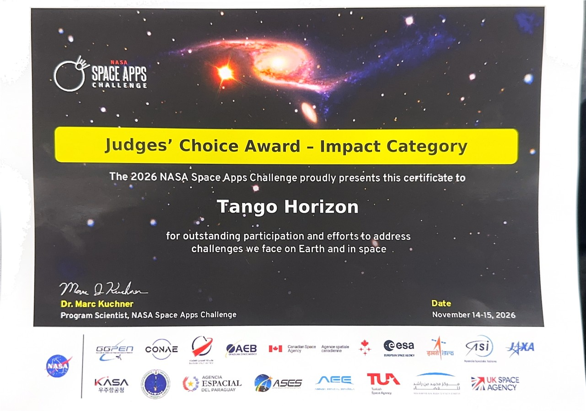<br/><sub>Judges' Choice Award, Impact Category: certificate of the 2026 NASA Space Apps Challenge, Buenos Aires (450+ participants).</sub></p>

<p align="center"></p>

[](README_ES.md)

<sub>This effort is supported by [NASA](https://www.nasa.gov/), [NASA Space Apps Challenge](https://www.spaceappschallenge.org/), [CONAE](https://www.argentina.gob.ar/ciencia/conae), [Universidad de Palermo](https://www.palermo.edu/) & [IBM Argentina](https://www.ibm.com/ar-es).</sub><br/>
<sub>All project development took place within the hackathon window starting Nov 14, 2026 at 09:00 ART (UTC-3), verifiable by repository creation (2026-11-14 16:56:55 UTC), commit hashes (initial commit [a3f7a4e](https://github.com/agustindiazcano/nasa-mars-tango-horizon/commit/a3f7a4e7d0bfa7ba5677b80eec3c6523eb61433b)), and [Pull Requests](https://github.com/agustindiazcano/nasa-mars-tango-horizon/pulls?q=is%3Apr).</sub>

# Tango Horizon: AI Systems for EVA and Mars Exploration

**Tango Horizon is a team of AI models that helps astronauts survive on Mars.** It is a real-time 3D simulation of the Gale Crater built on real NASA and USGS terrain data, where four astronauts work outside their base and a fleet of simulated robots (rovers, drones, a robot arm and a rescue robot) works with them. On Mars a radio message takes 4 to 24 minutes to reach Earth, so the crew cannot wait for Houston: the AI has to react on the spot.

**What it does**

- **Understands spoken orders.** The astronaut talks to the system hands-free, in English, Spanish, French, German or Italian ("send the rover to the pit", "how much oxygen is left?"), and it answers out loud.
- **Coordinates the robots.** A team of AI agents decides who does what: rovers drive, drones watch from above, the arm drills and samples, and routes are planned over the real terrain.
- **Runs rescues.** If an astronaut falls or loses suit pressure, the AI dispatches the rescue vehicle, the robot and the drones, and can fire a life-support pod (oxygen, CO2 scrubber, battery, suit patch) to the astronaut.
- **Watches every astronaut's health.** It reads the suit sensors (heart rate, oxygen, CO2, pressure, temperature), spots dangerous trends, estimates how many minutes are left, raises an alarm and explains it, citing the NASA health standards it looked up.
- **Predicts problems.** Three machine learning models trained on real NASA data point to likely water, forecast dust storms and flag mineral veins in rover photos.

**How the AI is organized.** Instead of one big chatbot, the system is a team of agents, each with one job: a fast agent listens to the astronaut, a coordinator (`BASE`) decides what to do, and specialists handle health, route planning, science, weather, maintenance and each robot. They use tools and a search over NASA documents so their numbers and citations come from real sources instead of being made up. Nothing reaches a robot until a safety layer (`GUARDIAN`) checks it: hard physical rules first (for example, never land a pod within 15 m of a person), then a second AI that acts as a judge, and for critical actions three different AI models vote. If one disagrees, a human decides. If the internet or the AI services fail, a built-in offline engine keeps the safety rules running.

**Under the hood.** Three.js (WebGL2) 3D simulator; Fastify server; Gemini 4 models on Google Vertex AI and AI Studio with Meta Muse as backup; six in-process tool servers (MCP); a 1,002-chunk search index over NASA standards (RAG); deterministic physics for suits, flight and routes; real data from MRO HiRISE, CTX, THEMIS, CRISM, Curiosity DAN, REMS and RAD. Details are in the sections below.

**Live demo (3D simulator):** [https://tangohorizon.vercel.app](https://tangohorizon.vercel.app) · **Showcase portal (`site/`):** [https://tangohorizon-site.vercel.app](https://tangohorizon-site.vercel.app)


## Index

- [Screenshots](#screenshots)
- [Team: Tango Horizon (Buenos Aires, Argentina)](#team-tango-horizon-buenos-aires-argentina)
- [Core Features & Operational Capabilities](#core-features--operational-capabilities)
- [System Architecture & Multi-Agent Runtime](#system-architecture--multi-agent-runtime)
- [Bidirectional Voice, Speech Models & 5-Language Support](#bidirectional-voice-speech-models--5-language-support)
- [In-Memory BM25 RAG & Predictive Telemetry (Health, FDIR & Weather)](#in-memory-bm25-rag--predictive-telemetry-health-fdir--weather)
- [Simulated Robotics, Fleet Autonomy & Cooperative Crew Rescue](#simulated-robotics-fleet-autonomy--cooperative-crew-rescue)
- [Real vs. Simulated vs. Engineering Design Assumptions](#real-vs-simulated-vs-engineering-design-assumptions)
- [NASA & USGS Data Used](#nasa--usgs-data-used)
- [Deterministic Physics Models](#deterministic-physics-models)
- [Physics & Engineering Constants](#physics--engineering-constants)
- [Our Models & Empirical Validation](#our-models--empirical-validation)
- [Known Limitations](#known-limitations)
- [NASA Space Apps Challenge Links](#nasa-space-apps-challenge-links)
- [AI Usage](#ai-usage)
- [Technologies & Local Run Commands](#technologies--local-run-commands)
- **Presentation & Pitch Materials (`docs/slides/`):**
  - [`docs/slides/PROJECT_OVERVIEW.md`](docs/slides/PROJECT_OVERVIEW.md) — Plain-language complete technical overview (EN / ES)
  - [`docs/slides/PRESENTATION_SCRIPT_3MIN.md`](docs/slides/PRESENTATION_SCRIPT_3MIN.md) — 3-minute presentation & live rescue script (ES / EN)
  - [`docs/slides/PRESENTATION_SCRIPT_30S.md`](docs/slides/PRESENTATION_SCRIPT_30S.md) — 30-second video script (ES / EN)
  - [`docs/slides/SLIDES.md`](docs/slides/SLIDES.md) — 10-slide presentation deck outline
  - [`docs/slides/TANGO_HORIZON_English.pptx`](docs/slides/TANGO_HORIZON_English.pptx) — English slide deck (PowerPoint)
- [License](#license)

## Screenshots

<table>
<tr>
<td width="50%">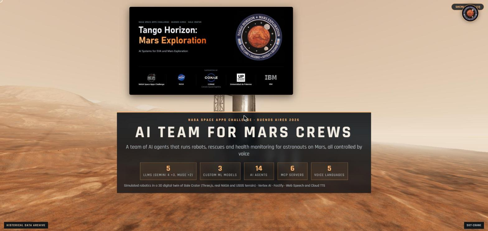<br/><sub>Cover of the explained video: project, event and sponsors.</sub></td>
<td width="50%">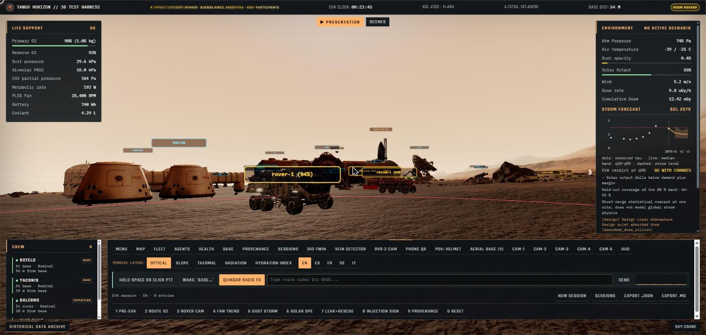<br/><sub>The simulator: crew, life support, AI console and the award badge.</sub></td>
</tr>
<tr>
<td width="50%">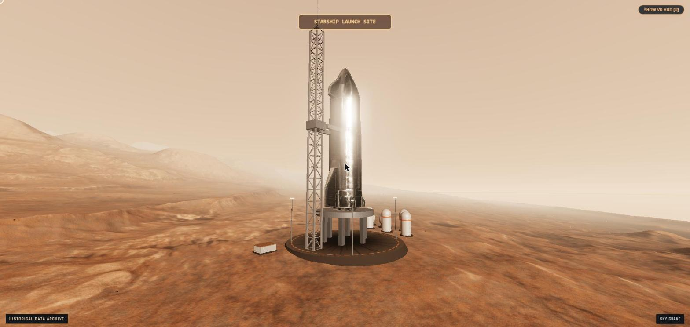<br/><sub>Starship launch complex on Mars, lit by the sun.</sub></td>
<td width="50%">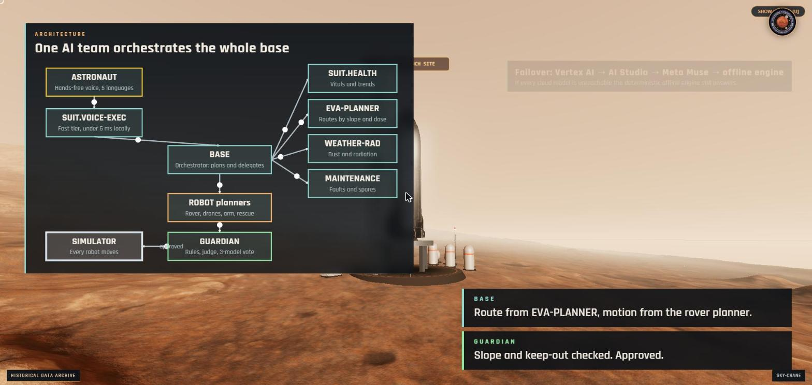<br/><sub>One AI team orchestrates the base: voice, BASE, specialists, robots and the safety gate.</sub></td>
</tr>
<tr>
<td width="50%">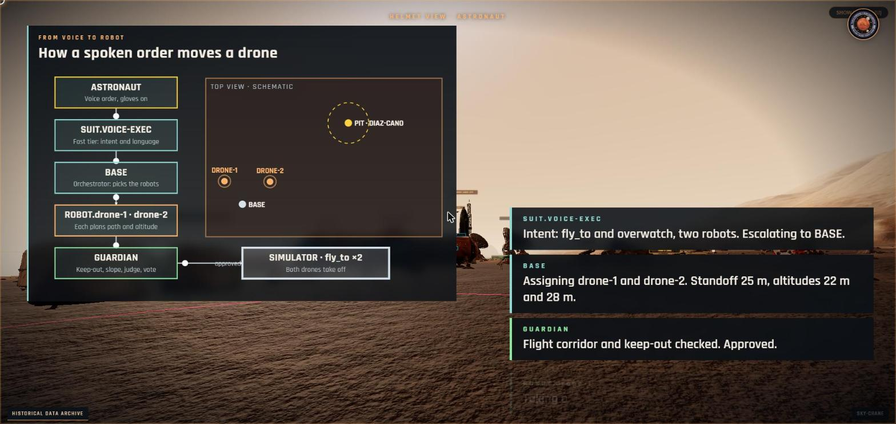<br/><sub>A spoken order becomes two drone flights, seen from the astronaut's helmet.</sub></td>
<td width="50%">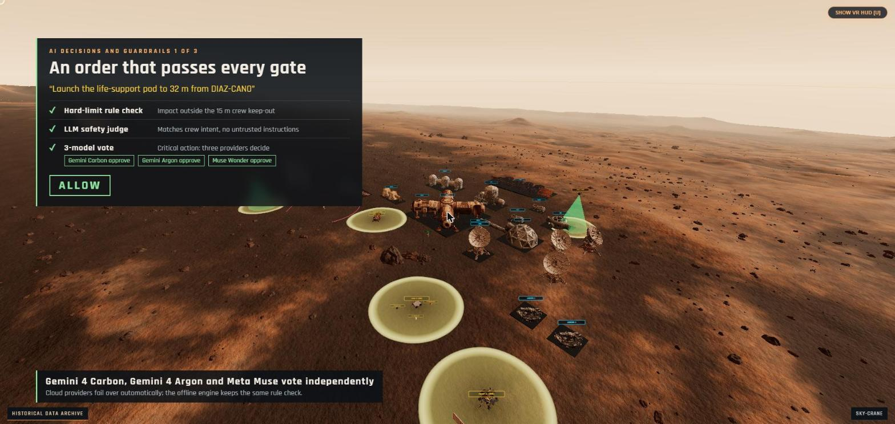<br/><sub>GUARDIAN checks an order: hard rules, AI judge and a three-model vote.</sub></td>
</tr>
<tr>
<td width="50%">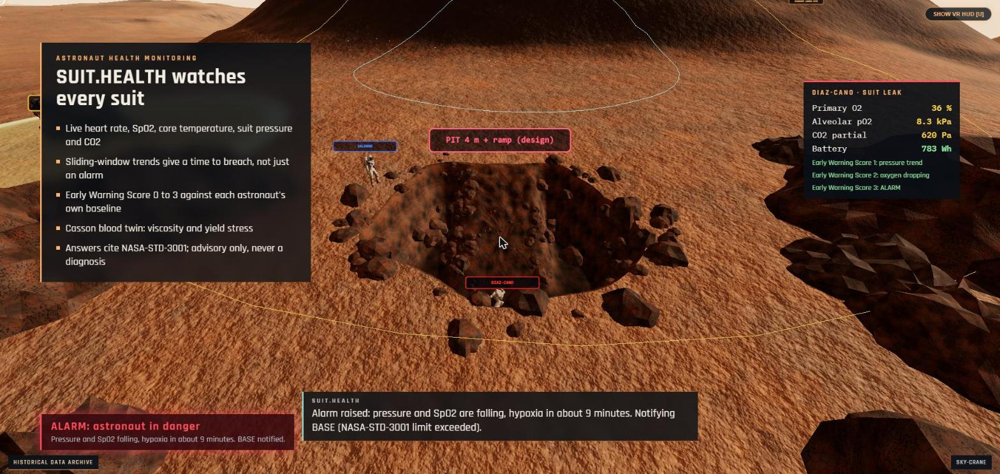<br/><sub>Health monitoring: the suit pressure falls, the alarm goes off and the AI notifies BASE.</sub></td>
<td width="50%">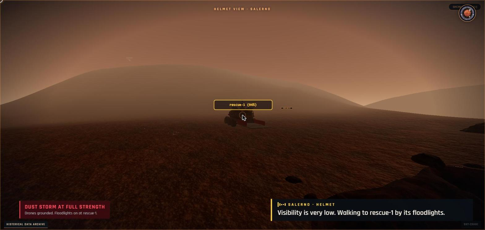<br/><sub>Dust storm at full strength, seen from an astronaut walking to the rescue vehicle.</sub></td>
</tr>
<tr>
<td width="50%">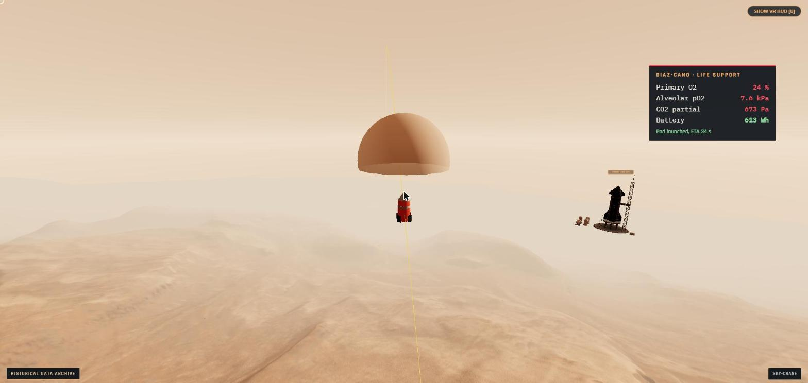<br/><sub>The life-support pod descends on its parachute toward the astronaut.</sub></td>
<td width="50%">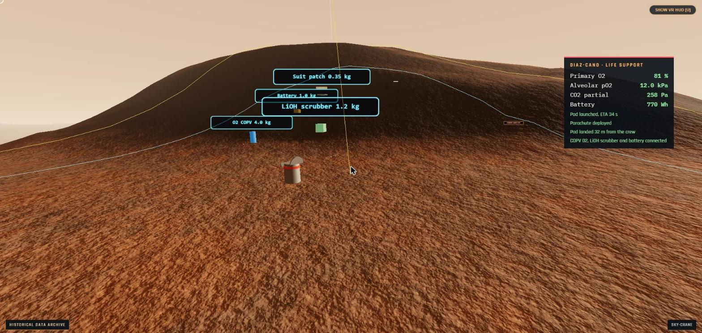<br/><sub>The pod opens: oxygen tank, CO2 scrubber, battery and suit patch.</sub></td>
</tr>
<tr>
<td width="50%">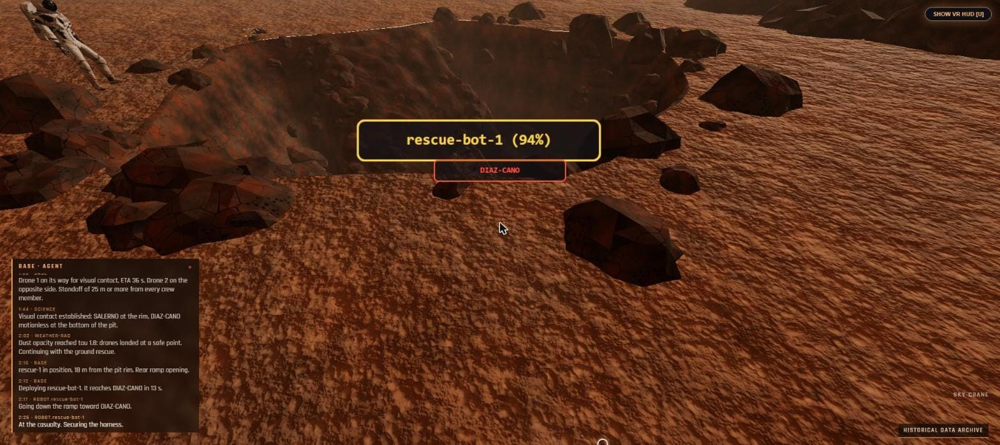<br/><sub>The rescue robot and the astronaut at the pit.</sub></td>
<td width="50%">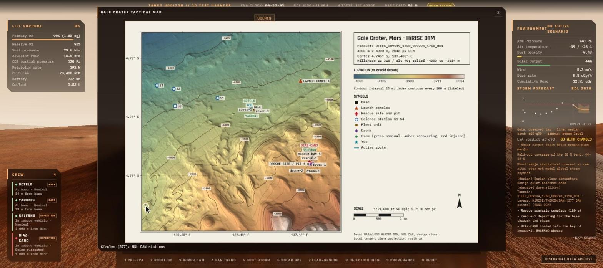<br/><sub>NASA and USGS style map of the Gale Crater scene.</sub></td>
</tr>
</table>

## Team: Tango Horizon (Buenos Aires, Argentina)

- **Agustin Diaz-Cano:** MS Candidate, Systems Engineering ([UTN, FRBA](https://frba.utn.edu.ar/)) · [LinkedIn](https://www.linkedin.com/in/agustindiazcano/) · [Portfolio](https://www.agustindiazcano.com/) · [GitHub](https://github.com/agustindiazcano) · [Qollab](https://qollab.xyz/u/agustindiazcano) · [YouTube](https://www.youtube.com/@agustin-diaz-cano)
- **Baltazar Salerno:** Frontend Developer · [GitHub](https://github.com/S-Baltazar)
- **Milagros Sotelo:** Systems Engineering Student ([UTN, FRBA](https://frba.utn.edu.ar/)) · [GitHub](https://github.com/Milagros-Sotelo)
- **Federico Yaconis:** 3D Developer & QA

## Core Features & Operational Capabilities

- **Hands-Free Voice Command & Live Telemetry Assistant:** Full mission operation by voice in **5 languages (`EN`, `ES`, `FR`, `DE`, `IT`)** with sub-5 ms local emergency intents, domain-normalized multimodal speech-to-text, neural radio voice synthesis, Apollo Quindar tones ($2525/2475\text{ Hz}$), and a 32-band real-time FFT audio visualizer.
- **Hierarchical Multi-Agent Orchestration & Per-Robot Agents:** Fast suit voice executor (`SUIT.VOICE-EXEC`), large base orchestrator (`BASE`), five domain specialists (`SUIT.HEALTH`, `EVA-PLANNER`, `SCIENCE`, `WEATHER-RAD`, `MAINTENANCE`), and dedicated onboard agents (`ROBOT.<id>`) for every rover, drone, glider, manipulator, and rescue robot—controllable directly by the astronaut or delegated by `BASE`.
- **Autonomous Emergency & Crew Rescue Deployment:** Triggered either by crew voice command or automatically when `SUIT.HEALTH` / `MAINTENANCE` / `WEATHER-RAD` detect suit depressurization, crew incapacitation, rover actuator failure, or dust storm onset—dispatching overwatch drones, a pressurized rescue rover (`rescue-1`), and a tracked rescue robot (`rescue-bot-1`) with a motorized winch and stretcher.
- **8.0 kg Ballistic Life-Support Drop-Pod & Solid-State Beacons:** Suborbital emergency pod launched from the habitat and integrated via 4th-order Runge-Kutta (RK4) under stratified Martian $\text{CO}_2$ drag and REMS logarithmic wind shear (`4.0 kg` high-pressure COPV with `1.0 kg` breathable $\text{O}_2$ at $3,000\text{ psi}$, `1.2 kg` $\text{LiOH}$ $\text{CO}_2$ scrubber cartridge, `1.0 kg` $200\text{ Wh}$ Li-ion battery, `0.35 kg` RTV/HybridSil suit breach patch kit, and `1.45 kg` aeroshell/parachute/UWB beacon), paired with non-pyrotechnic LED/laser + 6.5 GHz UWB breadcrumb beacons (`deploy_beacons`) compliant with `NASA-STD-3001 V2 6002` ($100\%\text{ O}_2$ fire safety).
- **GPS-Denied Mars Localization & 3D Flash LiDAR (`get_localization_and_lidar`):** Since Mars has no GPS constellation, units localize via HiRISE `1 m/px` Map-Relative Localization (MRL), 6.5 GHz IEEE 802.15.4z UWB time-of-flight mesh ranging, Visual-Inertial Odometry (VIO), and 360° 3D Flash LiDAR slope/hazard scanning.
- **Multimodal Camera Vision (`capture_vision` & `/api/agent/vision`):** Crew members can ask what their helmet camera or any rover/drone camera sees; the system captures the active viewport or offscreen vehicle camera frame and analyzes geological features or hazards with vision LLMs (`gemini-4-argon` / `muse-wonder-1.0`).
- **Predictive RAG over Aerospace Standards (`<2 ms` BM25):** In-memory retrieval across `1,002` chunks of `NASA-STD-3001` (Vol. 1 & 2), `OCHMO` briefs, `AMCL`, `MEDPRAT`, `Mars-GRAM`, `MCD`, `MSL RAD`, and `MOXIE` with exact `(document, page)` citations for biomedical early warning, FDIR fault recovery, and weather/radiation aborts.
- **3 Custom-Trained Scientific ML Models:** Offline-trained, cross-validated models on real NASA PDS datasets: **Hydration Prospector** (subsurface H/OH mineral hydration from MSL DAN + CRISM + THEMIS), **Storm Nowcaster** (1–3 sol dust opacity quantile forecast from MSL REMS pressure tides), and **Mineral Vein Detector** (frozen Meta `DINOv2-small` patch classifier/heatmap on real Curiosity Mastcam/MAHLI frames).
- **USGS/NASA-Style Cartographic Map & 6 Terrain Layers:** Interactive 3D terrain overlays (`Optical HiRISE`, `THEMIS Thermal Class`, `Slope`, `Sky View Factor`, `Radiation Dose`, `DAN/CRISM Hydration + Uncertainty`) plus a full-screen NASA/USGS planetary cartography map showing hypsometric tint, hillshade, contour lines, lat/lon graticule, base/launch pad, science sites, fleet units, and all four crew callsigns.
- **QR Smartphone Laser Pointer & PTT Remote (`/remote`):** Pairing a phone via QR code turns its gyroscope (`DeviceOrientation`) into a low-latency 3D HUD laser pointer and Push-to-Talk radio handset over `/ws/remote` with haptic vibration on critical alerts.

## System Architecture & Multi-Agent Runtime

Tango Horizon keeps the browser WebGL2 simulation (`web/`) as the single source of truth for mission telemetry, rendering the 4 km × 4 km Gale Crater HiRISE DTM with overlay rasters, helmet HUD, hands-free multilingual voice (`EN`/`ES`/`FR`/`DE`/`IT`), and QR-paired mobile pointer (`remote.html` over `/ws/remote`). Each spoken or text order passes a JSON `MissionContext` snapshot to the stateless Fastify server (`server/`), which executes tool calls across six in-process MCP servers (`InMemoryTransport`), an in-memory BM25 corpus (`NASA-STD-3001` Vol. 1 & 2, `OCHMO` briefs, `AMCL`, `Mars-GRAM`, `MOXIE`), and `GUARDIAN` before returning approved actions.

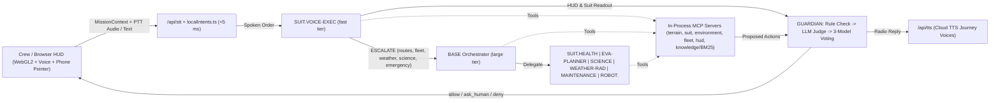

### Multi-Agent Hierarchy & Decision Flow

| Agent | Tier | Role & Decision Scope |
|---|---|---|
| `SUIT.VOICE-EXEC` | `fast` | Suit-level voice assistant. Handles HUD layers/panels/map, language switching, suit consumables/O2 readouts, fleet status/position queries, ballistic pod trajectory previews (`calculate_pod_launch`), and camera vision queries (`capture_vision`). Escalates physical actuation, routing, FDIR, science, and emergencies to `BASE`. |
| `BASE` | `large` | Central habitat mission orchestrator. Prioritizes crew survival over science. Reads live localization/LiDAR and environment telemetry, dispatches fleet units, triggers autonomous leak/rescue protocols, and delegates specialized analysis to domain and robot agents. |
| `SUIT.HEALTH` | `medium` | Biomedical decision-support specialist. Evaluates sliding-window vitals trends, time-to-breach, and Early Warning Scores (`evaluate_crew_biomed`) against personal baselines and `NASA-STD-3001` / `OCHMO` citations (`search_docs`). Issues operational advisories only (never clinical diagnoses or prescriptions). |
| `EVA-PLANNER` | `medium` | Traverse planner over `1 m/px` HiRISE DEM. Computes A* routes (`plan_route`, `show_route`) minimizing metabolic $\text{O}_2$ cost and radiation dose, checks storm forecasts, and deploys solid-state UWB/LED breadcrumb beacons (`deploy_beacons`). |
| `WEATHER-RAD` | `medium` | Atmospheric and space-weather specialist. Monitors REMS barometric tides, 3-sol dust opacity quantiles (`get_storm_forecast`), solar power margins, RAD surface dose, and DONKI SEP alerts (`evaluate_environmental_risk`, `evaluate_eva_weather`) to issue Go / Go-with-changes / No-Go verdicts. |
| `MAINTENANCE` | `medium` | Deterministic FDIR and predictive maintenance agent. Computes degradation slopes and Remaining Useful Life (`rul_s`) via `evaluate_component_health`, retrieves cited recovery SOPs from `search_docs` by `fault_code`, and proposes `isolate_component` (`switch_redundant`, `derate`, `safe_halt`, `quarantine`). |
| `SCIENCE` | `medium` | Astrobiology and geology specialist. Queries `get_hydration_at`, `rank_sample_sites`, and `detect_veins` to recommend high-priority drilling targets with low uncertainty. |
| `ROBOT.<id>` | `medium` | Per-unit autonomous onboard planner (`rover-1`, `rover-2`, `rover-3`/`manip-1`, `rescue-1`, `rescue-bot-1`, `drone-1`, `drone-2`, `glider-1`, `scout-1`). Enforces unit-scoped self-commanding, checks 360° LiDAR slopes, and executes mobility or 4-DOF arm skills (`arm_skill`). |

### Multi-Provider LLM Stack, Failover & Local Mars Compute Architecture

| Tier / Role | Primary: Google Cloud Vertex AI (`vertex`, ADC) | Secondary: Google AI Studio (`gemini`) | Backup: Meta Muse API (`meta`) | Offline Fallback (`AGENTS_OFFLINE=1`) |
|---|---|---|---|---|
| **Large (`BASE` Orchestrator)** | `google/gemini-4-carbon` | `gemini-4-carbon` | `muse-wonder-1.0` (`muse-wonder`) | Deterministic rule/tool router (`offline.ts`) |
| **Medium (`SUIT.HEALTH`, `EVA-PLANNER`, `SCIENCE`, `WEATHER-RAD`, `MAINTENANCE`, `ROBOT.<id>`)** | `google/gemini-4-argon` | `gemini-4-argon` | `muse-wonder-1.0` (`muse-wonder`) | Deterministic domain handlers (`offline.ts`) |
| **Fast (`SUIT.VOICE-EXEC`, Audio STT & ASR Normalization)** | `google/gemini-4-hydrogen` | `gemini-4-hydrogen` | `muse-spark-1.3` (`muse-spark`) | Regex/intent parser + local intents (`offline.ts`) |
| **Safety Judge (`GUARDIAN` Step 2)** | `google/gemini-4-argon` | `gemini-4-argon` | `muse-spark-1.3` (`muse-spark`) | Deterministic `ruleCheck` + `ask_human` gate |
| **Multimodal Vision (`capture_vision`, `/api/agent/vision`)** | `google/gemini-4-argon` | `gemini-4-argon` | `muse-wonder-1.0` (`muse-wonder`) | Offline telemetry + precomputed DINOv2 vein heatmaps |

- **Real Mars Deployment vs. Cloud Simulation:** In this web simulator, LLM inference runs on Google Cloud Run / Vertex AI with automatic per-request failover to Google AI Studio and Meta Muse. In an actual Mars mission—where Earth-Mars one-way light time is 4 to 24 minutes and solar conjunctions block links entirely—cloud APIs are unreachable; therefore, the architecture is stateless and modular so open-weight multimodal/reasoning models run locally on the **Mars Base `compute` module** (nuclear/solar microgrid) while fast-tier models (`SUIT.VOICE-EXEC`, `ROBOT.<id>`, `DINOv2`) run on suit and rover edge NPUs.
- **3-Layer Run-Time Assurance (`GUARDIAN` + Escalated Multi-Model Voting):**
  1. **Step 1 — Deterministic Hard Limits (`ruleCheck` in `guardian.ts`):** Blocks any action violating vehicle slope limits, 15 m ballistic pod keep-out around crew, 2 m manipulator arm keep-out (except stationary handover), 25 m drone overwatch standoff from crew during rescue, rotorcraft flight under high dust (`tau >= 1.8`), high wind, or low air density, outward dispatch during active SEP radiation spikes, uncorroborated FDIR component isolation, pyrotechnic flares near $100\%\text{ O}_2$ suits, or clinical overreach by `SUIT.HEALTH`.
  2. **Step 2 — Contextual LLM Safety Judge (`judge` in `guardian.ts`):** Wraps speech, document chunks, and subagent text in `<untrusted>` tags and verifies alignment with crew intent, failing closed (`deny`) on manipulation attempts.
  3. **Step 3 — Post-Guardrail 3-Model Escalated Voting (`voting.ts`):** For high-consequence actions (ballistic pod launch, ballistic beacons, long/steep/rescue dispatch, borderline `ask_human` verdicts, or severe telemetry), three heterogeneous models vote concurrently (**Voter A:** `gemini-4-carbon`, **Voter B:** `gemini-4-argon`, **Voter C:** `muse-wonder-1.0`). If a 2-allow / 1-deny split occurs and the dissenting model reports confidence $\ge 0.85$, an **Asymmetric Safety Override** downgrades the action to `ask_human` for explicit crew confirmation.

## Bidirectional Voice, Speech Models & 5-Language Support

Implemented across [`web/src/voice/listen.ts`](web/src/voice/listen.ts), [`web/src/voice/speak.ts`](web/src/voice/speak.ts), [`web/src/voice/localIntents.ts`](web/src/voice/localIntents.ts), [`server/src/agents/stt.ts`](server/src/agents/stt.ts), and [`server/src/tts.ts`](server/src/tts.ts):

- **5 Supported Languages (`EN`, `ES`, `FR`, `DE`, `IT`):** Full reactive localization (`setLang`) across HUD panels, alerts, provenance cards, speech recognition locales (`en-US`, `es-AR`/`es-ES`, `fr-FR`, `de-DE`, `it-IT`), agent responses, and neural text-to-speech synthesis.
- **Sub-5 ms Local Critical Intents (`localIntents.ts`):** Urgent safety and UI orders (*"stop"*, *"abort"*, *"show the map"* / *"muéstrame el mapa"* / *"montre la carte"* / *"zeig die Karte"* / *"mostra la mappa"*, layer switches, panel toggles, language changes) execute immediately in the browser with zero network latency.
- **Dual Speech Capture & Multimodal LLM Transcription (`listen.ts` + `stt.ts`):**
  - Captures live interim text via the browser Web Speech API while simultaneously recording mono 16 kHz 16-bit PCM WAV audio via `AudioContext` (triggered by Spacebar PTT, mobile `/remote` PTT, or continuous wake-word `"Base, ..."`).
  - Transcribes WAV audio using fast-tier multimodal LLMs (`google/gemini-4-hydrogen` via `input_audio`) conditioned on a dynamic Mars mission glossary (`buildDomainGlossary`), repairing phonetic ASR errors (e.g., *"rober uno"* $\to$ `rover-1`, *"masip 1"* $\to$ `rover-3`, *"moxy"* $\to$ `MOXIE`, *"gail crater"* $\to$ `Gale Crater`).
- **Neural Text-to-Speech & NASA Radio DSP (`tts.ts` + `speak.ts`):**
  - Synthesizes spoken replies via **Google Cloud Text-to-Speech (`@google-cloud/text-to-speech`)** using **Google Journey / Neural voices** (`es-US-Journey-D`, `en-US-Journey-D`, and localized neural voices for `fr-FR`, `de-DE`, `it-IT`) with an in-memory SHA-1 audio cache and automatic fallback to browser `speechSynthesis`.
  - Routes all speech through a Web Audio API radio chain featuring authentic Apollo **Quindar tones** ($2525\text{ Hz}$ intro beep, $2475\text{ Hz}$ outro beep), a $300\text{–}3200\text{ Hz}$ biquad bandpass filter, and a 64-point `AnalyserNode` driving the **32-band live FFT spectrum canvas** in the HUD.

## In-Memory BM25 RAG & Predictive Telemetry (Health, FDIR & Weather)

The knowledge engine ([`server/src/agents/tools/knowledge.ts`](server/src/agents/tools/knowledge.ts)) indexes **1,002 chunks across 15 authoritative aerospace documents** in `server/corpus/chunks.json` (`BM25` with $k_1 = 1.5, b = 0.75$ and optional `fault_codes` pre-filtering) in `<2 ms` with zero external database dependencies:

1. **Predictive Crew Biomedical Monitoring (`SUIT.HEALTH` + [`shared/src/physics/biomed.ts`](shared/src/physics/biomed.ts) + [`web/src/hud/cassonTwin.ts`](web/src/hud/cassonTwin.ts)):**
   - Computes sliding-window slopes and deterministic `time_to_breach_s` for inspired $\text{CO}_2$ (`PICO2` hypercapnia), core body temperature, Physiological Strain Index (PSI), arterial oxygen saturation ($\text{SpO}_2$), heart rate, and cardiac drift (`HR / metabolic_w`), producing a composite `0–3` Early Warning Score (`green / amber / red`).
   - Enforces a **Two-Tier Threshold Model**: personal astronaut baselines tighten early warnings sooner for an individual crew member's physiology while never relaxing `NASA-STD-3001` population safety ceilings/floors.
   - Simulates a **Casson/Quemada Non-Newtonian Blood Rheology Bio-Twin** (`cassonTwin.ts`), tracking hemoconcentration (hematocrit $H(t)$ from LCVG sublimation and sweat loss) and apparent blood viscosity $\mu_{\text{app}}$ under hypogravity.
   - Queries BM25 RAG over `NASA-STD-3001 Vol. 1 & 2`, `OCHMO-TB-004` ($\text{CO}_2$ / hypercapnia), `AMCL`, and `MEDPRAT` to cite exact `(document, page)` countermeasures while enforcing mandatory advisory framing (*"Decision support advisory only; not a medical diagnosis"*).
2. **Predictive Equipment Maintenance & Aerospace FDIR (`MAINTENANCE` + [`shared/src/physics/fdir.ts`](shared/src/physics/fdir.ts)):**
   - Evaluates sliding telemetry windows via linear least-squares slopes and z-score residuals to compute clamped **Remaining Useful Life (`rul_s`)** and isolate canonical fault codes across four subsystems:
     - **Suit PLSS:** `PLSS-FAN-01` (primary fan RPM degradation), `PLSS-SCRUB-01` ($\text{LiOH}$ / amine $\text{CO}_2$ scrubber saturation), `PLSS-COOL-01` (LCVG coolant loop loss/pressure drop).
     - **Fleet Rovers & Manipulator Arm:** `RVR-MOB-01` (wheel slip ratio / actuator stall in loose THEMIS Class 0 sand), `RVR-THM-01` (drive motor overheating), `ARM-TORQ-01` (`rover-3` / `manip-1` drill/joint overcurrent).
     - **Habitat Power & ISRU:** `HAB-PWR-01` (solar array dust fouling / bus voltage droop) and `ISRU-MOX-01` (MOXIE scroll compressor / $800^\circ\text{C}$ SOXE stack degradation).
   - Retrieves matching recovery SOPs from `search_docs` filtered by `fault_code` and executes `isolate_component` (`switch_redundant`, `derate`, `safe_halt`, `quarantine`), verified by `GUARDIAN` against live telemetry to block false or injected shutdowns.
3. **Predictive Weather, Dust Storms & Radiation (`WEATHER-RAD` + [`shared/src/physics/envNowcast.ts`](shared/src/physics/envNowcast.ts)):**
   - Combines rolling surface pressure-tide gradients ($\dot{P}$), dust opacity ramps ($\dot{\tau}$), wind shear, solar array output, battery autonomy (`time_to_zero_solar_margin_s`, `battery_autonomy_s`), MSL RAD dose rates, and NASA DONKI / WSA-Enlil SEP arrival alerts with `Mars-GRAM` and `MCD v5.2` RAG citations to trigger proactive maneuvers (`shorten_eva`, `reroute_near_rover`, `preposition_rover`, `recall_aircraft`, `charge_batteries`, `switch_to_fission`, `postpone`).

## Simulated Robotics, Fleet Autonomy & Cooperative Crew Rescue

### Simulated Robotics (Zero Mocks)

- **Analytic 4-DOF Inverse Kinematics Manipulator (`rover-3` / `manip-1` "HANDS", [`web/src/world/manipulatorArm.ts`](web/src/world/manipulatorArm.ts)):** Four articulated joints (`base yaw`, `shoulder pitch`, `elbow pitch`, `wrist pitch`, $0.9\text{ m}$ upper arm + $0.8\text{ m}$ forearm = $1.7\text{ m}$ reach) and a 4-tool turret (`gripper`, `core drill`, `scoop`, `wrist camera`). The agent selects a high-level skill (`drill`, `sample`, `photograph`, `handover`) and visual target marker (`T1..Tn` or `astronaut`); the browser `SkillRunner` state machine solves exact joint angles analytically every frame and renders an offscreen $512 \times 384$ mast-camera feed.
- **Coaxial Rotorcraft, Sky-Crane Tether Pendulum & LiDAR Cone (`drone-1`, `drone-2`, [`web/src/world/skyCraneProc.ts`](web/src/world/skyCraneProc.ts)):** Models a 6-rotor Mars helicopter (Ingenuity / Mars Science Helicopter heritage) with a damped spherical pendulum Kevlar tether ($k = 4.2 \times 10^4\text{ N/m}$) under Martian wind shear and a 532 nm green LiDAR scanning cone, subject to aerodynamic density and dust-grounding (`tau >= 1.8`) envelopes.
- **Terrain-Coupled A\* Navigation & Mesh-Optimized 3D Assets:** All ground vehicles (`rover-1`, `rover-2`, `rover-3`, `rescue-1`, `rescue-bot-1`, `scout-1`) follow A\* paths computed over the real `2048 × 2048` HiRISE elevation grid, respecting per-vehicle slope limits and THEMIS thermal traction classes, rendered with NASA 3D Resources glTF models and 16 custom 3D assets simplified and quantized via `meshoptimizer` (`tools/assets/optimize.mjs`).

### Autonomous 4-Astronaut Crew Rescue Scenario

- **Cast & Base Layout:** Four astronauts operate from the main habitat complex (`conae-base-mars`, solar array field, antenna farm, and the Starship launch complex at `LAUNCH_SITE_COORD`): **`SOTELO`** and **`YACONIS`** at base control, while **`SALERNO`** (driver) and **`DIAZ-CANO`** (geologist) conduct a science traverse $1.5\text{–}2.5\text{ km}$ away at `RESCUE_SITE` aboard pressurized rover **`rover-1`**.
- **Crisis & Autonomous Multi-Agent Response:**
  1. `rover-1` suffers a critical wheel actuator fault (`RVR-MOB-01`), isolated by `MAINTENANCE`.
  2. While sampling near a natural sinkhole pit (`RESCUE_PIT`), `DIAZ-CANO` falls into the shaft and is incapacitated (`SUIT.HEALTH` triggers a critical biomedical alert).
  3. Dust opacity $\tau$ ramps from $0.5$ toward $6.0$; `WEATHER-RAD` flags a `NO-GO` verdict for walking back.
  4. `BASE` dispatches the pressurized rescue vehicle **`rescue-1`** (carrying tracked **`rescue-bot-1`** in its rear bay) and launches overwatch drones **`drone-1`** and **`drone-2`** while $\tau < 1.8$. `GUARDIAN` enforces a strict $\ge 25\text{ m}$ horizontal standoff and $20\text{–}30\text{ m}$ altitude band so rotorcraft never fly directly over injured crew.
  5. When dust crosses $\tau \ge 1.8$, `BASE` executes `recall_aircraft` to land the drones safely. `rescue-1` reaches the pit rim, and—after human-in-the-loop confirmation (`ask_human`)—deploys **`rescue-bot-1`** down the rear ramp to descend the tether into the pit, secure `DIAZ-CANO` onto the stretcher, winch and drag the casualty into `rescue-1`, and return both astronauts to base.

## Real vs. Simulated vs. Engineering Design Assumptions

| Category | What is 100% Real (Unmodified Science & Standards) | What is Deterministic Simulation | What is a Flagged Engineering `[design assumption]` |
|---|---|---|---|
| **Cartography & Terrain** | MRO HiRISE DTM `DTEEC_009149_1750_009294_1750_U01` ($1\text{ m/px}$), HiRISE Orthoimage `PSP_009149_1750_RED` ($0.25\text{ m/px}$), CTX DEM ($20\text{ m/px}$), Odyssey THEMIS Night/Day IR (`mc23_aeolis_nir`/`dir`). | Adaptive $8\times 8$ LOD WebGL2 terrain mesh, central-difference slope ($\theta$), 16-azimuthal raycast Sky View Factor ($\Omega$), and A\* pathfinding. | 3-tercile qualitative mapping of uncalibrated THEMIS Night IR DN values (`193.0`, `220.0`) to terrain traction coefficients $\eta \in [1.0, 2.37]$; procedural natural sinkhole pit geometry (`RESCUE_PIT`). |
| **Atmosphere, Weather & Radiation** | MSL Curiosity REMS hourly time series (`mslrem_1001`, clear sols & MY 34 2018 global dust storm), Mastcam 880 nm optical depth (`msl_tau_880.csv`), MSL RAD surface dose rates (`MSL-M-RAD-3-RDR-V1.0` quiet & Sep 2017 SEP), JPL Horizons ephemeris (`DE441`), NASA DONKI SEP/WSA-Enlil alerts. | Barometric tide harmonic fitting ($S_1, S_2$), direct-beam solar extinction $\exp(-\tau/\mu)$, geometric SVF + regolith albedo dose integration, and 20,000-particle GPU dust shaders. | Albedo neutron backscatter factor $\beta = 0.09$; aerodynamic surface roughness $z_0 = 0.01\text{ m}$; worst-case Carrington-class reference SPE peak ($5,840\text{ }\mu\text{Sv/h}$) for shelter stress-testing. |
| **Bioastronautics & Life Support** | `NASA-STD-3001` Vol. 1 & 2 limits ($P_{\text{nom}} = 29.6\text{ kPa}$, Armstrong $6.27\text{ kPa}$, $\text{PICO}_2$ bounds), OCHMO hypercapnia briefs, AMCL & MEDPRAT corpus, Pandolf (1977) + Santee (2001) equations, isentropic choked orifice flow ($\text{Ma}=1$). | 1 Hz PLSS consumables integrator ($\text{O}_2$, $\text{CO}_2$, battery, coolant), RK4 3D ballistic drop-pod flight with wind drift, and sliding-window EWS / time-to-breach calculator. | Scaling Pandolf weight terms by $g_{\text{Mars}}/g_\oplus = 0.378$ in a pressurized suit; suit free gas volume ($0.135\text{ m}^3$), suit mass ($65\text{–}122\text{ kg}$), 8.0 kg multi-consumable drop-pod mass breakdown, 15 m pod keep-out radius, and Casson blood rheology Hct/viscosity parameterization. |
| **Robotics, FDIR & AI Models** | 1,567 MSL DAN neutron stops, 9 MRO CRISM MTRDR cubes, 117 human-audited Curiosity Mastcam/MAHLI frames, frozen Meta `DINOv2-small` weights, and Perseverance MOXIE O2 production logs (`mars2020_moxie`). | Analytic 2-bone / 4-DOF arm inverse kinematics, Sky-Crane tether spring-damper pendulum, linear-regression FDIR `RUL` prognostics, in-memory MCP tool execution, and 3-stage `GUARDIAN` + 3-model voting. | Vehicle max slope limits ($15^\circ\text{–}30^\circ$), 2 m arm crew keep-out, 25 m drone overwatch standoff, `tau >= 1.8` rotorcraft grounding threshold, and synthetic FDIR actuator fault injection profiles. |

## NASA & USGS Data Used

### How Each NASA & USGS Dataset Powers the Simulator

| Mission / Source | Dataset / Instrument | Operational Role in Tango Horizon |
|---|---|---|
| **Mars Reconnaissance Orbiter (MRO) — HiRISE** | USGS Astrogeology STAC `DTEEC_009149_1750_009294_1750_U01` ($1\text{ m/px}$ DTM) & `PSP_009149_1750_RED` ($0.25\text{ m/px}$ Orthoimage) | Provides the real $4\text{ km} \times 4\text{ km}$ Gale Crater / Aeolis Mons 3D elevation mesh (`height_2048.u16`), slope hazard map (`slope_1024.png`), 16-ray horizon Sky View Factor radiation shielding map (`svf_1024.png`), Map-Relative Localization (MRL), and photogrammetric surface texture (`ortho_4096.webp`). |
| **Mars Reconnaissance Orbiter (MRO) — CTX** | USGS STAC Stereo DEM `T01_000815_1749...` ($20\text{ m/px}$) | Supplies wide-area geomorphometry along the entire Curiosity traverse to train the **Hydration Prospector** model and quantify the MOLA areoid vs. IAU 2015 sphere vertical datum offset. |
| **Mars Odyssey — THEMIS IR** | Night (`mc23_aeolis_nir`) & Day (`mc23_aeolis_dir`) Controlled IR Mosaics ($100\text{ m/px}$) | Segments terrain into 3 thermal inertia proxy classes (`thermal_class.png`: loose eolian sand traps vs. consolidated bedrock) driving Pandolf metabolic walking cost and rover sinkage/slip prevention, plus orbital thermal features for hydration ML. |
| **MSL Curiosity — DAN** | PDS Geosciences `MSL-M-DAN-3/4-RDR-V1.0` (1,567 passive neutron measurements; 377 inside scene) | Provides ground-truth subsurface thermal-to-epithermal neutron count ratios (bound mineral H/OH indicator) to train and validate **Hydration Prospector** (`tango-horizon-hydration-v1`). |
| **Mars Reconnaissance Orbiter (MRO) — CRISM** | PDS Geosciences 9 MTRDR Spectral Summary Products (`BD1900_2`, `SINDEX2`) | Supplies orbital $1.9\text{ }\mu\text{m}$ H2O band depth and hydrated sulfate spectral indices as predictors for **Hydration Prospector**. |
| **MSL Curiosity — REMS & Mastcam Opacity** | PDS Atmospheres `mslrem_1001` (Sols 1–3953) & `msl_tau_880.csv` (Lemmon 2024) | Drives real hourly pressure, air/ground temperature, wind, and UV telemetry (`rems_clear.json`, `rems_storm2018.json`) and trains **Storm Nowcaster** (`rems_hgbr_quantile_v1`) on diurnal/semidiurnal pressure-tide amplification ahead of the MY 34 global dust storm. |
| **MSL Curiosity — RAD** | PDS-PPI `MSL-M-RAD-3-RDR-V1.0` (Sols 1773–1779 quiet & Sols 1811–1817 Sep 2017 SEP) | Anchors nominal Galactic Cosmic Ray surface dose rates (`rad_quiet.json`, $\sim 27\text{ }\mu\text{Sv/h}$) and real Solar Energetic Particle surface spikes (`rad_sep2017.json`) for `WEATHER-RAD` and `EVA-PLANNER`. |
| **MSL Curiosity — Mastcam & MAHLI** | NASA Mars Raw Images API (Sols 170, 925, 929, 931, 1190; 117 audited frames) | Real rover outcrop photographs (*Garden City*, *Sheepbed*, *Bagnold Dunes*) used to train, validate, and display **Mineral Vein Detector** (`tango-horizon-veins-v1`) heatmaps for robotic arm drilling. |
| **NASA JPL Horizons (`DE441 / mar099`)** | Earth-Mars Light Time & Gale Solar Ephemeris (`ephem.json`) | Computes real one-way/round-trip communication latency and hourly solar zenith/azimuth angles for solar array power generation (`solar.ts`). |
| **NASA CCMC DONKI** | `SEP`, `CMEAnalysis` & `WSAEnlilSimulations` APIs | Provides heliospheric space-weather alerts and coronal mass ejection arrival windows at Mars (`donki_alert`), gating outward EVA dispatch in `GUARDIAN`. |
| **Mars 2020 Perseverance — MOXIE** | PDS Atmospheres `mars2020_moxie` (Sols 0–659 $\text{O}_2$ production logs) | Models habitat ISRU solid-oxide electrolysis ($\text{CO}_2 \to \text{O}_2$) rates and compressor/SOXE fault signatures (`ISRU-MOX-01`) in `MAINTENANCE`. |
| **NASA OCHMO, NTRS & Standards** | `NASA-STD-3001` Vol. 1 & 2, `OCHMO-TB-004`, `AMCL`, `MEDPRAT`, `Mars-GRAM`, `MCD v5.2` | Forms the 1,002-chunk in-memory BM25 RAG corpus (`server/corpus/chunks.json`) cited by `SUIT.HEALTH`, `WEATHER-RAD`, `EVA-PLANNER`, and `MAINTENANCE`. |
| **NASA 3D Resources & Custom GLBs** | 25 meshopt-compressed mission GLBs | Renders NASA-style rovers and habitat modules alongside the Starship launch complex, solar arrays, antennas, rescue vehicles, and animated 4-astronaut crew. |

<!-- BEGIN AUTO:DATA -->
Tracked runtime assets in `web/public/data/provenance.json` (**57 entries**; SHA-256 checksums and CRS transforms recorded in the manifest):

| Asset | Source | Product / Model ID | Retrieved / Ref |
|---|---|---|---|
| `terrain/height_2048.u16` | USGS Astrogeology, MRO HiRISE SOCET DTMs (NASA/JPL/University of Arizona/USGS) | `DTEEC_009149_1750_009294_1750_U01` | 2026-11-14 · [link](https://astrogeo-ard.s3-us-west-2.amazonaws.com/mars/mro/hirise/controlled/dtm/PSP_009149_1750_PSP_009294_1750/DTEEC_009149_1750_009294_1750_U01.tif) |
| `terrain/meta.json` | USGS Astrogeology, MRO HiRISE SOCET DTMs (NASA/JPL/University of Arizona/USGS) | `DTEEC_009149_1750_009294_1750_U01` | 2026-11-14 · [link](https://astrogeo-ard.s3-us-west-2.amazonaws.com/mars/mro/hirise/controlled/dtm/PSP_009149_1750_PSP_009294_1750/DTEEC_009149_1750_009294_1750_U01.tif) |
| `terrain/svf_1024.png` | USGS Astrogeology, MRO HiRISE SOCET DTMs (NASA/JPL/University of Arizona/USGS) | `DTEEC_009149_1750_009294_1750_U01` | 2026-11-14 · [link](https://astrogeo-ard.s3-us-west-2.amazonaws.com/mars/mro/hirise/controlled/dtm/PSP_009149_1750_PSP_009294_1750/DTEEC_009149_1750_009294_1750_U01.tif) |
| `terrain/slope_1024.png` | USGS Astrogeology, MRO HiRISE SOCET DTMs (NASA/JPL/University of Arizona/USGS) | `DTEEC_009149_1750_009294_1750_U01` | 2026-11-14 · [link](https://astrogeo-ard.s3-us-west-2.amazonaws.com/mars/mro/hirise/controlled/dtm/PSP_009149_1750_PSP_009294_1750/DTEEC_009149_1750_009294_1750_U01.tif) |
| `terrain/ortho_4096.webp` | USGS Astrogeology, MRO HiRISE SOCET DTMs (NASA/JPL/University of Arizona/USGS) | `DTEEC_009149_1750_009294_1750_U01` | 2026-11-14 · [link](https://astrogeo-ard.s3-us-west-2.amazonaws.com/mars/mro/hirise/controlled/dtm/PSP_009149_1750_PSP_009294_1750/PSP_009149_1750_RED_A_01_ORTHO.tif) |
| `terrain/thermal_class.png` | USGS Astrogeology / ASU, Mars Odyssey THEMIS Controlled Night IR Mosaic (mc23_aeolis_nir) | `mc23_aeolis_nir` | 2026-11-14 · [link](https://astrogeo-ard.s3.us-west-2.amazonaws.com/mars/mo/themis/controlled_mosaics/mc23_aeolis_nir/mc23_aeolis_nir.tif) |
| `env/ephem.json` | NASA/JPL Horizons System (DE441 / mar099) | `Target 399 (Earth) w.r.t. 499 (Mars) + Target 10 (Sun) at Gale site` | 2026-11-14 · [link](https://ssd.jpl.nasa.gov/api/horizons.api) |
| `env/rad_quiet.json` | NASA/SwRI PDS-PPI, MSL RAD RDR V1.0 (MSL-M-RAD-3-RDR-V1.0) | `RAD_RDR_2017_213-219 (Sols 1773-1779)` | 2026-11-14 · [link](https://pds-ppi.igpp.ucla.edu/data/MSL-M-RAD-3-RDR-V1.0/DATA/SOL_01773_01869/) |
| `env/rad_sep2017.json` | NASA/SwRI PDS-PPI, MSL RAD RDR V1.0 (MSL-M-RAD-3-RDR-V1.0) | `RAD_RDR_2017_252-258 (Sols 1811-1817)` | 2026-11-14 · [link](https://pds-ppi.igpp.ucla.edu/data/MSL-M-RAD-3-RDR-V1.0/DATA/SOL_01773_01869/) |
| `env/rems_clear.json` | NASA/CAB PDS Atmospheres, MSL REMS MODRDR V1.0 (mslrem_1001) | `SOL02004-SOL02006 RMD` | 2026-11-14 · [link](https://atmos.nmsu.edu/PDS/data/mslrem_1001/DATA/SOL_02004_02127/) |
| `env/rems_storm2018.json` | NASA/CAB PDS Atmospheres, MSL REMS MODRDR V1.0 (mslrem_1001) | `SOL02060-SOL02090 RMD` | 2026-11-14 · [link](https://atmos.nmsu.edu/PDS/data/mslrem_1001/DATA/SOL_02004_02127/) |
| `terrain/hydration_1024.png` | Gradient Boosting ensemble (tango-horizon-hydration-v1) trained on MSL DAN passive neutron counts (PDS Geosciences MSL-M-DAN-3/4-RDR-V1.0) with MRO CRISM MTRDR (BD1900_2, SINDEX2), Mars Odyssey THEMIS IR (mc23_aeolis_nir, mc23_aeolis_dir), and MRO CTX DTM/DRG (USGS STAC) | `tango-horizon-hydration-v1` | 2026-11-14 · [link](https://pds-geosciences.wustl.edu/msl/msl-m-dan-3_4-rdr-v1/msldan_1000/data/) |
| `veins/index.json` | Own classifier (frozen DINOv2-small features + sol-grouped logistic regression) on MSL Mastcam/MAHLI images (NASA/JPL-Caltech/MSSS) | `tango-horizon-veins-v1` | 2026-11-14 · [link](https://mars.nasa.gov/api/v1/raw_image_items/) |
| `env/storm_forecast.json` | NASA/CAB PDS Atmospheres MSL REMS MODRDR V1.0 (mslrem_1001) + MSL Mastcam-100 Optical Depths (msl_mmm_tau_bundle, Lemmon 2024) | `mslrem_1001 (Sols 1-3953) + msl_tau_880.csv (doi:10.17189/fjh0-2978)` | 2026-11-14 · [link](https://atmos.nmsu.edu/PDS/review/PDS4/msl_mmm_tau_bundle/data_derived/msl_tau_880.csv) |
| `terrain/hydration_unc_1024.png` | Gradient Boosting ensemble (tango-horizon-hydration-v1) trained on MSL DAN passive neutron counts (PDS Geosciences MSL-M-DAN-3/4-RDR-V1.0) with MRO CRISM MTRDR (BD1900_2, SINDEX2), Mars Odyssey THEMIS IR (mc23_aeolis_nir, mc23_aeolis_dir), and MRO CTX DTM/DRG (USGS STAC) | `tango-horizon-hydration-v1` | 2026-11-14 · [link](https://pds-geosciences.wustl.edu/msl/msl-m-dan-3_4-rdr-v1/msldan_1000/data/) |
| `terrain/hydration_meta.json` | Gradient Boosting ensemble (tango-horizon-hydration-v1) trained on MSL DAN passive neutron counts (PDS Geosciences MSL-M-DAN-3/4-RDR-V1.0) with MRO CRISM MTRDR (BD1900_2, SINDEX2), Mars Odyssey THEMIS IR (mc23_aeolis_nir, mc23_aeolis_dir), and MRO CTX DTM/DRG (USGS STAC) | `tango-horizon-hydration-v1` | 2026-11-14 · [link](https://pds-geosciences.wustl.edu/msl/msl-m-dan-3_4-rdr-v1/msldan_1000/data/) |
| `terrain/hydration_sites.json` | Gradient Boosting ensemble (tango-horizon-hydration-v1) trained on MSL DAN passive neutron counts (PDS Geosciences MSL-M-DAN-3/4-RDR-V1.0) with MRO CRISM MTRDR (BD1900_2, SINDEX2), Mars Odyssey THEMIS IR (mc23_aeolis_nir, mc23_aeolis_dir), and MRO CTX DTM/DRG (USGS STAC) | `tango-horizon-hydration-v1-sites` | 2026-11-14 · [link](https://pds-geosciences.wustl.edu/msl/msl-m-dan-3_4-rdr-v1/msldan_1000/data/) |
| `veins/manifest.json` | Own classifier (frozen DINOv2-small features + sol-grouped logistic regression) on MSL Mastcam/MAHLI images (NASA/JPL-Caltech/MSSS) | `tango-horizon-veins-v1` | 2026-11-14 · [link](https://mars.nasa.gov/api/v1/raw_image_items/) |
| `models/antenna.glb` | Project owner (original 3D model) | `antenna` | 2026-11-15 · local pipeline |
| `models/asset-1.glb` | Project owner (original 3D model) | `asset-1` | 2026-11-15 · local pipeline |
| `models/asset-2.glb` | Project owner (original 3D model) | `asset-2` | 2026-11-15 · local pipeline |
| `models/asset-3.glb` | Project owner (original 3D model) | `asset-3` | 2026-11-15 · local pipeline |
| `models/asset-4.glb` | Project owner (original 3D model) | `asset-4` | 2026-11-15 · local pipeline |
| `models/astronaut.glb` | Project owner (original 3D model) | `astronaut` | 2026-11-15 · local pipeline |
| `models/astronaut-animated.glb` | Project owner (original 3D model) | `astronaut-animated` | 2026-11-15 · local pipeline |
| `models/building-1.glb` | Project owner (original 3D model) | `building-1` | 2026-11-15 · local pipeline |
| `models/building-2.glb` | Project owner (original 3D model) | `building-2` | 2026-11-15 · local pipeline |
| `models/building-3.glb` | Project owner (original 3D model) | `building-3` | 2026-11-15 · local pipeline |
| `models/building-connector.glb` | Project owner (original 3D model) | `building-connector` | 2026-11-15 · local pipeline |
| `models/conae-base-mars.glb` | Project owner (original 3D model) | `conae-base-mars` | 2026-11-15 · local pipeline |
| `models/rescue-robot-astronaut.glb` | Project owner (original 3D model) | `rescue-robot-astronaut` | 2026-11-15 · local pipeline |
| `models/rescue-robot-without-astronaut.glb` | Project owner (original 3D model) | `rescue-robot-without-astronaut` | 2026-11-15 · local pipeline |
| `models/circle-building-1.glb` | Project owner (original 3D model) | `circle-building-1` | 2026-11-15 · local pipeline |
| `models/circle-building-2.glb` | Project owner (original 3D model) | `circle-building-2` | 2026-11-15 · local pipeline |
| `models/drone-new.glb` | Project owner (original 3D model) | `drone-new` | 2026-11-15 · local pipeline |
| `models/life-support-cannon.glb` | Project owner (original 3D model) | `life-support-cannon` | 2026-11-15 · local pipeline |
| `models/model-1.glb` | Project owner (original 3D model) | `model-1` | 2026-11-15 · local pipeline |
| `models/model-2.glb` | Project owner (original 3D model) | `model-2` | 2026-11-15 · local pipeline |
| `models/rockets.glb` | Project owner (original 3D model) | `rockets` | 2026-11-15 · local pipeline |
| `models/rover-new.glb` | Project owner (original 3D model) | `rover-new` | 2026-11-15 · local pipeline |
| `models/rescue-rover.glb` | Project owner (original 3D model) | `rescue-rover` | 2026-11-15 · local pipeline |
| `models/rocket.glb` | Project owner (original 3D model) | `rocket` | 2026-11-15 · local pipeline |
| `models/solar-panel.glb` | Project owner (original 3D model) | `solar-panel` | 2026-11-15 · local pipeline |
| `models/manifest.json` | Generated by tools/assets/optimize.mjs | `models-manifest` | 2026-11-15 · local pipeline |
| `veins/*_DXXX.jpg` (8 frames) | NASA/JPL-Caltech/MSSS (MSL Curiosity Raw Images API) | MSL Mastcam/MAHLI Sols 170–1190 | 2026-11-14 |
| `veins/*_heat.png` (8 maps) | Own classifier (frozen DINOv2-small features + sol-grouped logistic regression) on MSL Mastcam/MAHLI images (NASA/JPL-Caltech/MSSS) | `tango-horizon-veins-v1` (256x256) | 2026-11-14 |
<!-- END AUTO:DATA -->

## Deterministic Physics Models

<!-- BEGIN AUTO:PHYSICS -->
| Domain | Formulation Summary | Reference / Basis | Implementation | Tests |
|---|---|---|---|---|
| Metabolic rate & O2/CO2 demand | `M = 1.5 W + k * [2.0(W + L)(L/W)^2 + eta(W + L)(1.5 v^2 + 0.35 v G)]` (`k = g_mars/g_earth`, floored at `1.5 W`, Santee `G < 0` downhill CF) | Pandolf et al. (1977) + Santee et al. (2001) scaled by `g_mars/g_earth`; NASA-STD-3001 Vol 2 | [metabolic.ts](shared/src/physics/metabolic.ts) | [physics.test.ts](shared/src/physics/__tests__/physics.test.ts) |
| Choked orifice leak & alveolar pO2 | `m_dot = C_d A P sqrt(gamma/(R T)) (2/(gamma+1))^((gamma+1)/(2(gamma-1)))`; `P_AO2 = P_suit - P_H2O - P_aCO2` | Compressible choked orifice flow; NASA-STD-3001 Vol 2 Rev E (Armstrong 6.27 kPa, `P_AO2 = 8.0 kPa` impaired) | [suitLeak.ts](shared/src/physics/suitLeak.ts) | [physics.test.ts](shared/src/physics/__tests__/physics.test.ts) |
| 1 Hz PLSS state & live suit telemetry | Fixed-step primary/reserve O2 draw, emergency regulator makeup, CO2 scrubber, fan RPM, battery Wh & coolant L | NASA-STD-3001 Vol 2; Apollo/xEMU design bounds | [suitState.ts](shared/src/physics/suitState.ts), [suitTelemetry.ts](shared/src/physics/suitTelemetry.ts) | [physics.test.ts](shared/src/physics/__tests__/physics.test.ts) |
| Martian atmosphere & solar extinction | `rho0 = P/(R_mars T)`, `rho(h) = rho0 exp(-h/H)`, log wind shear `u(h)`, direct beam `exp(-tau/mu)` | MSL REMS; `mars_solar_toa = 589.2 W/m^2`; direct-beam-only model | [atmosphere.ts](shared/src/physics/atmosphere.ts), [solar.ts](shared/src/physics/solar.ts) | [physics.test.ts](shared/src/physics/__tests__/physics.test.ts) |
| Geometric SVF radiation & albedo dose | `D_dot = D_0 * svf`; albedo backscatter `D_0 * (svf + beta * (1 - svf))` (`beta = 0.09`) | MSL-M-RAD-3-RDR-V1.0 (SwRI PDS-PPI); geometric SVF assumption | [dose.ts](shared/src/physics/dose.ts) | [physics.test.ts](shared/src/physics/__tests__/physics.test.ts) |
| RK4 ballistic pod & parachute delivery | 3D gravity + quadratic atmospheric drag + log wind shear; parachute deploy `< 120 m`; Monte Carlo landing ellipse | Mars ballistic/chute design model (`g_mars = 3.711 m/s^2`, `15 m` crew keep-out) | [ballistic.ts](shared/src/physics/ballistic.ts), [podDelivery.ts](shared/src/physics/podDelivery.ts) | [physics.test.ts](shared/src/physics/__tests__/physics.test.ts) |
| Storm go/no-go & EVA route planner (A*) | A* on DEM slope, thermal energy & SVF radiation weights; `tau >= 1.8` rotorcraft grounding; wind/dose go limits | Ingenuity flight envelope; OCHMO/RAD EVA limits | [route.ts](shared/src/physics/route.ts), [stormDecision.ts](shared/src/physics/stormDecision.ts) | [planning.test.ts](shared/src/physics/__tests__/planning.test.ts), [stormDecision.test.ts](shared/src/physics/__tests__/stormDecision.test.ts) |
| Crew biomedical EWS & time-to-breach | Weighted 0–3 subscores across `PICO2`, core temp, Physiological Strain Index, SpO2, HR, cardiac drift & hypoxia margin | NASA-STD-3001 Vol 1/2 & OCHMO-TB-004 (advisory only) | [biomed.ts](shared/src/physics/biomed.ts) | [biomed.test.ts](shared/src/physics/__tests__/biomed.test.ts) |
| Fleet/PLSS/ISRU fault detection (FDIR) | Sliding-window slope, z-score & remaining useful life (`RUL`) across fan, scrubber, thermal, rover mobility, arm & MOXIE channels | FDIR engineering envelope thresholds | [fdir.ts](shared/src/physics/fdir.ts) | [fdir.test.ts](shared/src/physics/__tests__/fdir.test.ts) |
| Environmental & space-weather risk | Diurnal `dP/dt`, air density flight check, dust visibility ETA, battery autonomy & DONKI SEP storm escalation | MSL REMS + NASA DONKI WSA-Enlil | [envNowcast.ts](shared/src/physics/envNowcast.ts) | [envNowcast.test.ts](shared/src/physics/__tests__/envNowcast.test.ts) |
<!-- END AUTO:PHYSICS -->

## Physics & Engineering Constants

<!-- BEGIN AUTO:CONSTANTS -->
Auto-extracted from `C` in [`shared/src/physics/constants.ts`](shared/src/physics/constants.ts) (**44 constants**: 18 published/standard values, 26 flagged engineering `[design assumption]` parameters):

<details>
<summary><strong>View all 44 constants and provenance flags</strong></summary>

| Constant | Value | Unit | Flag | Source |
|---|---:|---|---|---|
| `g_mars` | `3.711` | `m/s^2` | Published / Standard | NASA Mars Fact Sheet (NSSDCA) |
| `g_earth` | `9.80665` | `m/s^2` | Published / Standard | CODATA |
| `R_o2` | `259.84` | `J/(kg K)` | Published / Standard | Universal gas constant / O2 molar mass |
| `R_mars_atm` | `191.8` | `J/(kg K)` | Published / Standard | NASA Mars Fact Sheet, mean molar mass 43.34 g/mol |
| `gamma_o2` | `1.4` | `-` | Published / Standard | Ideal diatomic gas |
| `scale_height` | `11100` | `m` | Published / Standard | NASA Mars Fact Sheet |
| `o2_energy` | `20100` | `J/L` | Published / Standard | Caloric equivalent of O2 at RQ ~0.85 |
| `o2_density` | `1.429` | `g/L` | Published / Standard | O2 density at 0 C and 1 atm (STP) |
| `rq` | `0.85` | `-` | `[design assumption]` | Mixed diet respiratory quotient |
| `p_armstrong` | `6270` | `Pa` | Published / Standard | Water vapor pressure at 37 C (47 mmHg) |
| `p_h2o_alv` | `6270` | `Pa` | Published / Standard | Alveolar water vapor pressure at 37 C |
| `p_co2_alv` | `5330` | `Pa` | Published / Standard | Normal alveolar PaCO2 (40 mmHg) |
| `pao2_impaired` | `8000` | `Pa` | `[design assumption]` | PAO2 ~60 mmHg: onset of cognitive impairment |
| `pao2_critical` | `4000` | `Pa` | `[design assumption]` | PAO2 ~30 mmHg: loss of consciousness |
| `suit_p_nominal` | `29600` | `Pa` | Published / Standard | 4.3 psi, nominal NASA EVA suit pressure (NASA-STD-3001) |
| `suit_volume` | `0.135` | `m^3` | `[design assumption]` | Free gas volume inside pressurized suit |
| `suit_mass` | `65` | `kg` | `[design assumption]` | Martian surface EVA suit mass |
| `discharge_cd` | `0.62` | `-` | Published / Standard | Sharp-edged orifice discharge coefficient |
| `mars_solar_toa` | `589.2` | `W/m^2` | Published / Standard | NASA Mars Fact Sheet (mean solar irradiance at 1.524 AU) |
| `mars_sol_s` | `88775` | `s` | Published / Standard | NASA Mars Fact Sheet (mean Martian solar day) |
| `rad_gcr_baseline` | `27.0` | `uSv/h` | Published / Standard | MSL RAD quiet-time surface dose equivalent rate (Hassler et al., 2014) |
| `rad_albedo_beta` | `0.09` | `-` | `[design assumption]` | Martian regolith secondary albedo backscatter factor |
| `z0_rocky_plain` | `0.01` | `m` | `[design assumption]` | Aerodynamic roughness length for rocky Martian plain |
| `pod_keepout_m` | `15` | `m` | `[design assumption]` | Minimum safe drop-pod landing keep-out radius around crew |
| `pod_max_landing_speed_ms` | `15` | `m/s` | `[design assumption]` | Maximum rated impact speed for life-support pod payload |
| `pod_mass_kg` | `8.0` | `kg` | `[design assumption]` | Multi-consumable EVA emergency pod total mass (4.0 kg O2 COPV + 1.2 kg LiOH + 1.0 kg battery + 0.35 kg patch + 1.45 kg aeroshell/chute) |
| `pod_o2_copv_kg` | `4.0` | `kg` | `[design assumption]` | High-pressure O2 COPV assembly (1.00 kg O2 gas + 2.46 kg COPV dry mass at gamma_O2=2.46 + 0.54 kg regulator/umbilical, NASA xPLSS study) |
| `pod_o2_usable_kg` | `1.0` | `kg` | `[design assumption]` | Usable breathable O2 gas in emergency pod COPV (~3,000 psi / 20.7 MPa) |
| `pod_co2_scrubber_kg` | `1.2` | `kg` | `[design assumption]` | Single-use emergency LiOH CO2 scrubber cartridge (2-3 h contingency bypass) |
| `pod_battery_pack_kg` | `1.0` | `kg` | `[design assumption]` | Emergency Li-ion thermal/avionics battery pack (200 Wh at 200 Wh/kg) |
| `pod_patch_kit_kg` | `0.35` | `kg` | `[design assumption]` | Viscoelastic RTV/HybridSil cure-in-place suit breach patch + Nomex/Kapton mechanical clamp |
| `pod_aeroshell_chute_kg` | `1.45` | `kg` | `[design assumption]` | Crushable honeycomb aeroshell, drogue/main parachute (cdA=18.0 m^2), and UWB recovery beacon |
| `pod_chute_cda_m2` | `18.0` | `m^2` | `[design assumption]` | Parachute drag area sizing for 8.0 kg pod (terminal speed ~13.5 m/s <= 15 m/s at rho=0.018 kg/m^3) |
| `beacon_puck_mass_kg` | `0.25` | `kg` | `[design assumption]` | Non-pyrotechnic solid-state LED/laser + UWB breadcrumb beacon puck (NASA JPL CoSTAR / RTCM 13200.0 eVDSD class) |
| `beacon_spacing_m` | `50` | `m` | `[design assumption]` | Nominal breadcrumb beacon spacing along emergency return path |
| `beacon_uwb_freq_ghz` | `6.5` | `GHz` | Published / Standard | IEEE 802.15.4z UWB Channel 5 time-of-flight ranging frequency |
| `beacon_strobe_hz` | `1.5` | `Hz` | Published / Standard | RTCM 13200.0 eVDSD solid-state optical strobe flash rate (505 nm cyan + 615 nm red-orange + 850 nm NIR) |
| `beacon_homing_tone_hz` | `880` | `Hz` | `[design assumption]` | Acoustic ILS-style radio-homing pulse frequency in crew headset |
| `suit_o2_primary_kg` | `0.91` | `kg` | `[design assumption]` | Nominal EVA primary O2 tank capacity |
| `suit_o2_reserve_kg` | `0.54` | `kg` | `[design assumption]` | Nominal EVA secondary/SOP O2 reserve capacity |
| `suit_battery_wh` | `900` | `Wh` | `[design assumption]` | Nominal EVA PLSS battery capacity |
| `suit_coolant_l` | `4.5` | `L` | `[design assumption]` | Nominal EVA LCVG sublimator feedwater reserve |
| `suit_co2_limit_pa` | `1013` | `Pa` | `[design assumption]` | Contingency inspired CO2 upper bound (~7.6 mmHg) |
| `pandolf_mars_scaling` | `1` | `-` | `[design assumption]` | Pandolf-Santee weight terms scaled by g_mars/g_earth; unvalidated at 0.38 g pressurized suit |

</details>
<!-- END AUTO:CONSTANTS -->

## Our Models & Empirical Validation

<!-- BEGIN AUTO:MODELS -->
All three domain models are trained offline by Python scripts in [`tools/`](tools/), evaluated under leakage-free grouped cross-validation or held-out storm years, and verified in CI artifacts without runtime cloud training.

### 1. Hydration Prospector (`tango-horizon-hydration-v1`)

- **Task & data:** Predicts background-subtracted MSL DAN thermal/epithermal net neutron ratio (`(CTN - CTN_BKGD) / (CETN - CETN_BKGD)`, dimensionless relative H/OH indicator — *not* wt% liquid water) across the 4x4 km Gale Crater scene from CRISM MTRDR (`BD1900_2`, `SINDEX2`), THEMIS Day/Night IR, CTX ortho/DTM geomorphometry, and Curiosity traverse measurements (`n = 1567` stops, 36 spatial blocks of 500 m).
- **Validation (5-fold 500 m spatial-block `GroupKFold`):** Spearman = **0.5823** (`p = 6.845e-143`), Blocked `R²` = **0.3638**, MAE = **0.3695** vs. block-mean baseline MAE = **0.4860**. Top features: `elev` (0.566), `themis_day` (0.139), `img_mean` (0.056).
- **Details & plots:** [docs/HYDRATION_METRICS.md](docs/HYDRATION_METRICS.md) · 

### 2. Storm Nowcaster (`rems_hgbr_quantile_v1`)

- **Task & data:** Quantile `HistGradientBoostingRegressor` (`q = 0.1, 0.5, 0.9`) with Conformalized Quantile Regression (CQR) predicting Mastcam 880 nm dust opacity `tau` +1, +2, and +3 sols ahead from 28 MSL REMS daily surface tide and meteorology features (held-out test year: **MY 34** global dust storm; 76-sol replay window).
- **Tide physics verification (MY 34 storm window, `n = 58` sols):** Semidiurnal pressure tide `s2_amp` rises from `0.01727` to `0.0642` (`tau_max = 8.589`); `Spearman(s2_amp, tau) = 0.6709` (`p = 8.308e-09`).

| Horizon | Train / Test Sols | MAE Model | MAE Climatology | MAE Persistence | Spearman | 80% Cov (CQR / non-PEDE) |
|---|---:|---:|---:|---:|---:|---:|
| +1 sol | 835 / 114 | 1.587 | 1.718 | 0.210 | 0.777 | 0.439 / 0.676 |
| +2 sol | 742 / 116 | 1.524 | 1.634 | 0.280 | 0.765 | 0.491 / 0.740 |
| +3 sol | 902 / 130 | 1.332 | 1.420 | 0.313 | 0.796 | 0.523 / 0.723 |

- **Baseline note:** Beats 10-deg `Ls` seasonal climatology at all three horizons (`h = 1, 2, 3`), while single-station surface meteorology does not beat persistence (`MAE 0.210–0.313`) when extrapolating above training-set regional opacity into MY 34 peak opacity (`tau = 8.59`). Displayed as a trend and early-warning indicator.
- **Details & plots:** [docs/STORM_NOWCASTER_METRICS.md](docs/STORM_NOWCASTER_METRICS.md) · 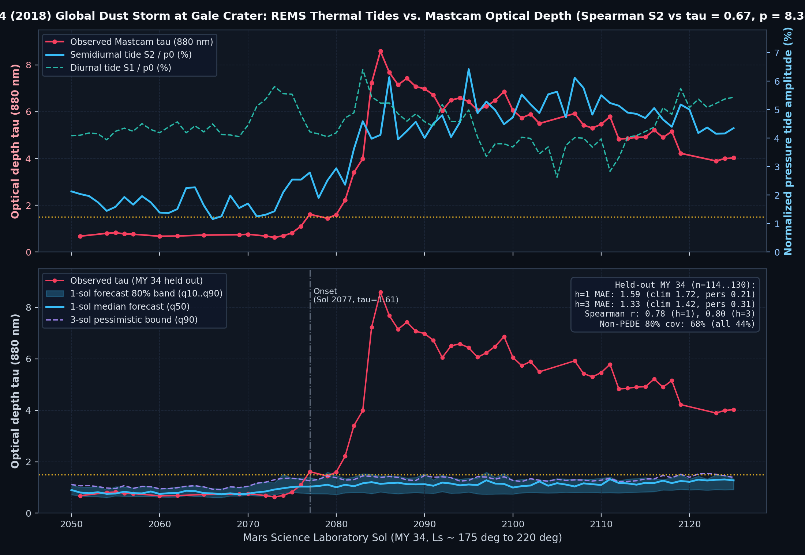

### 3. Mineral Vein Detector (`tango-horizon-veins-v1 (dinov2-small-vits14)`)

- **Task & data:** Identifies bright mineral-vein candidate signatures and 256x256 patch heatmaps on real NASA Curiosity Mastcam/MAHLI frames (`n = 117` audited images: 41 positive, 76 negative across 22 sols) using `dinov2-small-vits14` (`384`-d CLS + `32x32` patch tokens) + `StandardScaler + LogisticRegression(C=0.5, class_weight='balanced')` (with Gabor/morphological fallback). Never run on synthetic 3D renders.
- **Validation (5-fold `GroupKFold grouped by sol` + 500-run permutation test):** ROC-AUC = **0.8453**, PR-AUC = **0.7961** (vs. `0.3504` base rate), F1 = **0.7200** (Precision **0.7941**, Recall **0.6585**), permutation `p = 0.0020` (null AUC `0.4925 ± 0.0710`).
- **Details & plots:** [docs/VEIN_DETECTOR_METRICS.md](docs/VEIN_DETECTOR_METRICS.md) · 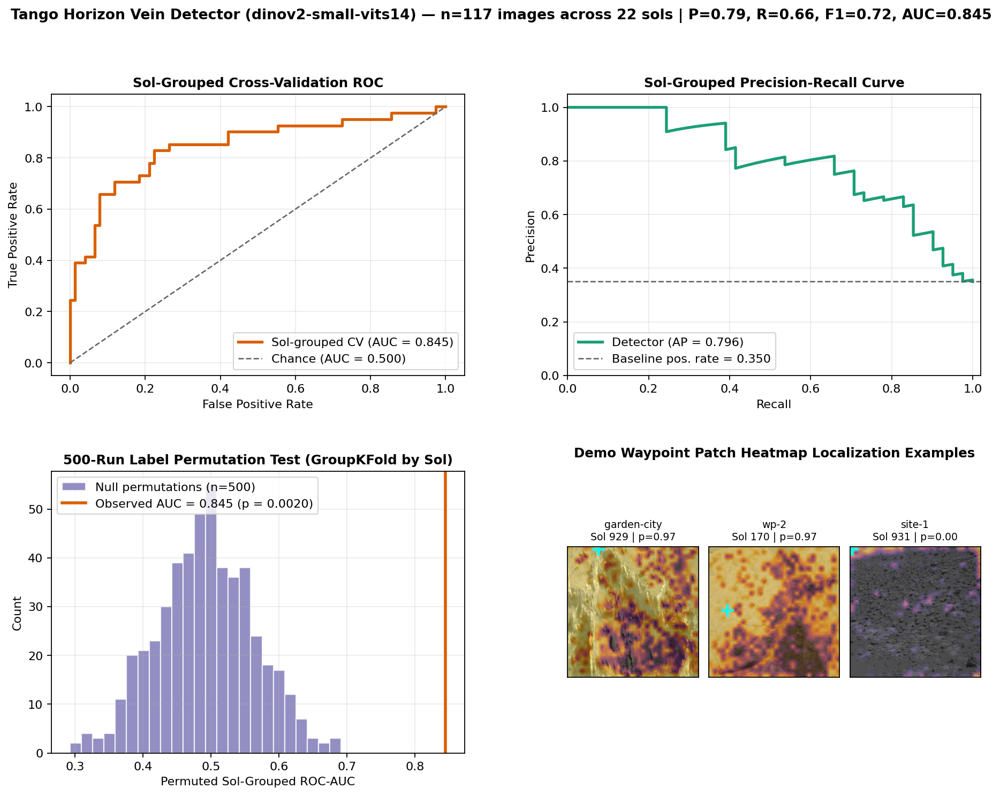
<!-- END AUTO:MODELS -->

## Known Limitations

- **Orbital & Surface Resolution Floor:** Terrain meshes cover a 4 km × 4 km Gale Crater box anchored to `1 m/px` HiRISE DTMs (resampled to `2048 × 2048` height / `4096 × 4096` ortho), while CRISM hydration inputs (`18–36 m/px`), CTX geomorphometry (`20 m/px`), and THEMIS IR (`100 m/px`) cannot resolve sub-20 m outcrops or small rocks.
- **Direct-Beam Solar & Planar Radiation Simplification:** `solar.ts` computes direct-beam extinction `exp(-tau / mu)` without diffuse sky-scattering terms, and `dose.ts` combines Curiosity MSL RAD silicon absorbed dose rates with 10 m-cell horizon sky-view factors (`SVF`) rather than full MCNPX 3D regolith transport.
- **Relative Hydration Indicator:** `tango-horizon-hydration-v1` predicts the background-subtracted MSL DAN thermal-to-epithermal net count ratio along the Curiosity traverse; it reflects near-surface H/OH moderation convolved with soil neutron absorbers (Fe/Cl) rather than absolute wt% water or shallow ground ice.
- **Single-Station Dust Nowcast:** `rems_hgbr_quantile_v1` infers dust trends solely from Gale Crater REMS surface meteorology and cannot simulate global dust transport or extrapolate above training-year opacity bounds without wider uncertainty intervals.
- **Visual-Only Vein Detection:** `tango-horizon-veins-v1` is strictly calibrated for real NASA Mastcam/MAHLI photographs (never synthetic 3D renders) and detects visual bright-vein signatures only; elemental/mineral identification still requires active LIBS (`ChemCam`) or XRD (`CheMin`).
- **Biomedical & FDIR Advisory Scope:** Crew physiological evaluations in `biomed.ts` and `SUIT.HEALTH` are decision-support advisories anchored to `NASA-STD-3001` thresholds and never replace flight-surgeon clinical diagnosis or telemetric command authority.

## NASA Space Apps Challenge Links

- **Team:** https://www.spaceappschallenge.org/2026/find-a-team/tango-horizon/?tab=project
- **Universidad de Palermo video (Facebook):** https://www.facebook.com/universidaddepalermo/videos/as%C3%AD-se-vivi%C3%B3-el-nasa-space-apps-challenge-en-la-upla-universidad-de-palermo-fue-/1829309231323121/
- **Instagram reel:** https://www.instagram.com/reels/DgH_go-JCgu/
- **Post on X (Universidad de Palermo):** https://x.com/udepalermo/status/2125210609981456661
- **Local Event — [Universidad de Palermo](https://www.palermo.edu/) (Buenos Aires, Argentina) Node:** https://www.spaceappschallenge.org/2026/local-events/buenos-aires/
- **Challenge — Interplanetary Survival Guide: Martian Map:** https://www.spaceappschallenge.org/2026/challenges/interplanetary-survival-guide-martian-map/
- **Rules (Participant Terms & Conditions):** https://www.spaceappschallenge.org/legal/
- **Project Submission Guide:** https://www.spaceappschallenge.org/resources/project-submission-guide/
- **Participant Resources & FAQs:** https://www.spaceappschallenge.org/resources/ · https://www.spaceappschallenge.org/resources/participant-faqs/
- **Space Apps Challenge:** https://www.spaceappschallenge.org/

## AI Usage

### AI-assisted development methodology (Software 3.0 — AFAW)

This project was built with AI-assisted development in the Software 3.0 style using our own [**AFAW (Anti-Fragile Agentic Workflow)**](https://github.com/agustindiazcano/afaw-anti-fragile-agentic-workflow) methodology for multi-agent coordination: AI coding agents took part in the whole development process (implementation, tests, CI/CD, pull requests, commits and documentation validated and designed by human, deploy), under human direction and review.

- **Multi-agent coordination methodology:** [**AFAW — Anti-Fragile Agentic Workflow**](https://github.com/agustindiazcano/afaw-anti-fragile-agentic-workflow) (author's methodology for coordinating multiple autonomous coding agents with shared contracts, worktree isolation, atomic commits, and human-in-the-loop verification)
- **Coding agents:** Codex, Claude Code, Gemini Antigravity, IBM Bob, Meta Muse
- **Parallel orchestration & isolation:** Multiple agents running in parallel via an orchestrator coordinating medium-tier models, each in its own git worktree and branch to avoid conflicts, plus a code reviewer agent
- **Workflow AI:** ChatGPT, Gemini, Google AI Studio, Grok

**Contracts for agent context.** Agents receive their context through contract files: [`AGENTS.md`](AGENTS.md) (rules), [`PENDING.md`](PENDING.md) (prioritized open tasks) and [`LASTCONTEXT.md`](LASTCONTEXT.md) (latest state and next step). Every task updates [`PENDING.md`](PENDING.md) and [`LASTCONTEXT.md`](LASTCONTEXT.md) so the next agent starts from the same state.

**Human responsibility (human in the loop).** All plan, code review, data validation, designs, mathematical formulations, implementations and empirical results were audited and verified by the authors.

## Technologies & Local Run Commands

| Layer | Technologies |
|---|---|
| Frontend & 3D Viewer | TypeScript, Vite, Three.js (`three` WebGL2), CSS 3D curved HUD, Web Speech API, Web Audio API, `qrcode`, `@vercel/analytics` |
| Backend & Agent Runtime | Node.js 22, Fastify 5 (`@fastify/static`, `@fastify/websocket`, `@fastify/rate-limit`), `@modelcontextprotocol/sdk` (`InMemoryTransport`), Zod, `openai` SDK, `google-auth-library` |
| Shared Physics & Testing | TypeScript (`@th/shared`: deterministic physics, schemas, 5-language i18n), Vitest (`vitest`) |
| Data Science & GIS Pipeline | Python 3, NumPy, Pandas, SciPy, scikit-learn, PyTorch, Hugging Face `transformers`, Pillow, Matplotlib, Rasterio, PyProj, PyMuPDF, `meshoptimizer` |
| Google Cloud & Hosting | Terraform (`infra/terraform/`), Cloud Run, Cloud Build, Artifact Registry, Secret Manager, Vertex AI, Cloud Text-to-Speech, Vercel, GitHub Actions |

### Run Locally

```bash
npm install
npm run dev:web   # Starts @th/server (:8080) and @th/web (:5174)
npm test             # Runs shared, server (offline mode), and web tests
npm run build        # Type-checks and builds all workspaces
python tools/generate_readme.py --check   # Verifies auto-generated README tables
```

## License

Copyright (c) 2026 Agustin Diaz-Cano, Baltazar Salerno, Milagros Sotelo and Federico Yaconis (Team Tango Horizon).

- **Software Code:** Licensed under the [MIT License](LICENSE).
- **3D Models (`web/public/models/*.glb` created by Team Tango Horizon):** All original 3D models created by Team Tango Horizon are **free to use** for **personal, educational, commercial, and illustration** purposes under the [Creative Commons Attribution 4.0 International (CC BY 4.0)](LICENSE-3D-ASSETS-CC-BY-4.0.md) license (`https://creativecommons.org/licenses/by/4.0/`). Third-party models from [NASA 3D Resources](https://github.com/nasa/NASA-3D-Resources) (`ingenuity.glb`, `mro.glb`, `rover.glb`) remain governed by NASA media guidelines.
