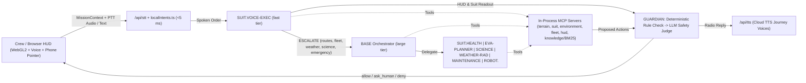
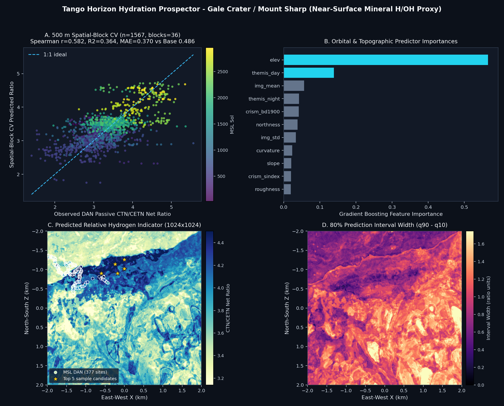

[](README_ES.md)

<sub>This effort is supported by [NASA](https://www.nasa.gov/), [NASA Space Apps Challenge](https://www.spaceappschallenge.org/), [CONAE](https://www.argentina.gob.ar/ciencia/conae), [Universidad de Palermo](https://www.palermo.edu/) & [IBM Argentina](https://www.ibm.com/ar-es).</sub><br/>
<sub>All project development took place within the hackathon window starting Nov 14, 2026 at 09:00 ART (UTC-3), verifiable by repository creation (2026-11-14 16:56:55 UTC), commit hashes (initial commit [a3f7a4e](https://github.com/agustindiazcano/nasa-mars-tango-horizon/commit/a3f7a4e7d0bfa7ba5677b80eec3c6523eb61433b)), and [Pull Requests](https://github.com/agustindiazcano/nasa-mars-tango-horizon/pulls?q=is%3Apr).</sub>

# Tango Horizon: AI Systems for EVA and Mars Exploration

**Autonomous Multi-Agent AI Systems for Extravehicular Activities (EVA)** — Real-time 3D Mars surface operations simulator over NASA/USGS Gale Crater cartography, pairing deterministic bioastronautics/physics (`@th/shared`) and hands-free multilingual voice control with a hierarchical Multi-Agent AI System guarded by Run-Time Assurance (`GUARDIAN`).

**Live Demo:** [https://tangohorizon.vercel.app](https://tangohorizon.vercel.app)

## Index

- [Team: Tango Horizon (Buenos Aires, Argentina)](#team-tango-horizon-buenos-aires-argentina)
- [NASA Space Apps Challenge Links](#nasa-space-apps-challenge-links)
- [System Architecture & Multi-Agent Runtime](#system-architecture--multi-agent-runtime)
- [NASA & USGS Data Used](#nasa--usgs-data-used)
- [Deterministic Physics Models](#deterministic-physics-models)
- [Physics & Engineering Constants](#physics--engineering-constants)
- [Our Models & Empirical Validation](#our-models--empirical-validation)
- [Known Limitations](#known-limitations)
- [AI Usage](#ai-usage)
- [Technologies & Local Run Commands](#technologies--local-run-commands)
- [License](#license)

## Team: Tango Horizon (Buenos Aires, Argentina)

- **Agustin Diaz Cano:** MS Candidate, Systems Engineering ([UTN, FRBA](https://frba.utn.edu.ar/)) · [LinkedIn](https://www.linkedin.com/in/agustindiazcano/) · [Portfolio](https://www.agustindiazcano.com/) · [GitHub](https://github.com/agustindiazcano) · [Qollab](https://qollab.xyz/u/agustindiazcano) · [YouTube](https://www.youtube.com/@agustin-diaz-cano)
- **Baltazar Salerno:** Frontend Developer · [GitHub](https://github.com/S-Baltazar)
- **Milagros Sotelo:** Systems Engineering Student ([UTN, FRBA](https://frba.utn.edu.ar/)) · [GitHub](https://github.com/Milagros-Sotelo)
- **Federico Yaconis:** 3D Developer & QA

## NASA Space Apps Challenge Links

- **Team:** https://www.spaceappschallenge.org/2026/find-a-team/tango-horizon/?tab=project
- **Local Event — [Universidad de Palermo](https://www.palermo.edu/) (Buenos Aires, Argentina) Node:** https://www.spaceappschallenge.org/2026/local-events/buenos-aires/
- **Challenge — Interplanetary Survival Guide: Martian Map:** https://www.spaceappschallenge.org/2026/challenges/interplanetary-survival-guide-martian-map/
- **Rules (Participant Terms & Conditions):** https://www.spaceappschallenge.org/legal/
- **Project Submission Guide:** https://www.spaceappschallenge.org/resources/project-submission-guide/
- **Participant Resources & FAQs:** https://www.spaceappschallenge.org/resources/ · https://www.spaceappschallenge.org/resources/participant-faqs/
- **Space Apps Challenge:** https://www.spaceappschallenge.org/

## System Architecture & Multi-Agent Runtime

Tango Horizon keeps the browser WebGL2 simulation (`web-test-3d/` / `web/`) as the single source of truth for mission telemetry, rendering the 4 km × 4 km Gale Crater HiRISE DTM with 5 overlay rasters, curved helmet CSS3D HUD, hands-free multilingual voice (`EN`/`ES`/`FR`/`DE`/`IT`), and a QR-paired mobile pointer (`remote.html` over `/ws/remote`). Each spoken or text order passes a JSON `MissionContext` snapshot to the stateless Fastify server (`server/`), which executes tool calls across six in-process MCP servers (`InMemoryTransport`), an in-memory BM25 corpus (`NASA-STD-3001` Vol. 1 & 2, `OCHMO` briefs, `AMCL`, `Mars-GRAM`, `MOXIE`), and `GUARDIAN` before returning approved actions.



- **3-Provider LLM Failover (`server/src/llm/provider.ts`):** Automatic failover across Google Cloud Vertex AI (primary via ADC: `google/gemini-4-carbon`, `google/gemini-4-argon`, `google/gemini-4-hydrogen`), Google AI Studio, and Meta Muse API (`muse-wonder-1.0`, `muse-spark-1.3`), backed by a deterministic offline execution engine (`offline.ts`).
- **GUARDIAN Run-Time Assurance (`server/src/agents/guardian.ts`):** Enforces vehicle slope limits, a 15 m ballistic O2 pod keep-out radius, 2 m manipulator arm clearance around crew, rotorcraft dust-opacity grounding (`tau >= 1.8`), non-pyrotechnic beacon rules near 100% O2 suits, and contextual LLM safety verification before actions reach the browser.

## NASA & USGS Data Used

<!-- BEGIN AUTO:DATA -->
Tracked runtime assets in `web/public/data/provenance.json` (**37 entries**; SHA-256 checksums and CRS transforms recorded in the manifest):

| Asset | Source | Product / Model ID | Retrieved / Ref |
|---|---|---|---|
| `terrain/height_2048.u16` | USGS Astrogeology, MRO HiRISE SOCET DTMs (NASA/JPL/University of Arizona/USGS) | `DTEEC_009149_1750_009294_1750_U01` | 2026-11-14 · [link](https://astrogeo-ard.s3-us-west-2.amazonaws.com/mars/mro/hirise/controlled/dtm/PSP_009149_1750_PSP_009294_1750/DTEEC_009149_1750_009294_1750_U01.tif) |
| `terrain/meta.json` | USGS Astrogeology, MRO HiRISE SOCET DTMs (NASA/JPL/University of Arizona/USGS) | `DTEEC_009149_1750_009294_1750_U01` | 2026-11-14 · [link](https://astrogeo-ard.s3-us-west-2.amazonaws.com/mars/mro/hirise/controlled/dtm/PSP_009149_1750_PSP_009294_1750/DTEEC_009149_1750_009294_1750_U01.tif) |
| `terrain/svf_1024.png` | USGS Astrogeology, MRO HiRISE SOCET DTMs (NASA/JPL/University of Arizona/USGS) | `DTEEC_009149_1750_009294_1750_U01` | 2026-11-14 · [link](https://astrogeo-ard.s3-us-west-2.amazonaws.com/mars/mro/hirise/controlled/dtm/PSP_009149_1750_PSP_009294_1750/DTEEC_009149_1750_009294_1750_U01.tif) |
| `terrain/slope_1024.png` | USGS Astrogeology, MRO HiRISE SOCET DTMs (NASA/JPL/University of Arizona/USGS) | `DTEEC_009149_1750_009294_1750_U01` | 2026-11-14 · [link](https://astrogeo-ard.s3-us-west-2.amazonaws.com/mars/mro/hirise/controlled/dtm/PSP_009149_1750_PSP_009294_1750/DTEEC_009149_1750_009294_1750_U01.tif) |
| `terrain/ortho_4096.webp` | USGS Astrogeology, MRO HiRISE SOCET DTMs (NASA/JPL/University of Arizona/USGS) | `DTEEC_009149_1750_009294_1750_U01` | 2026-11-14 · [link](https://astrogeo-ard.s3-us-west-2.amazonaws.com/mars/mro/hirise/controlled/dtm/PSP_009149_1750_PSP_009294_1750/PSP_009149_1750_RED_A_01_ORTHO.tif) |
| `terrain/thermal_class.png` | USGS Astrogeology / ASU, Mars Odyssey THEMIS Controlled Night IR Mosaic (mc23_aeolis_nir) | `mc23_aeolis_nir` | 2026-11-14 · [link](https://astrogeo-ard.s3.us-west-2.amazonaws.com/mars/mo/themis/controlled_mosaics/mc23_aeolis_nir/mc23_aeolis_nir.tif) |
| `env/ephem.json` | NASA/JPL Horizons System (DE441 / mar099) | `Target 399 (Earth) w.r.t. 499 (Mars) + Target 10 (Sun) at Gale site` | 2026-11-14 · [link](https://ssd.jpl.nasa.gov/api/horizons.api) |
| `env/rad_quiet.json` | NASA/SwRI PDS-PPI, MSL RAD RDR V1.0 (MSL-M-RAD-3-RDR-V1.0) | `RAD_RDR_2017_213-219 (Sols 1773-1779)` | 2026-11-14 · [link](https://pds-ppi.igpp.ucla.edu/data/MSL-M-RAD-3-RDR-V1.0/DATA/SOL_01773_01869/) |
| `env/rad_sep2017.json` | NASA/SwRI PDS-PPI, MSL RAD RDR V1.0 (MSL-M-RAD-3-RDR-V1.0) | `RAD_RDR_2017_252-258 (Sols 1811-1817)` | 2026-11-14 · [link](https://pds-ppi.igpp.ucla.edu/data/MSL-M-RAD-3-RDR-V1.0/DATA/SOL_01773_01869/) |
| `env/rems_clear.json` | NASA/CAB PDS Atmospheres, MSL REMS MODRDR V1.0 (mslrem_1001) | `SOL02004-SOL02006 RMD` | 2026-11-14 · [link](https://atmos.nmsu.edu/PDS/data/mslrem_1001/DATA/SOL_02004_02127/) |
| `env/rems_storm2018.json` | NASA/CAB PDS Atmospheres, MSL REMS MODRDR V1.0 (mslrem_1001) | `SOL02060-SOL02090 RMD` | 2026-11-14 · [link](https://atmos.nmsu.edu/PDS/data/mslrem_1001/DATA/SOL_02004_02127/) |
| `terrain/hydration_1024.png` | Gradient Boosting ensemble (tango-horizon-hydration-v1) trained on MSL DAN passive neutron counts (PDS Geosciences MSL-M-DAN-3/4-RDR-V1.0) with MRO CRISM MTRDR (BD1900_2, SINDEX2), Mars Odyssey THEMIS IR (mc23_aeolis_nir, mc23_aeolis_dir), and MRO CTX DTM/DRG (USGS STAC) | `tango-horizon-hydration-v1` | 2026-11-14 · [link](https://pds-geosciences.wustl.edu/msl/msl-m-dan-3_4-rdr-v1/msldan_1000/data/) |
| `veins/index.json` | Own classifier (frozen DINOv2-small features + sol-grouped logistic regression) on MSL Mastcam/MAHLI images (NASA/JPL-Caltech/MSSS) | `tango-horizon-veins-v1` | 2026-11-14 · [link](https://mars.nasa.gov/api/v1/raw_image_items/) |
| `env/storm_forecast.json` | NASA/CAB PDS Atmospheres MSL REMS MODRDR V1.0 (mslrem_1001) + MSL Mastcam-100 Optical Depths (msl_mmm_tau_bundle, Lemmon 2024) | `mslrem_1001 (Sols 1-3953) + msl_tau_880.csv (doi:10.17189/fjh0-2978)` | 2026-11-14 · [link](https://atmos.nmsu.edu/PDS/review/PDS4/msl_mmm_tau_bundle/data_derived/msl_tau_880.csv) |
| `terrain/hydration_unc_1024.png` | Gradient Boosting ensemble (tango-horizon-hydration-v1) trained on MSL DAN passive neutron counts (PDS Geosciences MSL-M-DAN-3/4-RDR-V1.0) with MRO CRISM MTRDR (BD1900_2, SINDEX2), Mars Odyssey THEMIS IR (mc23_aeolis_nir, mc23_aeolis_dir), and MRO CTX DTM/DRG (USGS STAC) | `tango-horizon-hydration-v1` | 2026-11-14 · [link](https://pds-geosciences.wustl.edu/msl/msl-m-dan-3_4-rdr-v1/msldan_1000/data/) |
| `terrain/hydration_meta.json` | Gradient Boosting ensemble (tango-horizon-hydration-v1) trained on MSL DAN passive neutron counts (PDS Geosciences MSL-M-DAN-3/4-RDR-V1.0) with MRO CRISM MTRDR (BD1900_2, SINDEX2), Mars Odyssey THEMIS IR (mc23_aeolis_nir, mc23_aeolis_dir), and MRO CTX DTM/DRG (USGS STAC) | `tango-horizon-hydration-v1` | 2026-11-14 · [link](https://pds-geosciences.wustl.edu/msl/msl-m-dan-3_4-rdr-v1/msldan_1000/data/) |
| `terrain/hydration_sites.json` | Gradient Boosting ensemble (tango-horizon-hydration-v1) trained on MSL DAN passive neutron counts (PDS Geosciences MSL-M-DAN-3/4-RDR-V1.0) with MRO CRISM MTRDR (BD1900_2, SINDEX2), Mars Odyssey THEMIS IR (mc23_aeolis_nir, mc23_aeolis_dir), and MRO CTX DTM/DRG (USGS STAC) | `tango-horizon-hydration-v1-sites` | 2026-11-14 · [link](https://pds-geosciences.wustl.edu/msl/msl-m-dan-3_4-rdr-v1/msldan_1000/data/) |
| `veins/manifest.json` | Own classifier (frozen DINOv2-small features + sol-grouped logistic regression) on MSL Mastcam/MAHLI images (NASA/JPL-Caltech/MSSS) | `tango-horizon-veins-v1` | 2026-11-14 · [link](https://mars.nasa.gov/api/v1/raw_image_items/) |
| `models/ingenuity.glb` | NASA 3D Resources (Ingenuity Mars Helicopter) | `ingenuity` | 2026-11-14 · [link](https://raw.githubusercontent.com/nasa/NASA-3D-Resources/master/3D%20Models/Ingenuity%20Mars%20Helicopter/Ingenuity%20Mars%20Helicopter.glb) |
| `models/mro.glb` | NASA 3D Resources (Mars Reconnaissance Orbiter) | `mro` | 2026-11-14 · [link](https://raw.githubusercontent.com/nasa/NASA-3D-Resources/master/3D%20Models/Mars%20Reconnaissance%20Orbiter%20(MRO)%20(A)/Mars%20Reconnaissance%20Orbiter%20(MRO)%20(A).glb) |
| `models/rover.glb` | NASA 3D Resources (Mars 2020 Perseverance Rover, MSL/Curiosity-class chassis) | `rover` | 2026-11-14 · [link](https://raw.githubusercontent.com/nasa/NASA-3D-Resources/master/3D%20Models/Mars%202020%20Perseverance%20Rover/Mars%202020%20Perseverance%20Rover.glb) |
| `veins/*_DXXX.jpg` (8 frames) | NASA/JPL-Caltech/MSSS (MSL Curiosity Raw Images API) | MSL Mastcam/MAHLI Sols 170–1190 | 2026-11-14 |
| `veins/*_heat.png` (8 maps) | Own classifier (frozen DINOv2-small features + sol-grouped logistic regression) on MSL Mastcam/MAHLI images (NASA/JPL-Caltech/MSSS) | `tango-horizon-veins-v1` (256x256) | 2026-11-14 |
<!-- END AUTO:DATA -->

## Deterministic Physics Models

<!-- BEGIN AUTO:PHYSICS -->
| Domain | Formulation Summary | Reference / Basis | Implementation | Tests |
|---|---|---|---|---|
| Metabolic rate & O2/CO2 demand | `M = 1.5 W + k * [2.0(W + L)(L/W)^2 + eta(W + L)(1.5 v^2 + 0.35 v G)]` (`k = g_mars/g_earth`, floored at `1.5 W`, Santee `G < 0` downhill CF) | Pandolf et al. (1977) + Santee et al. (2001) scaled by `g_mars/g_earth`; NASA-STD-3001 Vol 2 | [metabolic.ts](shared/src/physics/metabolic.ts) | [physics.test.ts](shared/src/physics/__tests__/physics.test.ts) |
| Choked orifice leak & alveolar pO2 | `m_dot = C_d A P sqrt(gamma/(R T)) (2/(gamma+1))^((gamma+1)/(2(gamma-1)))`; `P_AO2 = P_suit - P_H2O - P_aCO2` | Compressible choked orifice flow; NASA-STD-3001 Vol 2 Rev E (Armstrong 6.27 kPa, `P_AO2 = 8.0 kPa` impaired) | [suitLeak.ts](shared/src/physics/suitLeak.ts) | [physics.test.ts](shared/src/physics/__tests__/physics.test.ts) |
| 1 Hz PLSS state & live suit telemetry | Fixed-step primary/reserve O2 draw, emergency regulator makeup, CO2 scrubber, fan RPM, battery Wh & coolant L | NASA-STD-3001 Vol 2; Apollo/xEMU design bounds | [suitState.ts](shared/src/physics/suitState.ts), [suitTelemetry.ts](shared/src/physics/suitTelemetry.ts) | [physics.test.ts](shared/src/physics/__tests__/physics.test.ts) |
| Martian atmosphere & solar extinction | `rho0 = P/(R_mars T)`, `rho(h) = rho0 exp(-h/H)`, log wind shear `u(h)`, direct beam `exp(-tau/mu)` | MSL REMS; `mars_solar_toa = 589.2 W/m^2`; direct-beam-only model | [atmosphere.ts](shared/src/physics/atmosphere.ts), [solar.ts](shared/src/physics/solar.ts) | [physics.test.ts](shared/src/physics/__tests__/physics.test.ts) |
| Geometric SVF radiation & albedo dose | `D_dot = D_0 * svf`; albedo backscatter `D_0 * (svf + beta * (1 - svf))` (`beta = 0.09`) | MSL-M-RAD-3-RDR-V1.0 (SwRI PDS-PPI); geometric SVF assumption | [dose.ts](shared/src/physics/dose.ts) | [physics.test.ts](shared/src/physics/__tests__/physics.test.ts) |
| RK4 ballistic pod & parachute delivery | 3D gravity + quadratic atmospheric drag + log wind shear; parachute deploy `< 120 m`; Monte Carlo landing ellipse | Mars ballistic/chute design model (`g_mars = 3.711 m/s^2`, `15 m` crew keep-out) | [ballistic.ts](shared/src/physics/ballistic.ts), [podDelivery.ts](shared/src/physics/podDelivery.ts) | [physics.test.ts](shared/src/physics/__tests__/physics.test.ts) |
| Storm go/no-go & EVA route planner (A*) | A* on DEM slope, thermal energy & SVF radiation weights; `tau >= 1.8` rotorcraft grounding; wind/dose go limits | Ingenuity flight envelope; OCHMO/RAD EVA limits | [route.ts](shared/src/physics/route.ts), [stormDecision.ts](shared/src/physics/stormDecision.ts) | [planning.test.ts](shared/src/physics/__tests__/planning.test.ts), [stormDecision.test.ts](shared/src/physics/__tests__/stormDecision.test.ts) |
| Crew biomedical EWS & time-to-breach | Weighted 0–3 subscores across `PICO2`, core temp, Physiological Strain Index, SpO2, HR, cardiac drift & hypoxia margin | NASA-STD-3001 Vol 1/2 & OCHMO-TB-004 (advisory only) | [biomed.ts](shared/src/physics/biomed.ts) | [biomed.test.ts](shared/src/physics/__tests__/biomed.test.ts) |
| Fleet/PLSS/ISRU fault detection (FDIR) | Sliding-window slope, z-score & remaining useful life (`RUL`) across fan, scrubber, thermal, rover mobility, arm & MOXIE channels | FDIR engineering envelope thresholds | [fdir.ts](shared/src/physics/fdir.ts) | [fdir.test.ts](shared/src/physics/__tests__/fdir.test.ts) |
| Environmental & space-weather risk | Diurnal `dP/dt`, air density flight check, dust visibility ETA, battery autonomy & DONKI SEP storm escalation | MSL REMS + NASA DONKI WSA-Enlil | [envNowcast.ts](shared/src/physics/envNowcast.ts) | [envNowcast.test.ts](shared/src/physics/__tests__/envNowcast.test.ts) |
<!-- END AUTO:PHYSICS -->

## Physics & Engineering Constants

<!-- BEGIN AUTO:CONSTANTS -->
Auto-extracted from `C` in [`shared/src/physics/constants.ts`](shared/src/physics/constants.ts) (**44 constants**: 18 published/standard values, 26 flagged engineering `[design assumption]` parameters):

<details>
<summary><strong>View all 44 constants and provenance flags</strong></summary>

| Constant | Value | Unit | Flag | Source |
|---|---:|---|---|---|
| `g_mars` | `3.711` | `m/s^2` | Published / Standard | NASA Mars Fact Sheet (NSSDCA) |
| `g_earth` | `9.80665` | `m/s^2` | Published / Standard | CODATA |
| `R_o2` | `259.84` | `J/(kg K)` | Published / Standard | Universal gas constant / O2 molar mass |
| `R_mars_atm` | `191.8` | `J/(kg K)` | Published / Standard | NASA Mars Fact Sheet, mean molar mass 43.34 g/mol |
| `gamma_o2` | `1.4` | `-` | Published / Standard | Ideal diatomic gas |
| `scale_height` | `11100` | `m` | Published / Standard | NASA Mars Fact Sheet |
| `o2_energy` | `20100` | `J/L` | Published / Standard | Caloric equivalent of O2 at RQ ~0.85 |
| `o2_density` | `1.429` | `g/L` | Published / Standard | O2 density at 0 C and 1 atm (STP) |
| `rq` | `0.85` | `-` | `[design assumption]` | Mixed diet respiratory quotient |
| `p_armstrong` | `6270` | `Pa` | Published / Standard | Water vapor pressure at 37 C (47 mmHg) |
| `p_h2o_alv` | `6270` | `Pa` | Published / Standard | Alveolar water vapor pressure at 37 C |
| `p_co2_alv` | `5330` | `Pa` | Published / Standard | Normal alveolar PaCO2 (40 mmHg) |
| `pao2_impaired` | `8000` | `Pa` | `[design assumption]` | PAO2 ~60 mmHg: onset of cognitive impairment |
| `pao2_critical` | `4000` | `Pa` | `[design assumption]` | PAO2 ~30 mmHg: loss of consciousness |
| `suit_p_nominal` | `29600` | `Pa` | Published / Standard | 4.3 psi, nominal NASA EVA suit pressure (NASA-STD-3001) |
| `suit_volume` | `0.135` | `m^3` | `[design assumption]` | Free gas volume inside pressurized suit |
| `suit_mass` | `65` | `kg` | `[design assumption]` | Martian surface EVA suit mass |
| `discharge_cd` | `0.62` | `-` | Published / Standard | Sharp-edged orifice discharge coefficient |
| `mars_solar_toa` | `589.2` | `W/m^2` | Published / Standard | NASA Mars Fact Sheet (mean solar irradiance at 1.524 AU) |
| `mars_sol_s` | `88775` | `s` | Published / Standard | NASA Mars Fact Sheet (mean Martian solar day) |
| `rad_gcr_baseline` | `27.0` | `uSv/h` | Published / Standard | MSL RAD quiet-time surface dose equivalent rate (Hassler et al., 2014) |
| `rad_albedo_beta` | `0.09` | `-` | `[design assumption]` | Martian regolith secondary albedo backscatter factor |
| `z0_rocky_plain` | `0.01` | `m` | `[design assumption]` | Aerodynamic roughness length for rocky Martian plain |
| `pod_keepout_m` | `15` | `m` | `[design assumption]` | Minimum safe drop-pod landing keep-out radius around crew |
| `pod_max_landing_speed_ms` | `15` | `m/s` | `[design assumption]` | Maximum rated impact speed for life-support pod payload |
| `pod_mass_kg` | `8.0` | `kg` | `[design assumption]` | Multi-consumable EVA emergency pod total mass (4.0 kg O2 COPV + 1.2 kg LiOH + 1.0 kg battery + 0.35 kg patch + 1.45 kg aeroshell/chute) |
| `pod_o2_copv_kg` | `4.0` | `kg` | `[design assumption]` | High-pressure O2 COPV assembly (1.00 kg O2 gas + 2.46 kg COPV dry mass at gamma_O2=2.46 + 0.54 kg regulator/umbilical, NASA xPLSS study) |
| `pod_o2_usable_kg` | `1.0` | `kg` | `[design assumption]` | Usable breathable O2 gas in emergency pod COPV (~3,000 psi / 20.7 MPa) |
| `pod_co2_scrubber_kg` | `1.2` | `kg` | `[design assumption]` | Single-use emergency LiOH CO2 scrubber cartridge (2-3 h contingency bypass) |
| `pod_battery_pack_kg` | `1.0` | `kg` | `[design assumption]` | Emergency Li-ion thermal/avionics battery pack (200 Wh at 200 Wh/kg) |
| `pod_patch_kit_kg` | `0.35` | `kg` | `[design assumption]` | Viscoelastic RTV/HybridSil cure-in-place suit breach patch + Nomex/Kapton mechanical clamp |
| `pod_aeroshell_chute_kg` | `1.45` | `kg` | `[design assumption]` | Crushable honeycomb aeroshell, drogue/main parachute (cdA=18.0 m^2), and UWB recovery beacon |
| `pod_chute_cda_m2` | `18.0` | `m^2` | `[design assumption]` | Parachute drag area sizing for 8.0 kg pod (terminal speed ~13.5 m/s <= 15 m/s at rho=0.018 kg/m^3) |
| `beacon_puck_mass_kg` | `0.25` | `kg` | `[design assumption]` | Non-pyrotechnic solid-state LED/laser + UWB breadcrumb beacon puck (NASA JPL CoSTAR / RTCM 13200.0 eVDSD class) |
| `beacon_spacing_m` | `50` | `m` | `[design assumption]` | Nominal breadcrumb beacon spacing along emergency return path |
| `beacon_uwb_freq_ghz` | `6.5` | `GHz` | Published / Standard | IEEE 802.15.4z UWB Channel 5 time-of-flight ranging frequency |
| `beacon_strobe_hz` | `1.5` | `Hz` | Published / Standard | RTCM 13200.0 eVDSD solid-state optical strobe flash rate (505 nm cyan + 615 nm red-orange + 850 nm NIR) |
| `beacon_homing_tone_hz` | `880` | `Hz` | `[design assumption]` | Acoustic ILS-style radio-homing pulse frequency in crew headset |
| `suit_o2_primary_kg` | `0.91` | `kg` | `[design assumption]` | Nominal EVA primary O2 tank capacity |
| `suit_o2_reserve_kg` | `0.54` | `kg` | `[design assumption]` | Nominal EVA secondary/SOP O2 reserve capacity |
| `suit_battery_wh` | `900` | `Wh` | `[design assumption]` | Nominal EVA PLSS battery capacity |
| `suit_coolant_l` | `4.5` | `L` | `[design assumption]` | Nominal EVA LCVG sublimator feedwater reserve |
| `suit_co2_limit_pa` | `1013` | `Pa` | `[design assumption]` | Contingency inspired CO2 upper bound (~7.6 mmHg) |
| `pandolf_mars_scaling` | `1` | `-` | `[design assumption]` | Pandolf-Santee weight terms scaled by g_mars/g_earth; unvalidated at 0.38 g pressurized suit |

</details>
<!-- END AUTO:CONSTANTS -->

## Our Models & Empirical Validation

<!-- BEGIN AUTO:MODELS -->
All three domain models are trained offline by Python scripts in [`tools/`](tools/), evaluated under leakage-free grouped cross-validation or held-out storm years, and verified in CI artifacts without runtime cloud training.

### 1. Hydration Prospector (`tango-horizon-hydration-v1`)

- **Task & data:** Predicts background-subtracted MSL DAN thermal/epithermal net neutron ratio (`(CTN - CTN_BKGD) / (CETN - CETN_BKGD)`, dimensionless relative H/OH indicator — *not* wt% liquid water) across the 4x4 km Gale Crater scene from CRISM MTRDR (`BD1900_2`, `SINDEX2`), THEMIS Day/Night IR, CTX ortho/DTM geomorphometry, and Curiosity traverse measurements (`n = 1567` stops, 36 spatial blocks of 500 m).
- **Validation (5-fold 500 m spatial-block `GroupKFold`):** Spearman = **0.5823** (`p = 6.845e-143`), Blocked `R²` = **0.3638**, MAE = **0.3695** vs. block-mean baseline MAE = **0.4860**. Top features: `elev` (0.566), `themis_day` (0.139), `img_mean` (0.056).
- **Details & plots:** [docs/HYDRATION_METRICS.md](docs/HYDRATION_METRICS.md) · 

### 2. Storm Nowcaster (`rems_hgbr_quantile_v1`)

- **Task & data:** Quantile `HistGradientBoostingRegressor` (`q = 0.1, 0.5, 0.9`) with Conformalized Quantile Regression (CQR) predicting Mastcam 880 nm dust opacity `tau` +1, +2, and +3 sols ahead from 28 MSL REMS daily surface tide and meteorology features (held-out test year: **MY 34** global dust storm; 76-sol replay window).
- **Tide physics verification (MY 34 storm window, `n = 58` sols):** Semidiurnal pressure tide `s2_amp` rises from `0.01727` to `0.0642` (`tau_max = 8.589`); `Spearman(s2_amp, tau) = 0.6709` (`p = 8.308e-09`).

| Horizon | Train / Test Sols | MAE Model | MAE Climatology | MAE Persistence | Spearman | 80% Cov (CQR / non-PEDE) |
|---|---:|---:|---:|---:|---:|---:|
| +1 sol | 835 / 114 | 1.587 | 1.718 | 0.210 | 0.777 | 0.439 / 0.676 |
| +2 sol | 742 / 116 | 1.524 | 1.634 | 0.280 | 0.765 | 0.491 / 0.740 |
| +3 sol | 902 / 130 | 1.332 | 1.420 | 0.313 | 0.796 | 0.523 / 0.723 |

- **Baseline note:** Beats 10-deg `Ls` seasonal climatology at all three horizons (`h = 1, 2, 3`), while single-station surface meteorology does not beat persistence (`MAE 0.210–0.313`) when extrapolating above training-set regional opacity into MY 34 peak opacity (`tau = 8.59`). Displayed as a trend and early-warning indicator.
- **Details & plots:** [docs/STORM_NOWCASTER_METRICS.md](docs/STORM_NOWCASTER_METRICS.md) · 

### 3. Mineral Vein Detector (`tango-horizon-veins-v1 (dinov2-small-vits14)`)

- **Task & data:** Identifies bright mineral-vein candidate signatures and 256x256 patch heatmaps on real NASA Curiosity Mastcam/MAHLI frames (`n = 117` audited images: 41 positive, 76 negative across 22 sols) using `dinov2-small-vits14` (`384`-d CLS + `32x32` patch tokens) + `StandardScaler + LogisticRegression(C=0.5, class_weight='balanced')` (with Gabor/morphological fallback). Never run on synthetic 3D renders.
- **Validation (5-fold `GroupKFold grouped by sol` + 500-run permutation test):** ROC-AUC = **0.8453**, PR-AUC = **0.7961** (vs. `0.3504` base rate), F1 = **0.7200** (Precision **0.7941**, Recall **0.6585**), permutation `p = 0.0020` (null AUC `0.4925 ± 0.0710`).
- **Details & plots:** [docs/VEIN_DETECTOR_METRICS.md](docs/VEIN_DETECTOR_METRICS.md) · 
<!-- END AUTO:MODELS -->

## Known Limitations

- **Orbital & Surface Resolution Floor:** Terrain meshes cover a 4 km × 4 km Gale Crater box anchored to `1 m/px` HiRISE DTMs (resampled to `2048 × 2048` height / `4096 × 4096` ortho), while CRISM hydration inputs (`18–36 m/px`), CTX geomorphometry (`20 m/px`), and THEMIS IR (`100 m/px`) cannot resolve sub-20 m outcrops or small rocks.
- **Direct-Beam Solar & Planar Radiation Simplification:** `solar.ts` computes direct-beam extinction `exp(-tau / mu)` without diffuse sky-scattering terms, and `dose.ts` combines Curiosity MSL RAD silicon absorbed dose rates with 10 m-cell horizon sky-view factors (`SVF`) rather than full MCNPX 3D regolith transport.
- **Relative Hydration Indicator:** `tango-horizon-hydration-v1` predicts the background-subtracted MSL DAN thermal-to-epithermal net count ratio along the Curiosity traverse; it reflects near-surface H/OH moderation convolved with soil neutron absorbers (Fe/Cl) rather than absolute wt% water or shallow ground ice.
- **Single-Station Dust Nowcast:** `rems_hgbr_quantile_v1` infers dust trends solely from Gale Crater REMS surface meteorology and cannot simulate global dust transport or extrapolate above training-year opacity bounds without wider uncertainty intervals.
- **Visual-Only Vein Detection:** `tango-horizon-veins-v1` is strictly calibrated for real NASA Mastcam/MAHLI photographs (never synthetic 3D renders) and detects visual bright-vein signatures only; elemental/mineral identification still requires active LIBS (`ChemCam`) or XRD (`CheMin`).
- **Biomedical & FDIR Advisory Scope:** Crew physiological evaluations in `biomed.ts` and `SUIT.HEALTH` are decision-support advisories anchored to `NASA-STD-3001` thresholds and never replace flight-surgeon clinical diagnosis or telemetric command authority.

## AI Usage

### AI-assisted development methodology (Software 3.0)

This project was built with AI-assisted development in the Software 3.0 style: AI coding agents took part in the whole development process (implementation, tests, CI/CD, pull requests, commits and documentation validated and designed by human, deploy), under human direction and review.

- **Coding agents:** Codex, Claude Code, Gemini Antigravity, IBM Bob, Meta Muse
- **Parallel orchestration & isolation:** Multiple agents running in parallel via an orchestrator coordinating medium-tier models, each in its own git worktree and branch to avoid conflicts, plus a code reviewer agent
- **Workflow AI:** ChatGPT, Gemini, Google AI Studio, Grok

**Contracts for agent context.** Agents receive their context through contract files: [`AGENTS.md`](AGENTS.md) (rules), [`PENDING.md`](PENDING.md) (prioritized open tasks) and [`LASTCONTEXT.md`](LASTCONTEXT.md) (latest state and next step). Every task updates [`PENDING.md`](PENDING.md) and [`LASTCONTEXT.md`](LASTCONTEXT.md) so the next agent starts from the same state.

**Human responsibility (human in the loop).** All plan, code review, data validation, designs, mathematical formulations, implementations and empirical results were audited and verified by the authors.

## Technologies & Local Run Commands

| Layer | Technologies |
|---|---|
| Frontend & 3D Viewer | TypeScript, Vite, Three.js (`three` WebGL2), CSS 3D curved HUD, Web Speech API, Web Audio API, `qrcode`, `@vercel/analytics` |
| Backend & Agent Runtime | Node.js 22, Fastify 5 (`@fastify/static`, `@fastify/websocket`, `@fastify/rate-limit`), `@modelcontextprotocol/sdk` (`InMemoryTransport`), Zod, `openai` SDK, `google-auth-library` |
| Shared Physics & Testing | TypeScript (`@th/shared`: deterministic physics, schemas, 5-language i18n), Vitest (`vitest`) |
| Data Science & GIS Pipeline | Python 3, NumPy, Pandas, SciPy, scikit-learn, PyTorch, Hugging Face `transformers`, Pillow, Matplotlib, Rasterio, PyProj, PyMuPDF |
| Google Cloud & Hosting | Terraform (`infra/terraform/`), Cloud Run, Cloud Build, Artifact Registry, Secret Manager, Vertex AI, Cloud Text-to-Speech, Vercel, GitHub Actions |

### Run Locally

```bash
npm install
npm run dev:test3d   # Starts @th/server (:8080) and @th/web-test-3d (:5174)
npm test             # Runs shared, server (offline mode), and web-test-3d tests
npm run build        # Type-checks and builds all workspaces
python tools/generate_readme.py --check   # Verifies auto-generated README tables
```

## License

Copyright (c) 2026 Agustin Diaz-Cano, Baltazar Salerno, Milagros Sotelo and Federico Yaconis.

This project is licensed under the [MIT License](LICENSE).
