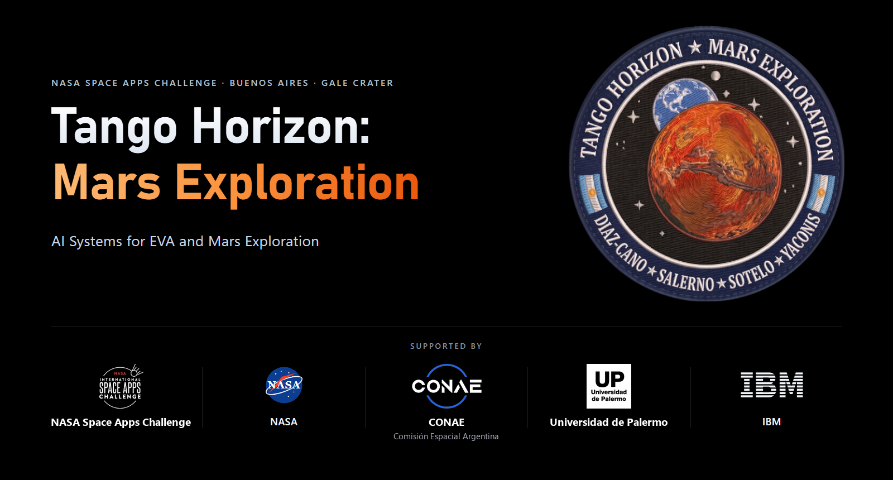
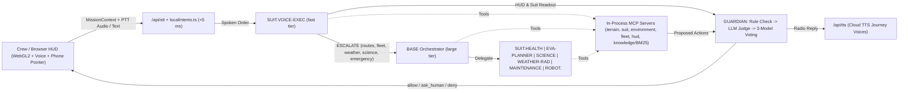

**🏆 Ganador de la Categoría Impact - NASA Space Apps Challenge (Buenos Aires, más de 450 participantes)**

**Tango Horizon:** proyecto del NASA Space Apps Challenge 2026 entre más de 450 participantes en Buenos Aires · [Página del proyecto](https://www.spaceappschallenge.org/2026/find-a-team/tango-horizon/?tab=project) · [Universidad de Palermo: sede del NASA Space Apps Challenge](https://www.palermo.edu/ingenieria/2026/noviembre/up-sede-nasa-space-apps-challenge.html)

<p align="center"></p>

[](README.md)

<sub>Este proyecto cuenta con el apoyo de [NASA](https://www.nasa.gov/), [NASA Space Apps Challenge](https://www.spaceappschallenge.org/), [CONAE](https://www.argentina.gob.ar/ciencia/conae), [Universidad de Palermo](https://www.palermo.edu/) e [IBM Argentina](https://www.ibm.com/ar-es).</sub><br/>
<sub>Todo el desarrollo del proyecto se realizó dentro de la ventana de la hackathon desde el 14/11/2026 a las 09:00 ART (UTC-3), verificable por la fecha de creación del repositorio (2026-11-14 16:56:55 UTC), hashes de commits (commit inicial [a3f7a4e](https://github.com/agustindiazcano/nasa-mars-tango-horizon/commit/a3f7a4e7d0bfa7ba5677b80eec3c6523eb61433b)) y [Pull Requests](https://github.com/agustindiazcano/nasa-mars-tango-horizon/pulls?q=is%3Apr).</sub>

# Tango Horizon: Sistemas de IA para EVA y Exploración de Marte

**Tango Horizon** es un simulador 3D en tiempo real de operaciones de misión en superficie marciana y gemelo digital táctico (Three.js WebGL2 a 60 FPS) construido sobre cartografía real de NASA y USGS del Cráter Gale (DTM MRO HiRISE de `1 m/px` y ortoimagen de `0.25 m/px`) para resguardar a una tripulación de cuatro astronautas (`SOTELO`, `YACONIS`, `SALERNO`, `DIAZ-CANO`) durante actividades extravehiculares (EVA) bajo demoras de comunicación Tierra-Marte de 4 a 24 minutos por tramo. Lejos de ser un juego o un tablero mock, es un simulador determinista de robótica, bioastronáutica y clima planetario (`@th/shared`) con voz por radio bidireccional manos libres en cinco idiomas (`Inglés`, `Español`, `Francés`, `Alemán`, `Italiano`), puntero láser giroscópico e intercomunicador Push-to-Talk desde el celular vía QR (`/remote` por WebSocket) y visión multimodal por cámaras (`capture_vision`). Los astronautas y el orquestador comandan una flota multi-robot—donde cada vehículo es un agente autónomo—con cinemática inversa analítica de 4 grados de libertad (`drill`, `sample`, `photograph`, `handover`), drones coaxiales de vigilancia con física de péndulo de malacate de Kevlar y conos LiDAR 3D, localización sin GPS (Map-Relative Localization sobre HiRISE + malla UWB a 6.5 GHz + VIO + Flash LiDAR 360°), despliegue balístico RK4 de cápsulas de soporte vital de 8.0 kg (COPV de $\text{O}_2$, depurador $\text{LiOH}$ de $\text{CO}_2$, batería de $200\text{ Wh}$, parche de traje) con balizas de estado sólido LED/UWB sin combustión, y rescate autónomo multi-vehículo cuando la telemetría o la tripulación reportan una emergencia.

Para tomar decisiones sin alucinaciones físicas, el sistema acopla una arquitectura jerárquica de IA Multi-Agente (`SUIT.VOICE-EXEC` en el traje escalando al orquestador `BASE` de la base, que delega en `SUIT.HEALTH`, `EVA-PLANNER`, `SCIENCE`, `WEATHER-RAD`, `MAINTENANCE` y en los planificadores a bordo de cada robot `ROBOT.<id>`) con failover automático entre tres proveedores de LLMs: **Google Cloud Vertex AI** y **Google AI Studio** (`google/gemini-4-carbon` grande, `google/gemini-4-argon` mediano/visión/juez, `google/gemini-4-hydrogen` rápido/audio STT), **Meta Muse** como respaldo (`muse-wonder-1.0`, `muse-spark-1.3`) y un motor determinista offline (`offline.ts`)—diseñado para que en una operación real en Marte los modelos de pesos abiertos se ejecuten localmente en el módulo `compute` de la base y en los procesadores de a bordo. La interacción por voz combina intenciones críticas locales en `<5 ms`, captura dual 16 kHz PCM + Web Speech API, transcripción multimodal normalizada con glosario marciano y **Google Cloud Neural Text-to-Speech (voces `Journey`)** con tonos Quindar de Apollo ($2525/2475\text{ Hz}$) y analizador de espectro FFT de 32 bandas en vivo. Seis servidores MCP en proceso (`InMemoryTransport`) y un motor RAG BM25 en memoria de `<2 ms` (`1,002` fragmentos de 15 estándares de NASA incluyendo `NASA-STD-3001` Vol. 1 y 2, `OCHMO`, `AMCL`, `MEDPRAT`, `Mars-GRAM`, `MCD` y `MOXIE`) impulsan alertas biomédicas predictivas (líneas base personales + bio-gemelo de reología sanguínea de Casson), aislamiento predictivo de fallas de hardware (`FDIR` y vida útil remanente `RUL`) y maniobras ante tormentas y radiación, junto con tres modelos propios de ML entrenados y validados con datos reales del PDS de NASA (`Hydration Prospector` sobre neutrones MSL DAN + CRISM/THEMIS, `Storm Nowcaster` sobre 3,953 soles de mareas barométricas REMS y `Mineral Vein Detector` con Meta `DINOv2-small` congelado sobre fotos de Curiosity Mastcam/MAHLI), todo protegido por el aseguramiento en tiempo de ejecución `GUARDIAN` de tres etapas y votación escalada de tres modelos.

**Demo en vivo (Simulador 3D):** [https://tangohorizon.vercel.app](https://tangohorizon.vercel.app) · **Portal Editorial y Showcase (`site/`):** [https://tangohorizon-site.vercel.app](https://tangohorizon-site.vercel.app)


## Índice

- [Equipo: Tango Horizon (Buenos Aires, Argentina)](#equipo-tango-horizon-buenos-aires-argentina)
- [Funcionalidades Principales y Capacidades Operativas](#funcionalidades-principales-y-capacidades-operativas)
- [Arquitectura del Sistema y Runtime Multi-Agente](#arquitectura-del-sistema-y-runtime-multi-agente)
- [Voz Bidireccional, Modelos de Voz y Soporte en 5 Idiomas](#voz-bidireccional-modelos-de-voz-y-soporte-en-5-idiomas)
- [RAG BM25 en Memoria y Telemetría Predictiva (Salud, FDIR y Clima)](#rag-bm25-en-memoria-y-telemetría-predictiva-salud-fdir-y-clima)
- [Robótica Simulada, Autonomía de Flota y Rescate Cooperativo](#robótica-simulada-autonomía-de-flota-y-rescate-cooperativo)
- [Real vs. Simulado vs. Supuestos de Diseño de Ingeniería](#real-vs-simulado-vs-supuestos-de-diseño-de-ingeniería)
- [Datos de NASA y USGS Utilizados](#datos-de-nasa-y-usgs-utilizados)
- [Modelos de Física Deterministas](#modelos-de-física-deterministas)
- [Nuestros Modelos de ML y Validación Empírica](#nuestros-modelos-de-ml-y-validación-empírica)
- [Limitaciones Conocidas](#limitaciones-conocidas)
- [Enlaces del NASA Space Apps Challenge](#enlaces-del-nasa-space-apps-challenge)
- [Uso de IA](#uso-de-ia)
- [Tecnologías y Comandos de Ejecución Local](#tecnologías-y-comandos-de-ejecución-local)
- **Materiales de Presentación y Pitch (`docs/slides/`):**
  - [`docs/slides/PROJECT_OVERVIEW.md`](docs/slides/PROJECT_OVERVIEW.md) — Resumen técnico completo en lenguaje claro (EN / ES)
  - [`docs/slides/PRESENTATION_SCRIPT_3MIN.md`](docs/slides/PRESENTATION_SCRIPT_3MIN.md) — Guion de presentación y rescate en vivo de 3 minutos (ES / EN)
  - [`docs/slides/PRESENTATION_SCRIPT_30S.md`](docs/slides/PRESENTATION_SCRIPT_30S.md) — Guion de video de 30 segundos (ES / EN)
  - [`docs/slides/SLIDES.md`](docs/slides/SLIDES.md) — Estructura de las 10 diapositivas (Slides)
  - [`docs/slides/TANGO_HORIZON_English.pptx`](docs/slides/TANGO_HORIZON_English.pptx) — Presentación en inglés (PowerPoint)
- [Licencia](#licencia)

## Equipo: Tango Horizon (Buenos Aires, Argentina)

- **Agustin Diaz-Cano:** Maestrando en Ingeniería en Sistemas ([UTN, FRBA](https://frba.utn.edu.ar/)) · [LinkedIn](https://www.linkedin.com/in/agustindiazcano/) · [Portfolio](https://www.agustindiazcano.com/) · [GitHub](https://github.com/agustindiazcano) · [Qollab](https://qollab.xyz/u/agustindiazcano) · [YouTube](https://www.youtube.com/@agustin-diaz-cano)
- **Baltazar Salerno:** Desarrollador Frontend · [GitHub](https://github.com/S-Baltazar)
- **Milagros Sotelo:** Estudiante de Ingeniería en Sistemas ([UTN, FRBA](https://frba.utn.edu.ar/)) · [GitHub](https://github.com/Milagros-Sotelo)
- **Federico Yaconis:** Desarrollador 3D y QA

## Funcionalidades Principales y Capacidades Operativas

- **Comando por Voz Manos Libres y Asistente de Telemetría en Vivo:** Operación integral por voz en **5 idiomas (`EN`, `ES`, `FR`, `DE`, `IT`)** con intenciones críticas locales en `<5 ms`, transcripción multimodal normalizada al dominio marciano, síntesis de voz neural por radio, tonos Quindar de Apollo ($2525/2475\text{ Hz}$) y analizador de espectro FFT de 32 bandas en tiempo real.
- **Orquestación Multi-Agente Jerárquica y Agentes por Robot:** Ejecutor rápido de voz en el traje (`SUIT.VOICE-EXEC`), orquestador central de la base (`BASE`), cinco especialistas de dominio (`SUIT.HEALTH`, `EVA-PLANNER`, `SCIENCE`, `WEATHER-RAD`, `MAINTENANCE`) y agentes autónomos a bordo (`ROBOT.<id>`) para cada rover, dron, planeador, manipulador y robot de rescate, controlables tanto por el astronauta como por `BASE`.
- **Despliegue Autónomo de Emergencia y Rescate de Tripulación:** Se activa por solicitud de voz o automáticamente cuando `SUIT.HEALTH` / `MAINTENANCE` / `WEATHER-RAD` detectan despresurización del traje, incapacitación de un astronauta, falla de tracción del rover o inicio de tormenta de polvo, enviando drones de vigilancia, el vehículo presurizado `rescue-1` y el robot de rescate `rescue-bot-1` con malacate y camilla.
- **Pack de Soporte Vital Balístico de 8.0 kg y Balizas de Estado Sólido:** Cápsula suborbital lanzada desde el hábitat e integrada con Runge-Kutta de 4.º orden (RK4) bajo arrastre atmosférico de $\text{CO}_2$ y cizalladura de viento REMS (`4.0 kg` COPV con `1.0 kg` de $\text{O}_2$ respirable a $3,000\text{ psi}$, `1.2 kg` cartucho depurador de $\text{CO}_2$ de $\text{LiOH}$, `1.0 kg` batería Li-ion de $200\text{ Wh}$, `0.35 kg` parche autovulcanizante RTV/HybridSil y `1.45 kg` aeroshell/paracaídas/baliza UWB), acompañada de balizas electrónicas LED/láser + UWB a 6.5 GHz sin pirotecnia (`deploy_beacons`) conforme a `NASA-STD-3001 V2 6002`.
- **Localización en Marte sin GPS y Flash LiDAR 3D (`get_localization_and_lidar`):** Al no existir GPS en Marte, las unidades se posicionan mediante Map-Relative Localization (MRL) sobre HiRISE `1 m/px`, malla de tiempo de vuelo UWB IEEE 802.15.4z a 6.5 GHz, odometría visual-inercial (VIO) y escaneo LiDAR 3D de 360°.
- **Visión Multimodal por Cámaras (`capture_vision` y `/api/agent/vision`):** El astronauta puede consultar qué ve la cámara de su casco o la cámara de cualquier rover o dron; el sistema captura el cuadro activo y analiza afloramientos o riesgos con modelos de visión (`gemini-4-argon` / `muse-wonder-1.0`).
- **RAG Predictivo sobre Estándares Aeroespaciales (`<2 ms` BM25):** Búsqueda en memoria sobre `1,002` fragmentos de `NASA-STD-3001` (Vol. 1 y 2), briefs de `OCHMO`, `AMCL`, `MEDPRAT`, `Mars-GRAM`, `MCD`, `MSL RAD` y `MOXIE` con citas exactas de `(documento, página)`.
- **3 Modelos Propios de Machine Learning Científico:** Entrenados offline y validados sobre datos reales de NASA PDS: **Hydration Prospector** (hidratación mineral subsuperficial H/OH con MSL DAN + CRISM + THEMIS), **Storm Nowcaster** (pronóstico por cuantiles a 1–3 soles de opacidad de polvo con mareas de presión REMS) y **Mineral Vein Detector** (clasificador y mapa de calor por parches con Meta `DINOv2-small` congelado sobre fotos reales de Curiosity Mastcam/MAHLI).
- **Mapa Cartográfico Estilo USGS/NASA y 6 Capas de Terreno:** Capas 3D interactivas (`Óptica HiRISE`, `Clase Térmica THEMIS`, `Pendiente`, `Sky View Factor`, `Dosis de Radiación`, `Hidratación DAN/CRISM + Incertidumbre`) y panel cartográfico estilo NASA/USGS con tintes hipsométricos, sombreado de relieve, curvas de nivel, grilla lat/lon, complejo de base y plataforma de cohetes, estaciones científicas, flota y los cuatro astronautas por callsign.
- **Celular como Puntero Láser y Transceptor PTT (`/remote`):** Al escanear un código QR, el giroscopio del teléfono actúa como puntero láser 3D sobre el HUD y micrófono Push-to-Talk por `/ws/remote` con vibración háptica en alertas críticas.

## Arquitectura del Sistema y Runtime Multi-Agente

Tango Horizon mantiene la simulación WebGL2 del navegador (`web/`) como única fuente de verdad del estado de la misión, enviando en cada orden un snapshot JSON `MissionContext` al servidor Fastify sin estado (`server/`), que ejecuta herramientas sobre seis servidores MCP en memoria (`InMemoryTransport`), el índice BM25 (`server/corpus/chunks.json`) y `GUARDIAN` antes de devolver las acciones aprobadas.



### Jerarquía de Agentes y Modelos LLM (Failover de 3 Proveedores + Cómputo Local en Base)

| Componente / Nivel | Modelo / Arquitectura | Proveedor / Framework | Rol y Toma de Decisiones |
|---|---|---|---|
| **Ejecutor de Voz del Traje (`SUIT.VOICE-EXEC`, `fast`)** | `google/gemini-4-hydrogen` (respaldo: `gemini-4-hydrogen`, `muse-spark-1.3`) | Vertex AI / Google AI Studio / Meta Muse | Cambios de capas/paneles/mapa/idioma, lecturas rápidas de traje y flota, cálculo previo de cápsula (`calculate_pod_launch`) e inspección visual (`capture_vision`). Escala órdenes físicas o emergencias a `BASE`. |
| **Orquestador Central (`BASE`, `large`)** | `google/gemini-4-carbon` (respaldo: `gemini-4-carbon`, `muse-wonder-1.0`) | Vertex AI / Google AI Studio / Meta Muse | Prioriza supervivencia de la tripulación sobre ciencia. Lee localización/LiDAR y clima, despacha unidades, activa protocolos de fuga/rescate y delega en agentes especialistas y de robots. |
| **Especialistas y Robots (`SUIT.HEALTH`, `EVA-PLANNER`, `SCIENCE`, `WEATHER-RAD`, `MAINTENANCE`, `ROBOT.<id>`, `medium` / `vision`)** | `google/gemini-4-argon` (respaldo: `gemini-4-argon`, `muse-wonder-1.0`) | Vertex AI / Google AI Studio / Meta Muse | Análisis biomédico predictivo, rutas A*, ciencia, pronóstico de tormentas, mantenimiento predictivo FDIR y planificación autónoma a bordo de cada robot. |
| **Juez de Seguridad (`GUARDIAN` Paso 2, `judge`)** | `google/gemini-4-argon` (respaldo: `gemini-4-argon`, `muse-spark-1.3`) | Vertex AI / Google AI Studio / Meta Muse | Evalúa seguridad contextual y bloquea intentos de manipulación en entradas `<untrusted>`. |
| **Votación Escalada de 3 Modelos (`ESC-VOTE` Paso 3)** | `gemini-4-carbon` + `gemini-4-argon` + `muse-wonder-1.0` | Vertex AI + AI Studio + Meta Muse | Votación concurrente para acciones críticas; aplica *Asymmetric Safety Override* (`ask_human`) si un votante niega con confianza $\ge 0.85$. |

- **Operación Real en Marte vs. Simulación Cloud:** En esta simulación web los modelos corren sobre Google Cloud Run / Vertex AI con failover a AI Studio y Meta Muse, más el motor determinista `offline.ts`. En una operación real en la superficie marciana, debido a los 4–24 minutos de retardo de luz con la Tierra, los modelos de pesos abiertos se ejecutan localmente en el **módulo `compute` de la base marciana** y en las NPUs de borde del traje y los rovers.

## Voz Bidireccional, Modelos de Voz y Soporte en 5 Idiomas

- **5 Idiomas Completos (`EN`, `ES`, `FR`, `DE`, `IT`):** Traducción reactiva de toda la interfaz, alertas, reconocimiento de voz, razonamiento de agentes y síntesis hablada.
- **Captura Dual y Transcripción Multimodal (`listen.ts` + `stt.ts`):** Intenciones críticas locales en `<5 ms` (`localIntents.ts`), captura simultánea por Web Speech API y grabación WAV PCM mono a $16\text{ kHz}$ transcrita con `google/gemini-4-hydrogen` e inyección del glosario de misión marciana.
- **Síntesis de Voz Neural y DSP de Radio (`tts.ts` + `speak.ts`):** **Google Cloud Text-to-Speech** con voces **Google Journey / Neural** (`es-US-Journey-D`, `en-US-Journey-D`, `fr-FR`, `de-DE`, `it-IT`), tonos Quindar ($2525/2475\text{ Hz}$), filtro pasabanda ($300\text{–}3200\text{ Hz}$) y canvas FFT de 32 bandas en vivo.

## RAG BM25 en Memoria y Telemetría Predictiva (Salud, FDIR y Clima)

1. **Salud Predictiva de Astronautas (`SUIT.HEALTH` + `biomed.ts` + `cassonTwin.ts`):** Calcula pendientes en ventana deslizante y `time_to_breach_s` para $\text{PICO}_2$, temperatura central, PSI, $\text{SpO}_2$, deriva cardíaca y *Early Warning Score (0–3)*, combinando líneas base personales con límites `NASA-STD-3001` Vol. 1 y 2 / `OCHMO-TB-004` y el bio-gemelo de viscosidad sanguínea no-newtoniana de Casson/Quemada.
2. **Mantenimiento Predictivo y FDIR (`MAINTENANCE` + `fdir.ts`):** Estima pendiente de degradación y **Vida Útil Remanente (`rul_s`)** en traje (`PLSS-FAN-01`, `PLSS-SCRUB-01`, `PLSS-COOL-01`), rovers y brazo (`RVR-MOB-01`, `RVR-THM-01`, `ARM-TORQ-01`), energía de la base (`HAB-PWR-01`) y planta **MOXIE** (`ISRU-MOX-01`), recuperando procedimientos SOP del RAG por código de falla y ejecutando `isolate_component`.
3. **Clima, Tormentas de Polvo y Radiación (`WEATHER-RAD` + `envNowcast.ts`):** Integra gradientes barométricos REMS, rampa de opacidad $\dot{\tau}$, margen solar, autonomía de baterías, dosis RAD y alertas DONKI SEP con citas de `Mars-GRAM` y `MCD v5.2`.

## Robótica Simulada, Autonomía de Flota y Rescate Cooperativo

- **Cinemática Inversa Analítica de 4 Grados de Libertad (`rover-3` / `manip-1` "HANDS"):** Brazo articulado de $1.7\text{ m}$ de alcance con torreta de 4 herramientas (pinza, taladro, pala, cámara) resuelto analíticamente cuadro a cuadro sin que el LLM invente ángulos.
- **Drones Sky-Crane con Péndulo de Kevlar y Cono LiDAR (`drone-1`, `drone-2`):** Simulación de tensión elástica del cable bajo viento marciano, sujeta a límites de densidad atmosférica y aterrizaje obligatorio con $\tau \ge 1.8$.
- **Escenario de Rescate de 4 Astronautas (`SOTELO`, `YACONIS`, `SALERNO`, `DIAZ-CANO`):** Ante la falla del `rover-1` en `RESCUE_SITE`, la caída e incapacitación de `DIAZ-CANO` en un pozo natural (`RESCUE_PIT`) y el avance de una tormenta de polvo ($\tau \to 6.0$), `BASE` y `GUARDIAN` despachan `rescue-1`, los drones `drone-1` y `drone-2` en órbita de vigilancia ($\ge 25\text{ m}$ de separación horizontal) y despliegan al robot `rescue-bot-1` para descender al pozo, asegurar al astronauta en la camilla y extraerlo hacia `rescue-1`.

## Real vs. Simulado vs. Supuestos de Diseño de Ingeniería

- **100 % Datos y Ciencia Real (Cero Mocks):** Malla topográfica HiRISE DTM (`1 m/px`) y ortoimagen (`0.25 m/px`), mosaicos térmicos THEMIS, series horarias REMS y espesor óptico Mastcam, dosimetría RAD (nominal y SEP Sep 2017), 1,567 mediciones de neutrones DAN, 9 cubos espectrales CRISM, 117 fotografías crudas Mastcam/MAHLI, efemérides JPL Horizons, alertas DONKI, registros MOXIE, modelos glTF de NASA 3D Resources, ecuaciones físicas diferenciales en unidades SI y corpus RAG de 15 documentos oficiales de NASA.
- **Simulación Determinista:** Cinemática inversa del brazo de 4 DOF, péndulo elástico del malacate Sky-Crane, navegación A* sobre pendientes reales, geometría del pozo natural de rescate (`RESCUE_PIT`), integrador de soporte vital a 1 Hz y balística RK4.
- **Supuestos de Diseño Documentados (`[design assumption]`):** Segmentación por terciles de niveles digitales (DN) de THEMIS en coeficientes de tracción $\eta$, parámetros mecánicos de volumen/masa del traje y del Drop-Pod de $8.0\text{ kg}$, radios de exclusión de seguridad ($15\text{ m}$ cápsula, $2\text{ m}$ brazo, $25\text{ m}$ drones) y relaciones de hematocrito/viscosidad del panel Casson.

## Datos de NASA y USGS Utilizados

53 activos rastreados con suma de verificación SHA-256 y transformaciones CRS en [`web/public/data/provenance.json`](web/public/data/provenance.json), incluyendo MRO HiRISE DTM y ortoimagen, MRO CTX DEM, Mars Odyssey THEMIS IR, MSL Curiosity DAN, MRO CRISM MTRDR, MSL Curiosity REMS y opacidad Mastcam, MSL Curiosity RAD, imágenes crudas de Mastcam/MAHLI, NASA JPL Horizons, NASA DONKI, Perseverance MOXIE, estándares `NASA-STD-3001` / `OCHMO` y modelos 3D de NASA 3D Resources + activos propios optimizados con `meshoptimizer`. (Ver tabla completa auto-generada en [`README.md`](README.md#nasa--usgs-data-used)).

## Modelos de Física Deterministas

| Dominio | Formulación | Referencia / Base | Implementación |
|---|---|---|---|
| Tasa metabólica y demanda de O2/CO2 | `M = 1.5 W + k * [2.0(W + L)(L/W)^2 + eta(W + L)(1.5 v^2 + 0.35 v G)]` (`k = g_mars/g_earth`, piso en `1.5 W`, factor de Santee para `G < 0` en bajada) | Pandolf et al. (1977) + Santee et al. (2001) escalados por `g_mars/g_earth`; NASA-STD-3001 Vol 2 | [metabolic.ts](shared/src/physics/metabolic.ts) |
| Fuga por orificio bloqueado y pO2 alveolar | `m_dot = C_d A P sqrt(gamma/(R T)) (2/(gamma+1))^((gamma+1)/(2(gamma-1)))`; `P_AO2 = P_suit - P_H2O - P_aCO2` | Flujo compresible en orificio bloqueado; NASA-STD-3001 Vol 2 Rev E (Armstrong 6.27 kPa, `P_AO2 = 8.0 kPa` con deterioro) | [suitLeak.ts](shared/src/physics/suitLeak.ts) |
| Estado del PLSS a 1 Hz y telemetría del traje | Consumo de O2 primario/reserva a paso fijo, regulador de emergencia, depurador de CO2, RPM del ventilador, batería (Wh) y refrigerante (L) | NASA-STD-3001 Vol 2; límites de diseño Apollo/xEMU | [suitState.ts](shared/src/physics/suitState.ts), [suitTelemetry.ts](shared/src/physics/suitTelemetry.ts) |
| Atmósfera marciana y extinción solar | `rho0 = P/(R_mars T)`, `rho(h) = rho0 exp(-h/H)`, cizalla logarítmica del viento `u(h)`, haz directo `exp(-tau/mu)` | MSL REMS; `mars_solar_toa = 589.2 W/m^2`; modelo solo de haz directo | [atmosphere.ts](shared/src/physics/atmosphere.ts), [solar.ts](shared/src/physics/solar.ts) |
| Dosis de radiación por SVF geométrico y albedo | `D_dot = D_0 * svf`; retrodispersión de albedo `D_0 * (svf + beta * (1 - svf))` (`beta = 0.09`) | MSL-M-RAD-3-RDR-V1.0 (SwRI PDS-PPI); supuesto geométrico de SVF | [dose.ts](shared/src/physics/dose.ts) |
| Cápsula balística RK4 y entrega con paracaídas | Gravedad 3D + arrastre atmosférico cuadrático + cizalla logarítmica del viento; apertura del paracaídas `< 120 m`; elipse de aterrizaje Monte Carlo | Modelo de diseño balístico/paracaídas para Marte (`g_mars = 3.711 m/s^2`, exclusión de `15 m` alrededor de la tripulación) | [ballistic.ts](shared/src/physics/ballistic.ts), [podDelivery.ts](shared/src/physics/podDelivery.ts) |
| Go/no-go por tormenta y planificador de rutas EVA (A*) | A* sobre pendiente del DEM, energía térmica y pesos de radiación por SVF; `tau >= 1.8` deja en tierra al rotorcraft; límites de viento y dosis | Envolvente de vuelo de Ingenuity; límites EVA de OCHMO/RAD | [route.ts](shared/src/physics/route.ts), [stormDecision.ts](shared/src/physics/stormDecision.ts) |
| EWS biomédico de la tripulación y tiempo a la ruptura | Subpuntajes ponderados 0-3 sobre `PICO2`, temperatura central, Physiological Strain Index, SpO2, FC, deriva cardíaca y margen de hipoxia | NASA-STD-3001 Vol 1/2 y OCHMO-TB-004 (solo asesoría) | [biomed.ts](shared/src/physics/biomed.ts) |
| Detección de fallas de flota/PLSS/ISRU (FDIR) | Pendiente en ventana deslizante, z-score y vida útil remanente (`RUL`) en canales de ventilador, depurador, térmico, movilidad de rover, brazo y MOXIE | Umbrales de la envolvente de ingeniería FDIR | [fdir.ts](shared/src/physics/fdir.ts) |
| Riesgo ambiental y de clima espacial | `dP/dt` diurno, chequeo de vuelo por densidad del aire, ETA de visibilidad por polvo, autonomía de batería y escalada por tormentas SEP de DONKI | MSL REMS + NASA DONKI WSA-Enlil | [envNowcast.ts](shared/src/physics/envNowcast.ts) |

Las 44 constantes de ingeniería (18 valores publicados o estándar y 26 supuestos de diseño marcados `[design assumption]`) están en [`shared/src/physics/constants.ts`](shared/src/physics/constants.ts).

## Nuestros Modelos de ML y Validación Empírica

1. **Hydration Prospector (`tango-horizon-hydration-v1`):** Ensamble `GradientBoostingRegressor` + intervalos conformales al 90 % entrenado sobre `n = 1,567` mediciones de neutrones de MSL DAN y predictores orbitales CRISM (`BD1900_2`, `SINDEX2`), THEMIS IR y CTX. Validación `GroupKFold` por bloques espaciales de 500 m: **Spearman = 0.5823**, **R² = 0.3638**, **MAE = 0.3695** (vs. baseline `0.4860`).
2. **Storm Nowcaster (`rems_hgbr_quantile_v1`):** `HistGradientBoostingRegressor` por cuantiles (`q = 0.1, 0.5, 0.9`) + CQR sobre 28 variables de mareas barométricas y meteorología de MSL REMS (Año Marciano 34 retenido como conjunto de prueba). Verifica el aumento físico de la marea semidiurna `s2_amp` con el polvo (`Spearman = 0.6709`) y supera a la climatología estacional en los horizontes de +1, +2 y +3 soles (`Spearman = 0.765–0.796`).
3. **Mineral Vein Detector (`tango-horizon-veins-v1`):** Extractor `facebook/dinov2-small` congelado (`dinov2-small-vits14`) + `LogisticRegression` validado por sol completo (`GroupKFold` sobre `n = 117` imágenes auditadas de Curiosity Mastcam/MAHLI en 22 soles): **ROC-AUC = 0.8453**, **PR-AUC = 0.7961**, **Precisión = 0.7941**, **Recall = 0.6585** (`p = 0.0020`).

## Limitaciones Conocidas

- **Piso de resolución orbital y de superficie:** La malla cubre un recuadro de 4 km × 4 km del Cráter Gale anclado a DTM HiRISE de `1 m/px` (remuestreado a `2048 × 2048` de altura y `4096 × 4096` de ortoimagen), mientras que las entradas de hidratación CRISM (`18–36 m/px`), la geomorfometría CTX (`20 m/px`) y THEMIS IR (`100 m/px`) no resuelven afloramientos ni rocas menores a 20 m.
- **Simplificación solar de haz directo y radiación planar:** `solar.ts` calcula la extinción de haz directo `exp(-tau / mu)` sin términos de dispersión difusa del cielo, y `dose.ts` combina tasas de dosis absorbida de silicio de MSL RAD con factores de visión de cielo (`SVF`) en celdas de 10 m, en lugar de transporte 3D completo en regolito con MCNPX.
- **Indicador relativo de hidratación:** `tango-horizon-hydration-v1` predice la razón neta de cuentas térmicas a epitérmicas de MSL DAN (restado el fondo) a lo largo del recorrido de Curiosity; refleja la moderación de H/OH cercana a la superficie combinada con absorbentes de neutrones del suelo (Fe/Cl), no un % en peso absoluto de agua ni hielo somero.
- **Nowcast de polvo de una sola estación:** `rems_hgbr_quantile_v1` infiere tendencias de polvo solo con la meteorología de superficie REMS del Cráter Gale; no simula el transporte global de polvo ni extrapola por encima de la opacidad del período de entrenamiento sin ampliar los intervalos de incertidumbre.
- **Detección de vetas solo visual:** `tango-horizon-veins-v1` está calibrado para fotografías reales de Mastcam/MAHLI de la NASA (nunca renders 3D sintéticos) y detecta únicamente firmas visuales de vetas brillantes; la identificación elemental o mineral requiere LIBS activo (`ChemCam`) o XRD (`CheMin`).
- **Alcance asesor biomédico y FDIR:** Las evaluaciones fisiológicas de `biomed.ts` y `SUIT.HEALTH` son asesorías de apoyo a la decisión ancladas a umbrales de `NASA-STD-3001`; nunca reemplazan el diagnóstico clínico de un cirujano de vuelo ni la autoridad de comando telemétrico.

## Enlaces del NASA Space Apps Challenge

- **Equipo:** https://www.spaceappschallenge.org/2026/find-a-team/tango-horizon/?tab=project
- **Evento local — Sede [Universidad de Palermo](https://www.palermo.edu/) (Buenos Aires, Argentina):** https://www.spaceappschallenge.org/2026/local-events/buenos-aires/
- **Desafío — Interplanetary Survival Guide: Martian Map:** https://www.spaceappschallenge.org/2026/challenges/interplanetary-survival-guide-martian-map/
- **Reglas (Términos y Condiciones para Participantes):** https://www.spaceappschallenge.org/legal/
- **Guía de entrega de proyectos (Submission Guide):** https://www.spaceappschallenge.org/resources/project-submission-guide/
- **Recursos y Preguntas Frecuentes (FAQs):** https://www.spaceappschallenge.org/resources/ · https://www.spaceappschallenge.org/resources/participant-faqs/
- **Space Apps Challenge:** https://www.spaceappschallenge.org/

## Uso de IA

### Metodología de desarrollo asistido por IA (Software 3.0 — AFAW)

Este proyecto se construyó con desarrollo asistido por IA al estilo Software 3.0 utilizando nuestra metodología propia [**AFAW (Anti-Fragile Agentic Workflow)**](https://github.com/agustindiazcano/afaw-anti-fragile-agentic-workflow) para la coordinación de múltiples agentes: los agentes de programación con IA participaron en todo el proceso de desarrollo (implementación, pruebas, CI/CD, pull requests, commits y documentación validados y diseñados por humanos, despliegue), bajo dirección y revisión humana.

- **Metodología propia de coordinación multi-agente:** [**AFAW — Anti-Fragile Agentic Workflow**](https://github.com/agustindiazcano/afaw-anti-fragile-agentic-workflow) (metodología propia para coordinar múltiples agentes autónomos de código con contratos de contexto compartidos, aislamiento por worktrees, commits atómicos y verificación human-in-the-loop)
- **Agentes de código:** Codex, Claude Code, Gemini Antigravity, IBM Bob, Meta Muse
- **Orquestación en paralelo y aislamiento:** Múltiples agentes ejecutados en paralelo bajo un agente orquestador coordinando modelos medianos, cada uno en su propio worktree y rama para evitar conflictos, junto con un agente code reviewer
- **IA para workflows:** ChatGPT, Gemini, Google AI Studio, Grok

**Contratos para el contexto de los agentes.** Los agentes reciben su contexto mediante archivos de contrato: [`AGENTS.md`](AGENTS.md) (reglas), [`PENDING.md`](PENDING.md) (tareas abiertas priorizadas) y [`LASTCONTEXT.md`](LASTCONTEXT.md) (último estado y próximo paso). Cada tarea actualiza [`PENDING.md`](PENDING.md) y [`LASTCONTEXT.md`](LASTCONTEXT.md) para que el siguiente agente arranque desde el mismo estado.

**Responsabilidad humana (human in the loop).** Todos los planes, revisiones de código, validación de datos, diseños, formulaciones matemáticas, implementaciones y resultados empíricos fueron auditados y verificados por los autores.

## Tecnologías y Comandos de Ejecución Local

| Capa | Tecnologías |
|---|---|
| Frontend y visor 3D | TypeScript, Vite, Three.js (`three` WebGL2), HUD 3D en CSS, Web Speech API, Web Audio API, `qrcode`, `@vercel/analytics` |
| Backend y runtime de agentes | Node.js 22, Fastify 5 (`@fastify/static`, `@fastify/websocket`, `@fastify/rate-limit`), `@modelcontextprotocol/sdk` (`InMemoryTransport`), Zod, SDK `openai`, `google-auth-library` |
| Física compartida y tests | TypeScript (`@th/shared`: física determinista, esquemas, i18n en 5 idiomas), Vitest (`vitest`) |
| Ciencia de datos y pipeline GIS | Python 3, NumPy, Pandas, SciPy, scikit-learn, PyTorch, Hugging Face `transformers`, Pillow, Matplotlib, Rasterio, PyProj, PyMuPDF, `meshoptimizer` |
| Google Cloud y Hosting | Terraform (`infra/terraform/`), Cloud Run, Cloud Build, Artifact Registry, Secret Manager, Vertex AI, Cloud Text-to-Speech, Vercel, GitHub Actions |

### Ejecutar Localmente

```bash
npm install
npm run dev:web   # Inicia @th/server (:8080) y @th/web (:5174)
npm test             # Ejecuta los tests de shared, server (modo offline) y web
npm run build        # Verifica tipos y compila todos los workspaces
python tools/generate_readme.py --check   # Verifica las tablas auto-generadas del README
```

## Licencia

Copyright (c) 2026 Agustin Diaz-Cano, Baltazar Salerno, Milagros Sotelo y Federico Yaconis (Equipo Tango Horizon).

- **Código de Software:** Distribuido bajo la [Licencia MIT](LICENSE).
- **Modelos 3D (`web/public/models/*.glb` creados por el Equipo Tango Horizon):** Todos los modelos 3D originales creados por el equipo Tango Horizon son de uso libre (**free to use**) para fines **personales, educativos, comerciales e ilustraciones** bajo la licencia [Creative Commons Attribution 4.0 International (CC BY 4.0)](LICENSE-3D-ASSETS-CC-BY-4.0.md) (`https://creativecommons.org/licenses/by/4.0/`). Los modelos externos de [NASA 3D Resources](https://github.com/nasa/NASA-3D-Resources) (`ingenuity.glb`, `mro.glb`, `rover.glb`) conservan los términos abiertos de la NASA.
