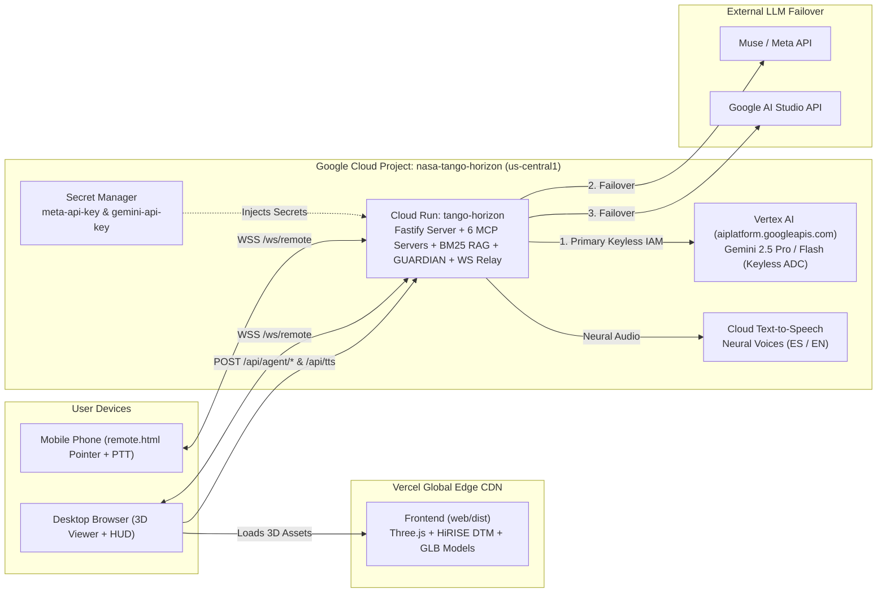

# Infrastructure, Terraform & Vertex AI Guide (`nasa-tango-horizon`)

Complete reference for the Google Cloud project `nasa-tango-horizon`, Terraform Infrastructure-as-Code (`infra/terraform/`), Vertex AI keyless authentication, 3-provider LLM failover (`vertex` + `meta` + `gemini`), and the Cloud Run + Vercel deployment topology.

---

## 1. Linked Google Cloud Project

| Parameter | Value |
|---|---|
| **Project ID** | `nasa-tango-horizon` |
| **Project Number** | `291271901218` |
| **Primary Region** | `us-central1` |
| **Vertex AI Location** | `us-central1` |
| **Backend Service Account** | `tango-horizon-sa@nasa-tango-horizon.iam.gserviceaccount.com` |
| **Artifact Registry Repo** | `us-central1-docker.pkg.dev/nasa-tango-horizon/tango-horizon` |
| **Vertex AI OpenAI Endpoint** | `https://us-central1-aiplatform.googleapis.com/v1/projects/nasa-tango-horizon/locations/us-central1/endpoints/openapi` |

Local CLI and Application Default Credentials (ADC) are linked to `nasa-tango-horizon`:

```bash
gcloud config set project nasa-tango-horizon
gcloud auth application-default set-quota-project nasa-tango-horizon
```

---

## 2. How Vertex AI, Muse/Meta, and Google AI Studio Work Together

### 2.1 Why a Backend (`server/`) Is Required Even with Cloud Models
Even though Vertex AI, Muse/Meta, and Google AI Studio run inference in the cloud, the browser (`web/`) never calls LLM endpoints directly:
1. **Credential security:** Vertex AI IAM tokens and API keys (`META_API_KEY`, `GEMINI_API_KEY`) must stay on the server (`server/`).
2. **In-process MCP & RAG:** The 6 MCP servers (`mcp-terrain`, `mcp-suit`, `mcp-environment`, `mcp-fleet`, `mcp-hud`, `mcp-knowledge`), the in-memory BM25 RAG index over `NASA-STD-3001` & OCHMO (`server/corpus/chunks.json`), `GUARDIAN` (`ruleCheck` + `judge`), and Google Cloud Text-to-Speech (`/api/tts`) execute inside `server/`.
3. **Stateful WebSocket Relay (`/ws/remote`):** The phone pointer room lives in `server/` memory (`min-instances = 1`, `max-instances = 1`, `session-affinity`).

### 2.2 4-Layer Resilience & Failover Chain (`server/src/llm/provider.ts`)

| Order | Provider ID | Endpoint & Auth | Default Models (`large` / `fast` & `medium` & `judge` & `vision`) |
|---|---|---|---|
| **1 (Primary)** | `vertex` | Vertex AI OpenAI-compatible endpoint on `nasa-tango-horizon`. **Keyless ADC** via `google-auth-library` (`tango-horizon-sa` on Cloud Run, `gcloud auth application-default` locally). | `google/gemini-2.5-pro` / `google/gemini-2.5-flash` |
| **2 (Failover 1)** | `meta` | Muse / Meta OpenAI-compatible API (`META_BASE_URL`), authenticated via `META_API_KEY` (Secret Manager `meta-api-key`). | Configured via `LLM_MODEL_*` in `.env` |
| **3 (Failover 2)** | `gemini` | Google AI Studio OpenAI-compatible endpoint (`https://generativelanguage.googleapis.com/v1beta/openai/`), authenticated via `GEMINI_API_KEY` (Secret Manager `gemini-api-key`). | `gemini-2.5-pro` / `gemini-2.5-flash` |
| **4 (Offline Fallback)** | `offline.ts` | Deterministic rule engine inside `server/src/agents/offline.ts` calling the exact same `@th/shared` physics and MCP read tools in `0 ms` if all cloud providers time out or `AGENTS_OFFLINE=1`. | Rule-based + `GUARDIAN` `ruleCheck` |

To switch the primary provider (for example, to prioritize `meta` or `gemini`), set `LLM_PROVIDER=meta` or `LLM_PROVIDER=gemini` in `.env`; the remaining enabled providers stay active as automatic failover within the same request whenever a call exceeds `LLM_FAST_TIMEOUT_MS` (`4000 ms`) or `LLM_DEFAULT_TIMEOUT_MS` (`12000 ms`).

---

## 3. Terraform Infrastructure (`infra/terraform/`)

### 3.1 Files

| File | Purpose |
|---|---|
| `infra/terraform/versions.tf` | Terraform `>= 1.5.0` and `hashicorp/google ~> 6.0` provider configured for `var.project_id` |
| `infra/terraform/variables.tf` | Input variables (`project_id`, `region`, `vertex_location`, `service_name`, `llm_provider`, `allowed_origins`, `deploy_cloud_run`, `container_image`) |
| `infra/terraform/main.tf` | Enables 8 GCP APIs, creates `tango-horizon-sa`, binds `roles/aiplatform.user` + logging/monitoring + Secret Manager access, creates Artifact Registry `tango-horizon`, creates `meta-api-key` & `gemini-api-key` secrets, and optionally deploys the Cloud Run v2 service |
| `infra/terraform/outputs.tf` | Outputs `project_id`, `region`, `service_account_email`, `artifact_registry_repository`, `vertex_openai_base_url`, and `cloud_run_url` |
| `infra/terraform/terraform.tfvars` | Default values bound to `nasa-tango-horizon` (`us-central1`) |

### 3.2 Resources Provisioned by Terraform

1. **Google Cloud APIs (`google_project_service.apis`):**
   - `cloudresourcemanager.googleapis.com`
   - `aiplatform.googleapis.com` (Vertex AI)
   - `texttospeech.googleapis.com` (Google Cloud Text-to-Speech)
   - `run.googleapis.com` (Cloud Run)
   - `cloudbuild.googleapis.com` (Cloud Build)
   - `artifactregistry.googleapis.com` (Artifact Registry)
   - `secretmanager.googleapis.com` (Secret Manager)
   - `iam.googleapis.com` (IAM)
2. **Service Account & IAM:**
   - `tango-horizon-sa@nasa-tango-horizon.iam.gserviceaccount.com`
   - `roles/aiplatform.user` (Vertex AI inference)
   - `roles/logging.logWriter` and `roles/monitoring.metricWriter`
   - `roles/secretmanager.secretAccessor` on `meta-api-key` and `gemini-api-key`
3. **Artifact Registry:**
   - Docker repository `us-central1-docker.pkg.dev/nasa-tango-horizon/tango-horizon`
4. **Secret Manager:**
   - Secret containers `meta-api-key` and `gemini-api-key`
5. **Cloud Run v2 Service (`count = var.deploy_cloud_run ? 1 : 0`):**
   - Service `tango-horizon` in `us-central1` running as `tango-horizon-sa`, `min_instance_count = 1`, `max_instance_count = 1`, `session_affinity = true`, `timeout = 3600s`, public `allUsers` invoker.

### 3.3 Terraform Commands

```bash
# 1. Initialize and apply base infrastructure (APIs, Service Account, IAM, Artifact Registry, Secrets)
cd infra/terraform
terraform init
terraform plan
terraform apply

# 2. Once the Docker image is built and pushed to Artifact Registry, deploy Cloud Run via Terraform (or ./deploy.sh):
terraform apply -var="deploy_cloud_run=true" -var="allowed_origins=https://nasa-mars-tango-horizon.vercel.app"
```

---

## 4. Deployment Topology (Vercel Frontend + Cloud Run Backend)


